<div align="center">

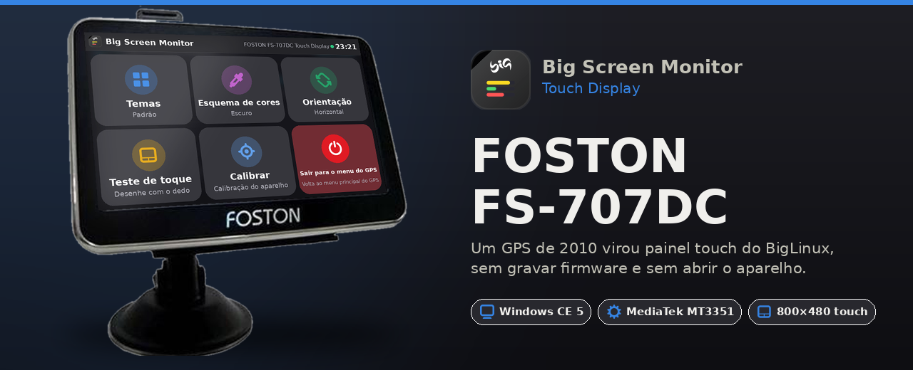

# 🧭 FOSTON FS-707DC → Big Screen Monitor Touch Display

**Um navegador GPS de 2010 virou painel de monitoramento _touch_ do BigLinux.**
**Sem gravar firmware. Sem abrir o aparelho. Só software livre.** 🐧


[📸 Fotos](#-fotos-do-aparelho) •
[🚀 Passo a passo](#-passo-a-passo-enviando-para-o-foston) •
[👆 Usando](#-usando-o-painel-com-o-dedo) •
[📊 Desempenho](#-desempenho-medido-no-aparelho) •
[🔬 Técnico](#-informações-técnicas) •
[🛟 Problemas](#-solução-de-problemas)

</div>

---

## ✨ O que você ganha

<table>
<tr>
<td width="50%">

- 📺 **Painel em tempo real** com CPU, GPU, memória, disco, rede e relógio
- 🎨 **Os 7 temas** do Big Screen Monitor, com as cores, skins e aparências de cada um
- 👆 **Toque de verdade**: troque tema, cores, orientação e histórias pela própria tela
- 🔌 **Plug and play**: o serviço reconhece o aparelho sozinho e se recupera se o cabo sair
- 🛡️ **Firmware intacto**: dá para voltar ao GPS original a qualquer momento
- ⌨️ **Não atrapalha o PC**: o toque nunca mexe no teclado nem no mouse do computador

</td>
<td width="50%">


</td>
</tr>
</table>

---

> 🐧 **Quer Linux no próprio FOSTON?** O **BigFoston OS** (Linux completo com Big GPS, TV,
> Bluetooth, Telefone e mais, em dual boot com o Windows CE) agora tem repositório próprio:
> **[ruscher/big-fostonos](https://github.com/ruscher/big-fostonos)**. Este repositório trata
> só do **Big Screen Monitor Touch Display** pelo Windows CE original.

---

## 📟 O aparelho

<table>
<tr>
<td width="38%" align="center">


**FOSTON FS-707DC**

</td>
<td>

| | Dado | Como foi confirmado |
|---|---|---|
| 🧠 | **MediaTek MT3351** (ARM) | revisão `3351` informada pelo próprio USB |
| 🪟 | **Windows CE 5.0** (build 1400) | lido pelo cliente no aparelho |
| 🏷️ | Plataforma `APOLLO` · OEM `MTK` | `SystemParametersInfo` |
| 💾 | **~118 MB de RAM** (≈100 MB livres) | `GlobalMemoryStatus` |
| 🖥️ | Tela **7" 800×480**, 16 bits | métricas do sistema |
| 👆 | Toque **resistivo de 1 ponto**, já calibrado | toques reais de x 1–789, y 1–478 |
| 🔌 | USB `045e:ffff` (pendrive) ou `045e:00ce` (serial) | kernel do Linux |
| 📦 | Armazenamento de 2 GB FAT32 | `lsblk` |
| 🧭 | Navegador original: iGO 8 | arquivos do aparelho |

> ℹ️ Anúncios citam 64 MB de RAM, TV digital, AV-IN, Bluetooth e transmissor FM. Só o que está na tabela foi **medido nesta unidade**; o Bluetooth (MediaTek MT6611) foi confirmado depois, pelo BigFoston OS.

</td>
</tr>
</table>

---

## 📸 Fotos do aparelho

| 🖐️ Tela de espera (cliente `bsmd-ce` 1.2.0) | 🎨 Galeria de temas com miniaturas reais |
|:---:|:---:|
| 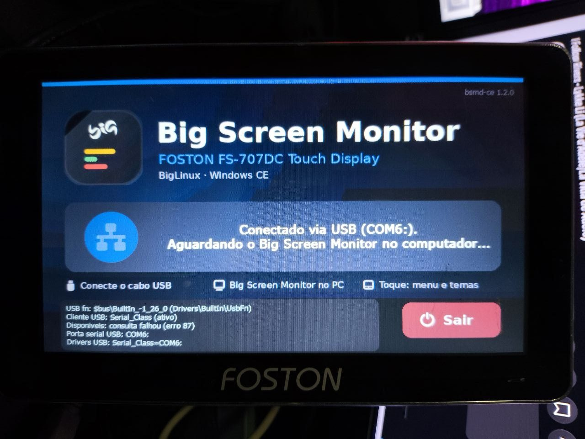 |  |
| 🏝️ **Brother Away com a barra de controle** | 🩺 **A primeira versão, com o diagnóstico que destravou tudo** |
|  | 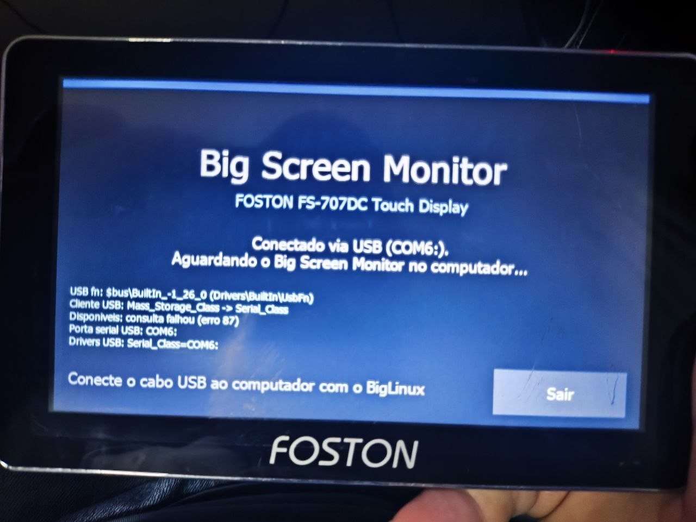 |

---

## 🚀 Passo a passo: enviando para o FOSTON


### Você vai precisar

| | |
|---|---|
| 💻 | Computador com **BigLinux** (ou Manjaro/Arch) |
| 📟 | **FOSTON FS-707DC** ligado (ou outro navegador Windows CE parecido) |
| 🔌 | Cabo **mini-USB de dados** (não serve cabo só de carga) |
| ⏱️ | Uns **10 minutos** na primeira vez; depois é só tocar em Navegação |

---


O suporte ao FOSTON está na branch `feat/foston-fs707dc` do [Big Screen Monitor Display](https://github.com/biglinux/big-screen-monitor-display). Para gerar e instalar o pacote:

```bash
git clone -b feat/foston-fs707dc <url do big-screen-monitor-display>
cd big-screen-monitor-display/pkgbuild
makepkg -ef
sudo pacman -U big-screen-monitor-display-*-any.pkg.tar
```

> 📦 O pacote traz o serviço, a regra de permissão (udev) só para o FOSTON e o programa do aparelho em `/usr/share/big-screen-monitor-display/device-clients/wince/bsmd-ce.exe`.

---

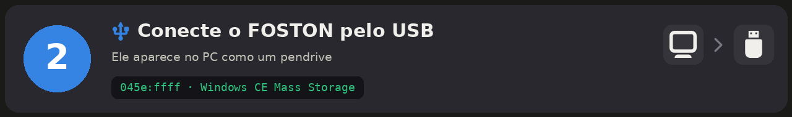

Ligue o FOSTON e conecte o cabo no computador. Ele aparece no gerenciador de arquivos como **um pendrive de 2 GB**. 💾

---


Abra **Big Screen Monitor → Meus Displays → FOSTON → 📥 Instalar o cliente no navegador**.

<details>
<summary>📂 Prefere copiar à mão?</summary>

Crie uma pasta **`BigScreen`** na raiz do pendrive do FOSTON e copie para ela o arquivo:

```
/usr/share/big-screen-monitor-display/device-clients/wince/bsmd-ce.exe
```

Resultado no aparelho: `BigScreen\bsmd-ce.exe`
</details>

---

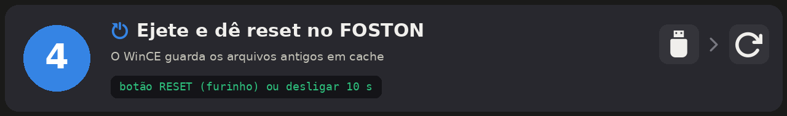

1. ⏏️ **Ejete** o pendrive no computador e **desconecte o cabo**.
2. 🔄 **Dê reset no FOSTON** (botão no furinho, com um clipe, ou segure o liga/desliga ~10 s).

> ⚠️ **Não pule o reset!** Enquanto está ligado ao PC, o Windows CE guarda uma cópia antiga dos arquivos na memória. Sem o reset, ele abre a versão velha (ou não abre nada).

---


No menu principal do FOSTON:

> ⚙️ **Configurações** → 🧭 **Caminho da navegação** → 📁 **BigScreen** → 📄 **bsmd-ce.exe** → ✅ **OK**

Isso só é feito **uma vez**. A partir daí, o botão **Navegação** do GPS abre o Big Screen. Para usar o GPS de novo, basta apontar o caminho de volta para o navegador original.

---


1. ▶️ Toque em **Navegação**: aparece a tela de espera (a versão fica no canto superior direito).
2. 🔌 **Conecte o cabo USB.**
3. ⚡ Em cerca de **1 segundo** o painel aparece. O próprio programa troca o USB de "pendrive" para "serial".

| ⏳ Antes de conectar | 🎉 Conectado |
|:---:|:---:|
|  |  |

### 🔙 Para voltar ao GPS

Escolha uma:
- 👆 no painel: **menu → Sair para o menu do GPS** (dois toques, para não sair sem querer);
- 🖥️ no computador: **Meus Displays → FOSTON → Fechar o cliente no navegador**;
- 🔴 na tela de espera: botão **Sair**.

O FOSTON volta ao menu principal e ao modo pendrive.

---

## 👆 Usando o painel com o dedo

| Gesto | | O que acontece |
|:---:|:---:|---|
| **Toque** | 👆 | aparece a barra de baixo (◀ tema ▶, menu, fechar) e a faixa com hora, data e conexão |
| **Deslizar ← →** | 👈👉 | troca de tema |
| **Segurar 1 s** ou **deslizar ↑** | ✋ | abre o menu |
| **Deslizar ↓** | 👇 | fecha o que estiver aberto |

<table>
<tr>
<td align="center"><b>📋 Menu</b><br></td>
<td align="center"><b>🎛️ Barra de controle</b><br>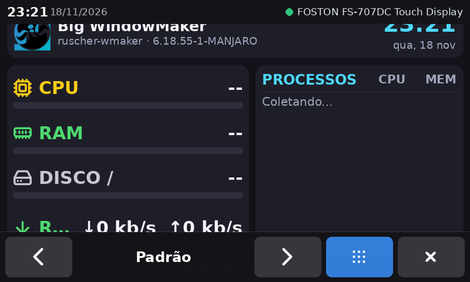</td>
</tr>
<tr>
<td align="center"><b>🎨 Temas</b><br></td>
<td align="center"><b>🌈 Esquemas de cores (Padrão)</b><br></td>
</tr>
<tr>
<td align="center"><b>🎵 Skins do Big Media Player</b><br>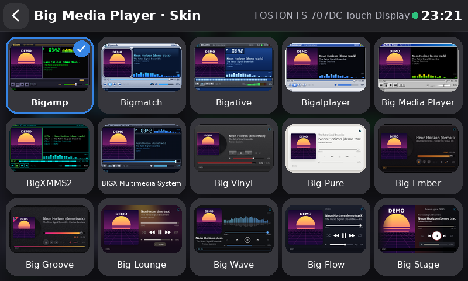</td>
<td align="center"><b>🌃 Aparências do Kojiro</b><br></td>
</tr>
<tr>
<td align="center"><b>🏝️ Histórias do Brother Away</b><br></td>
<td align="center"><b>🔄 Orientação</b><br></td>
</tr>
</table>

| Cartão do menu | Opções |
|---|---|
| 🎨 **Temas** | Padrão, GKrellM, Planet, Computador Antigo, Brother Away, Kojiro, Big Media Player |
| 🌈 **Aparência** | Padrão: 8 esquemas · GKrellM: 3 estilos · Planet: 5 cores · Computador Antigo: 4 esquemas · Big Media Player: 15 skins · Kojiro: 7 aparências · Brother Away: 14 histórias (começa na hora) |
| 🔄 **Orientação** | Horizontal, Vertical e as duas invertidas |
| ✍️ **Teste de toque** | desenha o caminho do dedo e mostra as coordenadas |
| 🎯 **Calibrar** | abre a calibração do próprio aparelho |
| ⏻ **Sair para o menu do GPS** | dois toques em até 4 segundos |

> 💡 O que você escolhe no painel vale só para o FOSTON. Se mudar o mesmo ajuste na janela do Big Screen Monitor, **a janela prevalece**.

---

## 📊 Desempenho medido no aparelho

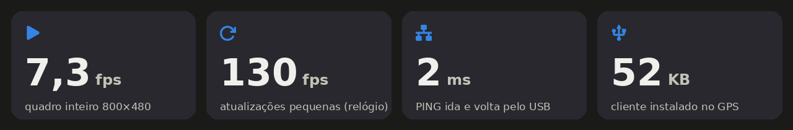

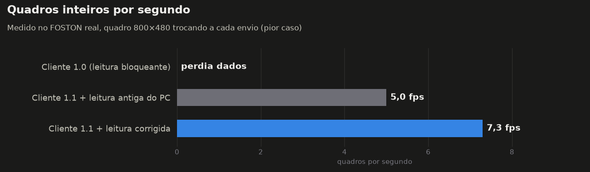

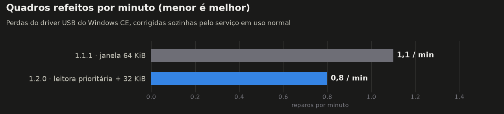

| Métrica | Valor medido |
|---|---|
| 🖼️ Quadro inteiro 800×480 (pior caso) | **7,1–7,3 fps** · mediana 130–144 ms · ~200 KiB/s |
| ⏱️ Atualização pequena (relógio) | **~130 fps** · mediana 7,5 ms · p95 10,2 ms |
| 🏓 PING ida e volta | mediana **2,0 ms** · máximo 3,2 ms |
| 🧮 Decodificação no aparelho (quadro inteiro) | 54–76 ms + 12–14 ms para desenhar |
| 🤝 Conexão (handshake) | 10–204 ms |
| 💪 Estresse de 30 s só com quadros inteiros | 208 quadros, **nenhum erro** na sessão |
| 🔁 Desconectar e reconectar o cabo | **3 de 3** voltaram sozinhos |
| 🩹 Quadros refeitos em uso normal | ~0,8 por minuto (corrigidos sozinhos) |
| 📦 Programa no GPS / memória livre | 52 KB / ~100 MB |

<sub>Dados brutos: arquivos <code>bench-2026-11-18-*.jsonl</code> e pasta <code>lab/</code> deste repositório.</sub>

---

## 🔬 Informações técnicas

### 🏗️ Como funciona

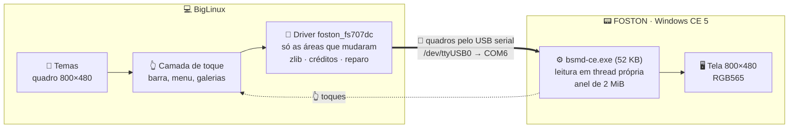

### 🔄 Uma conexão, do início ao fim

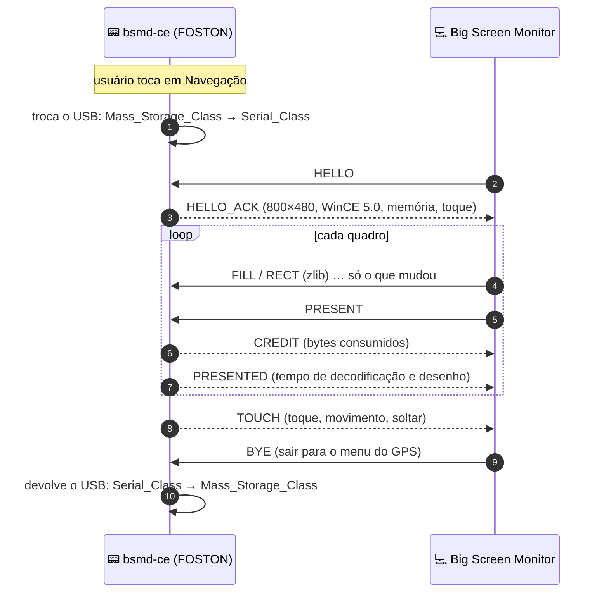

### 🧩 Por que este caminho

| Alternativa | Vídeo | Toque | Risco | Resultado |
|---|:---:|:---:|:---:|---|
| ✅ **Programa próprio no firmware original** | ✅ | ✅ | baixo | **escolhida e validada** |
| 📺 Entrada AV-IN (vídeo composto) | ✅ | ❌ | baixo | só exibiria vídeo |
| 🔧 Trocar a controladora do LCD | ✅ | ✅ | médio | exige abrir o aparelho e comprar placas |
| 🐧 Linux no aparelho | ✅ | ✅ | baixo | virou outro projeto: [BigFoston OS](https://github.com/ruscher/big-fostonos) |

### 📡 Protocolo FSP (Foston Screen Protocol)

Cabeçalho de **16 bytes** (little endian): `"FS"` · versão · tipo · sequência · flags · tamanho · CRC-16 do conteúdo · CRC-16 do cabeçalho. O CRC do cabeçalho permite se ressincronizar depois de bytes perdidos.

| Sentido | Mensagens |
|---|---|
| 💻 → 📟 | `HELLO` · `PING` · `RECT` (bruto, RLE ou zlib) · `FILL` · `PRESENT` · `BRIGHTNESS` · `CALIBRATE` · `BYE` · `TOUCHCFG` |
| 📟 → 💻 | `HELLO_ACK` · `PRESENTED` · `PONG` · `NAK` · `CREDIT` · `TOUCH` · `KEY` · `LOG` |

> 🧪 O mesmo código C que roda no GPS é compilado no PC durante os testes e comparado **byte a byte** com o lado Python.

### 💡 O que o aparelho ensinou

| | Descoberta | Solução |
|---|---|---|
| 📉 | O driver USB do WinCE **perde dados acima de ~1 KB** quando ninguém lê a tempo (850 B chegavam, 2 KB não) | thread leitora dedicada, anel de 2 MiB, controle de fluxo por créditos |
| 🩹 | Ainda há perdas raras sob carga | o PC detecta pelo CRC, refaz o handshake e reenvia o quadro, sem cair |
| 🚫 | O WinCE deste aparelho **não tem `_vsnwprintf`**: o programa nem abre | usar só funções que existem nele |
| ✂️ | `DrawText` não aceita `DT_END_ELLIPSIS` | desenhar sem essa opção |
| 🗂️ | O pendrive fica montado **nos dois lados**: o GPS não vê arquivos novos | reset depois de copiar |
| 📵 | O driver `ipaq` do Linux não implementa `TIOCMGET` | prova de vida por `PING` |
| 📞 | O ModemManager mandaria comandos AT para a porta | a regra udev o impede |

### 🗓️ Evolução do programa no GPS

| Versão | O que mudou |
|---|---|
| 1.0.0 | 🖼️ primeira imagem no aparelho; mensagens acima de ~1 KB se perdiam |
| 1.0.1 | 🚫 não abria (`_vsnwprintf` ausente) |
| 1.0.2 / 1.0.3 | 🩺 diagnóstico na tela: troca de USB confirmada (COM6) |
| 1.1.0 | 🧵 thread leitora + créditos: quadros inteiros estáveis |
| 1.1.1 | ⏳ volta à tela de espera se o PC parar de enviar |
| 1.2.0 | 🎨 tela de espera com a cara do app; leitura prioritária |

### 🔐 Segurança

- 🎯 Regra udev **só** para `045e:00ce` com a identificação deste firmware; nunca `MODE="0666"`.
- 🧱 O serviço continua isolado pelo systemd (usuário dinâmico, sem uinput).
- 🖱️ Nenhum evento é injetado no desktop: o toque é tratado dentro do serviço.
- 📟 No GPS, nada persistente muda além da pasta `BigScreen` e do caminho escolhido no menu.

---

## 🛟 Solução de problemas

| 😕 Sintoma | 🔍 Causa | ✅ Solução |
|---|---|---|
| Tocar em **Navegação** não abre nada | arquivo copiado sem reset | dê **reset** no FOSTON |
| "Aguardando a porta USB serial" | cabo desconectado | conecte o cabo; as linhas verdes mostram o diagnóstico |
| "Porta COMx ocupada" | o ActiveSync pegou a porta | o programa fecha o `repllog.exe` e tenta de novo |
| Tela parada, relógio congelado | o PC parou de enviar | em até 30 s o GPS volta à tela de espera; verifique o serviço |
| "client … is too old" no log | programa antigo no GPS | instale o `bsmd-ce.exe` do pacote |
| `/dev/ttyUSB0` sem permissão | regra udev ausente | instale o pacote |
| "frame damaged … resynchronising" no log | perda de bytes no USB do WinCE | nada: o quadro é refeito sozinho |
| O pendrive não aparece no PC | o programa está aberto (modo serial) | **Sair** no aparelho |

> 🔙 **Voltar ao original:** Configurações → Caminho da navegação → navegador original. Se quiser, apague a pasta `BigScreen`.

---

## 🛠️ Para desenvolvedores

<details>
<summary>⚙️ Compilar o programa do GPS (<code>bsmd-ce.exe</code>)</summary>

O código está em `device-clients/wince/` no projeto principal.

```bash
cd device-clients/wince
make host-test        # testa o núcleo no PC, sem compilador cruzado
LD_LIBRARY_PATH=<deps32>/lib make package CROSS=<mingw32ce>/bin/arm-mingw32ce-
make splash           # regera a arte da tela de espera
```

Compilador: [CeGCC 0.59.1](https://sourceforge.net/projects/cegcc/files/cegcc/0.59.1/) (`mingw32ce-0.59.1.tar.bz2`). Ele precisa de `libgmp.so.3` e `libmpfr.so.1` de **32 bits**, que não existem mais nos repositórios; compile [GMP 4.3.2](https://ftp.gnu.org/gnu/gmp/) e [MPFR 2.4.2](https://ftp.gnu.org/gnu/mpfr/) num diretório próprio:

```bash
FL="-m32 -O2 -std=gnu89 -Wno-error=implicit-function-declaration -Wno-error=implicit-int -Wno-error=incompatible-pointer-types -Wno-error=int-conversion"
(cd gmp-4.3.2 && ABI=32 CFLAGS="$FL" ./configure --prefix=$PWD/../deps32 --build=i686-pc-linux-gnu --disable-static && make && make install)
(cd mpfr-2.4.2 && CFLAGS="$FL" ./configure --prefix=$PWD/../deps32 --build=i686-pc-linux-gnu --with-gmp=$PWD/../deps32 --disable-static && make && make install)
```

⚠️ Neste WinCE **não use** `_vsnwprintf` nem `DT_END_ELLIPSIS`.
</details>

<details>
<summary>🧪 Bancada de testes no aparelho</summary>

Com o programa aberto no GPS e o serviço parado:

```bash
python3 tools/fsp_bench.py /dev/ttyUSB0 --seconds 8 --touch 30   # cores, texto, vazão, PING, toque
SWEEP_S=15 python3 tools/fsp_sweep.py 32768x16384 65536x16384    # janela × tamanho de mensagem
python3 tools/make_readme_art.py                                  # regera as imagens deste README
```
</details>

<details>
<summary>📁 Conteúdo deste repositório</summary>

| Caminho | Conteúdo |
|---|---|
| `docs/art/` | banner, números, gráficos e cartões do passo a passo |
| `docs/images/` | fotos do aparelho e capturas da interface |
| `tools/` | bancada (`fsp_bench.py`), varredura (`fsp_sweep.py`), artes do README (`make_readme_art.py`) |
| `udev/` | regra de permissão para desenvolvimento |
| `bench-*.jsonl`, `lab/` | medições e logs reais |

🔒 **Ficam fora (`.gitignore`)**: `backup/` (dados pessoais do GPS), `toolchain/` (231 MB de terceiros), `pkg/` e o estado local.

🐧 O código do BigFoston OS (kernel, Buildroot, agente Dual Boot, instalador, apps) fica em [ruscher/big-fostonos](https://github.com/ruscher/big-fostonos).
</details>

---

## 🗺️ Próximos passos

- [x] Identificar o hardware e comunicar pelo USB
- [x] Mostrar dados reais com todos os temas
- [x] Toque: menu, galerias, orientação, histórias, calibração, sair
- [x] Recuperação automática ao desconectar o cabo
- [ ] Testar reinício do PC, suspensão, KDE Plasma e Wayland
- [ ] Reenviar só o pedaço perdido em vez do quadro inteiro
- [ ] Controlar o Big Media Player pelo toque
- [ ] Traduzir os textos novos para os outros idiomas

---

## 🙏 Créditos

- 🐧 [Big Screen Monitor Display](https://github.com/biglinux/big-screen-monitor-display) e comunidade **BigLinux**
- 🔌 Troca de função USB no WinCE: [Nicolas Besson](http://nicolasbesson.blogspot.com/2009/11/usb-function-profile-switcher.html) e [PrabuKumar](https://prabukumar.wordpress.com/2008/10/07/usb-function-driver-dynamic-switching-in-wince/); IOCTLs conferidos no [SDK Meizu M8](https://docs.huihoo.com/meizu/m8sdk/0.9.6.0/usbfnioctl_8h.html)
- 🧭 Informações do modelo: fórum [GpsInfo](https://www.gpsinfo.com.br/viewtopic.php?t=3181)
- 🎨 Ícones: tema [Adwaita](https://gitlab.gnome.org/GNOME/adwaita-icon-theme) do GNOME
- 📜 Este repositório: [LICENSE](LICENSE) · programa do GPS, driver e camada de toque: GPL-3.0-or-later no projeto principal

<div align="center">

**É impressionante o que dá para fazer com Linux e software livre.** 💙

</div>
