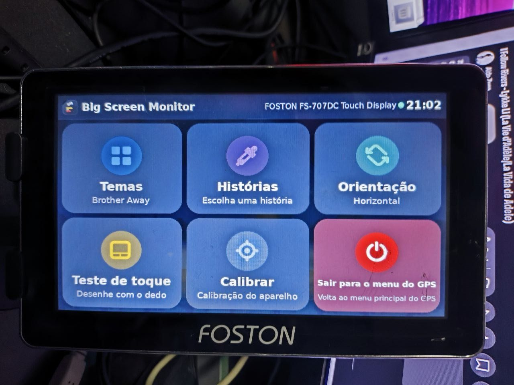
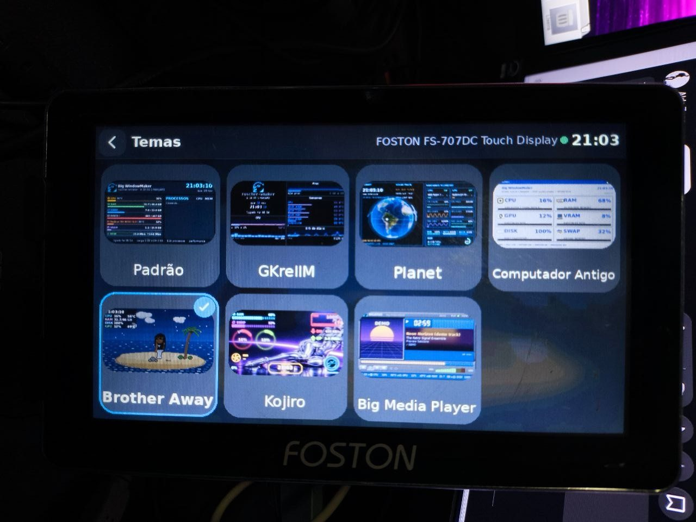
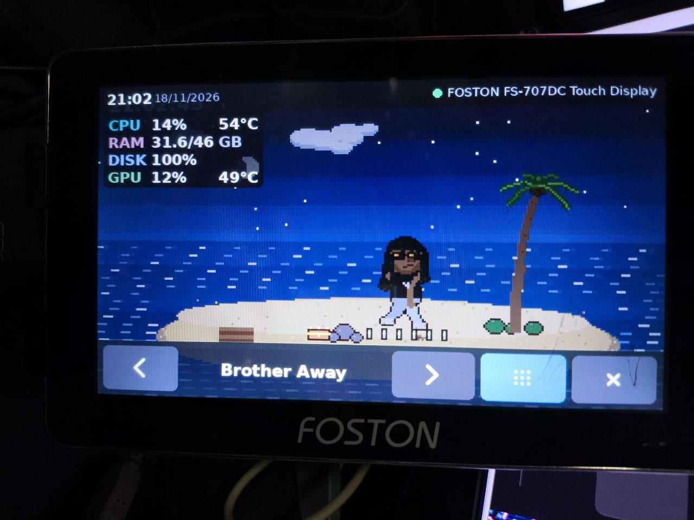
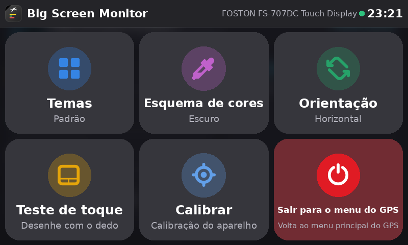
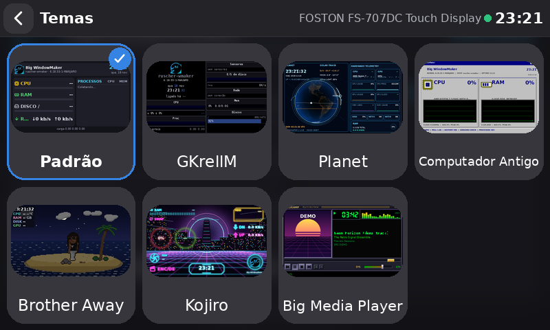
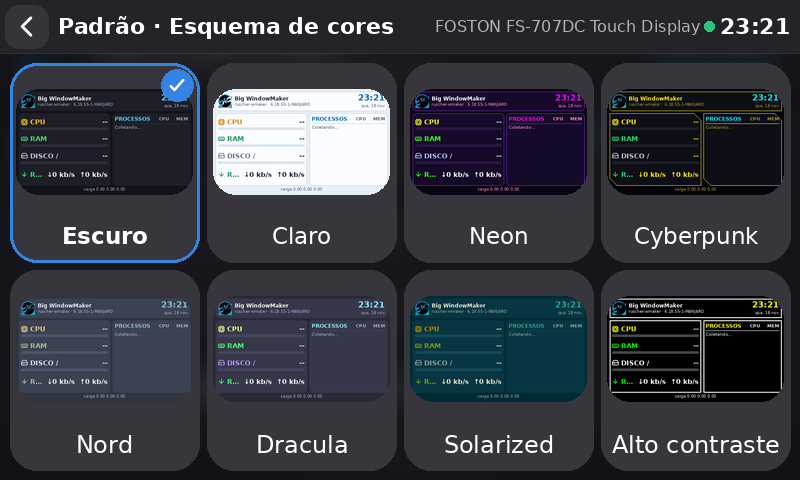
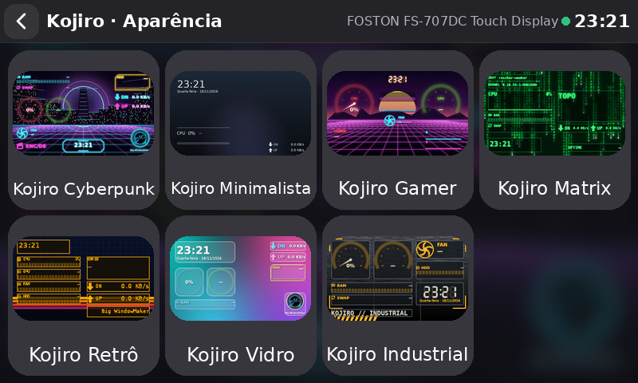
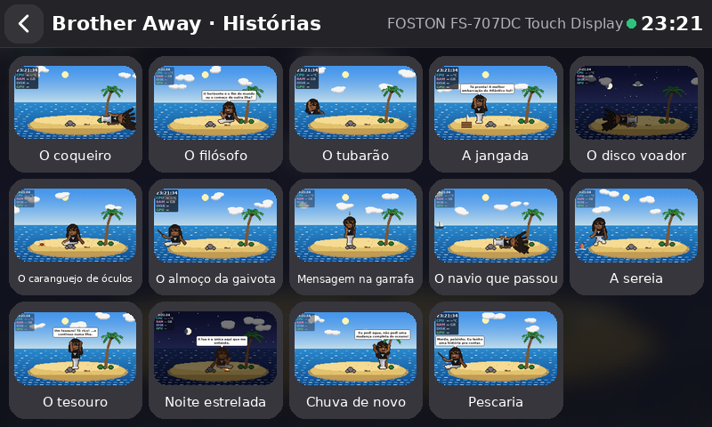
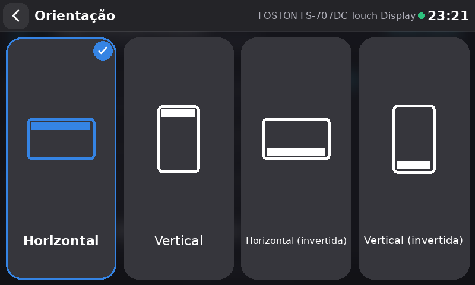
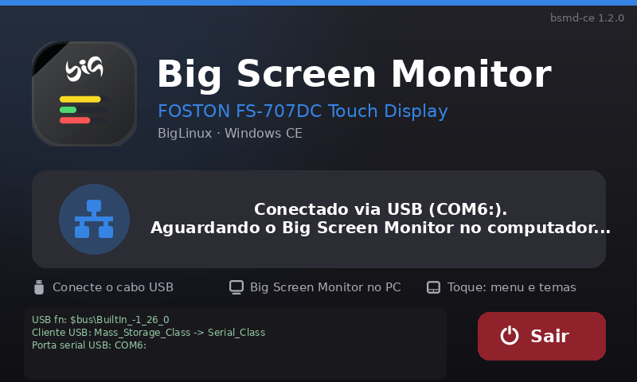

# FOSTON FS-707DC → Big Screen Monitor Touch Display

**Um navegador GPS de 2010 (Windows CE 5, MediaTek MT3351, 7", 800×480, toque resistivo) transformado em painel de monitoramento touch do [Big Screen Monitor Display](https://github.com/biglinux/big-screen-monitor-display) no BigLinux — sem gravar firmware, sem abrir o aparelho.**



Este repositório é o **laboratório** do projeto: investigação do hardware, ferramentas de bancada, medições e documentação. O código que o usuário final instala (driver, camada de toque, cliente Windows CE) fica no projeto principal, na branch `feat/foston-fs707dc` do `big-screen-monitor-display`.

---

## Sumário

1. [O que funciona](#o-que-funciona)
2. [Fotos e capturas](#fotos-e-capturas)
3. [Como funciona](#como-funciona)
4. [Instalação passo a passo](#instalação-passo-a-passo)
5. [Usando o painel](#usando-o-painel)
6. [Solução de problemas](#solução-de-problemas)
7. [Informações técnicas](#informações-técnicas)
8. [Compilar o cliente Windows CE](#compilar-o-cliente-windows-ce)
9. [Conteúdo deste repositório](#conteúdo-deste-repositório)
10. [Pendências](#pendências)
11. [Licença e créditos](#licença-e-créditos)

---

## O que funciona

Tudo abaixo foi **validado no aparelho real** em 18/11/2026, salvo onde indicado.

| | |
|---|---|
| ✅ Detecção automática | o serviço reconhece o FOSTON (`045e:00ce`) e confirma pelo handshake do cliente |
| ✅ Painel em tempo real | todos os temas: Padrão, GKrellM, Planet, Computador Antigo, Brother Away, Kojiro, Big Media Player |
| ✅ Toque | toque, segurar, deslizar; menu, galeria de temas, aparências, histórias, orientação, teste de toque |
| ✅ Calibração | calibração nativa do próprio WinCE, aberta pelo painel ou pela janela |
| ✅ Sair para o menu do GPS | pelo painel (dois toques) ou pela janela; o USB volta ao modo armazenamento |
| ✅ Reconexão | 3 ciclos de desconectar/reconectar o cabo, todos recuperados sozinhos |
| ✅ Firmware original | nada é gravado na ROM; basta apontar o "caminho da navegação" para o cliente |
| ⚠️ Brilho | o firmware não expõe controle de luz de fundo; os botões de brilho ficam ocultos |
| ⏳ Não testado | reiniciar o PC, suspensão, KDE Plasma, WindowMaker Wayland, junto com outro display no mesmo serviço |

---

## Fotos e capturas

### No aparelho

| Tela de espera (cliente `bsmd-ce` 1.2.0) | Galeria de temas com miniaturas reais |
|---|---|
|  |  |
| **Brother Away com a barra de controle** | **Primeira versão, com o diagnóstico que destravou o projeto** |
|  |  |

### Interface (capturas 800×480 geradas pelo próprio serviço)

| Menu | Barra de controle (um toque) |
|---|---|
|  |  |
| **Temas** | **Esquemas de cores do tema Padrão** |
|  |  |
| **Skins do Big Media Player** | **Aparências do Kojiro** |
|  |  |
| **Histórias do Brother Away (cena real de cada uma)** | **Orientação** |
|  |  |

A tela de espera é composta no build com o ícone, a fonte e as cores do app e embutida no cliente:



---

## Como funciona

```
 Big Screen Monitor Display (BigLinux)                    FOSTON FS-707DC (Windows CE 5.0)
 ┌───────────────────────────────────┐                   ┌───────────────────────────────┐
 │ temas → quadro 800×480            │                   │ bsmd-ce.exe (C, 52 KB)        │
 │ touch.TouchUI: barra, menu, galerias│                  │  thread leitora → anel 2 MiB  │
 │ driver foston_fs707dc             │   USB serial       │  parser FSP + CRC             │
 │   retângulos sujos → FILL/zlib/bruto├──045e:00ce──────►│  inflate → DIB RGB565 → BitBlt │
 │   janela de créditos 32 KiB       │ /dev/ttyUSB0 ↔ COM6│  PRESENTED / CREDIT           │
 │   reparo automático de quadro     │◄──────────────────┤  toque (WM_LBUTTON*) → TOUCH  │
 └───────────────────────────────────┘                   └───────────────────────────────┘
```

1. O cliente **`bsmd-ce`** roda no firmware original, pelo menu "caminho da navegação" do GPS.
2. Ele troca a função USB do aparelho de **armazenamento** para **serial** (`IOCTL_UFN_CHANGE_CURRENT_CLIENT`); no Linux o kernel cria `/dev/ttyUSB0` (driver `ipaq`).
3. O serviço do Big Screen Monitor desenha o tema, envia **só as áreas que mudaram** pelo protocolo **FSP**, e o aparelho responde quando o quadro está na tela.
4. O toque volta pelo mesmo cabo e é tratado **dentro do serviço**, desenhado no próprio painel. **Nada é injetado no desktop** (sem uinput/XTest): o foco do teclado, menus abertos e o mouse do computador nunca são afetados, em X11 ou Wayland.
5. Ao sair, o cliente devolve o USB ao modo armazenamento e o GPS volta ao menu principal.

Por que este caminho? Foram avaliadas quatro alternativas (cliente no firmware original, entrada AV-IN, trocar a controladora do LCD, Linux embarcado). Só a primeira entrega **vídeo e toque** sem risco ao aparelho; o AV-IN seria só vídeo, e trocar firmware de modelos parecidos pode inutilizar o GPS.

---

## Instalação passo a passo

### Requisitos

* BigLinux / Manjaro / Arch com o **Big Screen Monitor Display com suporte ao FOSTON** (branch `feat/foston-fs707dc`, ou uma versão publicada que a inclua).
* FOSTON FS-707DC (ou navegador Windows CE parecido) com o cabo mini-USB de dados.

### 1. Instalar o Big Screen Monitor com o suporte ao FOSTON

A partir do código-fonte da branch:

```bash
git clone -b feat/foston-fs707dc <url do big-screen-monitor-display>
cd big-screen-monitor-display/pkgbuild
makepkg -ef
sudo pacman -U big-screen-monitor-display-*-any.pkg.tar
```

O pacote instala o serviço, a regra udev restrita ao FOSTON e o cliente do aparelho em
`/usr/share/big-screen-monitor-display/device-clients/wince/bsmd-ce.exe`.

> Sem o pacote, em desenvolvimento: `sudo install -m644 udev/70-bsmd-foston-dev.rules /etc/udev/rules.d/ && sudo udevadm control --reload-rules && sudo udevadm trigger --action=add --subsystem-match=tty`. Apague a regra quando instalar o pacote.

### 2. Copiar o cliente para o GPS

1. Ligue o FOSTON e conecte o cabo: ele aparece no gerenciador de arquivos como armazenamento.
2. Abra **Big Screen Monitor → Meus Displays → FOSTON → Instalar o cliente no navegador**
   (ou copie o `bsmd-ce.exe` para uma pasta **`BigScreen`** na raiz do volume).
3. Ejete o volume, desconecte o cabo e **dê reset no FOSTON**.
   O Windows CE mantém em cache a versão anterior dos arquivos enquanto o volume está exportado ao PC; sem o reset ele roda o executável antigo.

### 3. Configurar o GPS (uma vez)

No menu principal do FOSTON: **Configurações → Caminho da navegação → BigScreen → bsmd-ce.exe**.
A partir daí o botão **Navegação** abre o Big Screen. A versão aparece no canto superior direito.

### 4. Usar

1. Toque em **Navegação**: aparece a tela de espera.
2. Conecte o cabo USB.
3. Em cerca de 1 segundo o painel aparece. Pronto.

Para voltar ao GPS: menu → **Sair para o menu do GPS** (dois toques), ou o botão **Sair** da tela de espera, ou segure o canto superior esquerdo por 3 s.

---

## Usando o painel

| Gesto | O que faz |
|---|---|
| Toque | mostra a barra inferior (◀ tema ▶, menu, fechar) e a faixa de status (hora, data, nome, conexão) |
| Deslizar ← / → | troca de tema |
| Segurar ~1 s, deslizar ↑ ou botão de grade | abre o menu |
| Deslizar ↓ | fecha o que estiver aberto |

**Menu**

| Cartão | Opções |
|---|---|
| Temas | os 7 temas, com miniatura real |
| Aparência do tema atual | Padrão: 8 esquemas · GKrellM: 3 estilos · Planet: 5 cores · Computador Antigo: 4 esquemas · Big Media Player: 15 skins · Kojiro: 7 aparências · Brother Away: 14 histórias (a escolhida começa na hora) |
| Orientação | Horizontal, Vertical e as duas invertidas |
| Teste de toque | desenha o caminho do dedo e mostra as coordenadas; segurar sai |
| Calibrar | calibração nativa do aparelho (toque nas cruzes) |
| Sair para o menu do GPS | dois toques em até 4 s |

O que você escolhe no painel vale só para o FOSTON e é guardado entre reinícios. Se o mesmo ajuste for mudado na janela de configuração, **a janela prevalece**.

Na janela (**Meus Displays → FOSTON**): interruptor *Touchscreen*, *Teste de toque*, *Calibrar toque*, *Fechar o cliente no navegador*, *Instalar o cliente no navegador*, além de tema, orientação e desempenho como em qualquer display.

---

## Solução de problemas

| Sintoma | Causa | Solução |
|---|---|---|
| Tocar em Navegação não abre nada | executável copiado sem reset | reset no FOSTON |
| "Aguardando a porta USB serial" | cabo desconectado | conectar o cabo; as linhas verdes mostram o diagnóstico |
| "Porta COMx ocupada" | ActiveSync segurou a porta | o cliente encerra o `repllog.exe` e tenta de novo |
| Tela parada, relógio congelado | o PC parou de enviar | a partir da 1.1.1 o aparelho volta à tela de espera em 30 s; verifique o serviço |
| Serviço: "client … is too old" | cliente 1.0.x | instale o cliente do pacote |
| `/dev/ttyUSB0` sem permissão | regra udev ausente | instalar o pacote |
| Log: "frame damaged on the link … resynchronising" | perda de bytes no driver USB do WinCE | nada a fazer: o quadro é refeito sozinho (~0,8 por minuto) |
| Volume não aparece no PC | cliente aberto (modo serial) | Sair no aparelho |

Restaurar o GPS ao original: **Configurações → Caminho da navegação** de volta ao navegador original e, se quiser, apagar a pasta `BigScreen`.

---

## Informações técnicas

### Hardware identificado

| Item | Valor | Como foi obtido |
|---|---|---|
| SoC | MediaTek **MT3351** | `ID_REVISION=3351` no INQUIRY SCSI |
| Sistema | **Windows CE 5.0.1400** | `GetVersionEx` pelo cliente |
| Plataforma / OEM | `APOLLO` / `MTK` | `SystemParametersInfo` |
| RAM | 120 668 KB (~100 MB livres com o cliente) | `GlobalMemoryStatus` |
| Tela | 800×480, 16 bpp, toque resistivo de 1 ponto | métricas do sistema + eventos reais (x 1–789, y 1–478) |
| USB serial | `045e:00ce`, driver `ipaq`, COM6 no aparelho | kernel + registro `Drivers\Active` |
| USB armazenamento | `045e:ffff`, 2 GB FAT32 | kernel |
| Controlador USB Function | `$bus\BuiltIn_-1_26_0` (`Drivers\BuiltIn\UsbFn`) | `FindFirstDevice` |

### Protocolo FSP (Foston Screen Protocol) v1

Cabeçalho de 16 bytes little endian: `"FS"`, versão, tipo, sequência, flags, tamanho, CRC-16/CCITT-FALSE do payload e do cabeçalho (o CRC do cabeçalho permite ressincronizar após lixo).

| Sentido | Mensagens |
|---|---|
| PC → aparelho | `HELLO`, `PING`, `RECT` (bruto / RLE / zlib), `FILL`, `PRESENT`, `BRIGHTNESS`, `CALIBRATE`, `BYE`, `TOUCHCFG` |
| aparelho → PC | `HELLO_ACK` (resolução, versão do WinCE, memória, recursos), `PRESENTED`, `PONG`, `NAK`, `CREDIT`, `TOUCH`, `KEY`, `LOG` |

O núcleo C do cliente (parser, CRC, inflate, decodificação) é compilado no PC nos testes e comparado **byte a byte** com o codificador Python.

### O que o aparelho ensinou (cada item custou um ciclo de reset)

* O driver serial do WinCE **descarta dados acima de ~1 KB** quando o aplicativo não lê a tempo (medido: 850 B chegavam; 2 KB a 64 KB se perdiam). Solução: thread leitora dedicada com prioridade alta, anel de 2 MiB e controle de fluxo por créditos.
* Perdas raras continuam sob carga: o PC detecta pelo CRC, refaz o handshake (zera os contadores dos dois lados) e reenvia o quadro, sem derrubar a sessão.
* O `coredll` deste WinCE **não tem `_vsnwprintf`**: um executável que a importe não abre, sem mensagem de erro.
* O `DrawText` do WinCE não aceita `DT_END_ELLIPSIS`.
* O volume fica montado nos dois lados ao mesmo tempo: o GPS só vê arquivos novos depois de um reset.
* O driver `ipaq` do Linux não implementa `TIOCMGET`; a prova de vida é o `PING`.
* O ModemManager sondaria a porta com comandos AT; a regra udev o impede.

### Desempenho medido no aparelho

| Métrica | Valor |
|---|---|
| Quadro completo 800×480 (pior caso) | 7,1–7,3 fps, mediana 130–144 ms, ~200 KiB/s |
| Atualização pequena (região de relógio) | ~130 fps, mediana 7,5 ms, p95 10,2 ms |
| PING ida e volta | mediana 2,0 ms, máximo 3,2 ms |
| Decodificação no aparelho (quadro completo zlib) | 54–76 ms + blit 12–14 ms |
| Handshake | 10–204 ms |
| Estresse de 30 s só com quadros completos | 208 quadros, nenhum erro na sessão |
| Reparos de quadro em uso normal | ~0,8 por minuto |
| Tamanho do cliente / memória livre com ele | 52 KB / ~100 MB |

Arquivos brutos: [`bench-2026-11-18-*.jsonl`](.) e [`lab/`](lab/).

### Evolução do cliente

| Versão | O que mudou |
|---|---|
| 1.0.0 | primeira imagem no aparelho; mensagens acima de ~1 KB perdidas |
| 1.0.1 | não abria: `_vsnwprintf` ausente |
| 1.0.2 / 1.0.3 | diagnóstico na tela (troca de função USB confirmada, COM6) |
| 1.1.0 | thread leitora, anel 2 MiB, créditos, ressincronização → quadros completos estáveis |
| 1.1.1 | volta à tela de espera após 30 s sem dados do PC |
| 1.2.0 | tela de espera com a identidade do app; leitora com prioridade 200 |

### Segurança

* Regra udev só para `045e:00ce` **com a string de produto deste firmware**; grupo dedicado + `uaccess`; nunca `MODE="0666"`.
* O serviço continua no sandbox do systemd (DynamicUser, sem uinput).
* Nenhuma escrita persistente no GPS além da pasta `BigScreen` e da opção escolhida no menu.

---

## Compilar o cliente Windows CE

O fonte está em `device-clients/wince/` no projeto principal.

```bash
cd device-clients/wince
make host-test                     # núcleo portátil com o gcc do PC (sem compilador cruzado)
LD_LIBRARY_PATH=<deps32>/lib make package CROSS=<mingw32ce>/bin/arm-mingw32ce-
make splash                        # regera a arte da tela de espera
```

Compilador: [CeGCC 0.59.1](https://sourceforge.net/projects/cegcc/files/cegcc/0.59.1/) (`mingw32ce-0.59.1.tar.bz2`, SHA-256 `dd7e0820…7470`). Ele precisa de `libgmp.so.3` e `libmpfr.so.1` de 32 bits, que não existem mais nos repositórios. Funciona compilando [GMP 4.3.2](https://ftp.gnu.org/gnu/gmp/) e [MPFR 2.4.2](https://ftp.gnu.org/gnu/mpfr/) num prefixo privado:

```bash
FL="-m32 -O2 -std=gnu89 -Wno-error=implicit-function-declaration -Wno-error=implicit-int -Wno-error=incompatible-pointer-types -Wno-error=int-conversion"
(cd gmp-4.3.2 && ABI=32 CFLAGS="$FL" ./configure --prefix=$PWD/../deps32 --build=i686-pc-linux-gnu --disable-static && make && make install)
(cd mpfr-2.4.2 && CFLAGS="$FL" ./configure --prefix=$PWD/../deps32 --build=i686-pc-linux-gnu --with-gmp=$PWD/../deps32 --disable-static && make && make install)
```

Toolchains mais novos ([cegcc-build](https://github.com/MaxKellermann/cegcc-build), GCC 9) também devem servir. Neste WinCE **não use** `_vsnwprintf` nem `DT_END_ELLIPSIS`.

---

## Conteúdo deste repositório

| Caminho | Conteúdo |
|---|---|
| `tools/fsp_bench.py` | bancada no aparelho real: handshake, padrões de cor e texto, vazão, PING, teste de toque |
| `tools/fsp_sweep.py` | varredura janela de créditos × tamanho de mensagem |
| `udev/70-bsmd-foston-dev.rules` | regra udev de desenvolvimento (cópia da regra do pacote) |
| `bench-2026-11-18-*.jsonl` | resultados brutos das bancadas |
| `lab/` | logs das execuções do serviço completo no aparelho (reparos, reconexões) |
| `docs/images/` | fotos do aparelho e capturas da interface |

**Fora do repositório (`.gitignore`)**: `backup/` (cópia do volume do GPS, com dados pessoais), `toolchain/` (compilador e bibliotecas de terceiros, 231 MB), `pkg/` (pacotes gerados) e o estado local do laboratório.

Uso da bancada (com o cliente aberto no GPS e o serviço parado):

```bash
python3 tools/fsp_bench.py /dev/ttyUSB0 --seconds 8 --touch 30
SWEEP_S=15 python3 tools/fsp_sweep.py 32768x16384 65536x16384
```

A documentação completa (investigação, alternativas, protocolo, toque, instalação, testes, recuperação, relatório final) está em `docs/foston-fs707dc/` no projeto principal. Lá também estão os 49 testes automatizados do suporte ao FOSTON (`tests/test_foston.py`).

---

## Pendências

* Testes físicos: reiniciar o PC, suspensão, KDE Plasma, WindowMaker Wayland e o FOSTON junto com outro display no mesmo serviço.
* Reduzir o impacto dos reparos: reenviar só a mensagem perdida em vez do quadro inteiro (exige nova versão do cliente).
* Controle do Big Media Player pelo toque: o canal de mídia é unidirecional por projeto (sessão → serviço); abrir o sentido inverso pede uma decisão de segurança.
* Traduções das strings novas para os demais idiomas (hoje: português).

---

## Licença e créditos

* Este repositório: veja [LICENSE](LICENSE).
* Cliente `bsmd-ce`, driver e camada de toque: GPL-3.0-or-later, no projeto [Big Screen Monitor Display](https://github.com/biglinux/big-screen-monitor-display).
* Troca de função USB no Windows CE: técnica documentada por [Nicolas Besson](http://nicolasbesson.blogspot.com/2009/11/usb-function-profile-switcher.html) e [PrabuKumar](https://prabukumar.wordpress.com/2008/10/07/usb-function-driver-dynamic-switching-in-wince/); códigos dos IOCTL conferidos no [SDK Meizu M8](https://docs.huihoo.com/meizu/m8sdk/0.9.6.0/usbfnioctl_8h.html).
* Informações do modelo: fórum [GpsInfo](https://www.gpsinfo.com.br/viewtopic.php?t=3181).
* Ícones da interface: tema [Adwaita](https://gitlab.gnome.org/GNOME/adwaita-icon-theme) do GNOME.
* Projeto desenvolvido por ruscher com a comunidade BigLinux.
