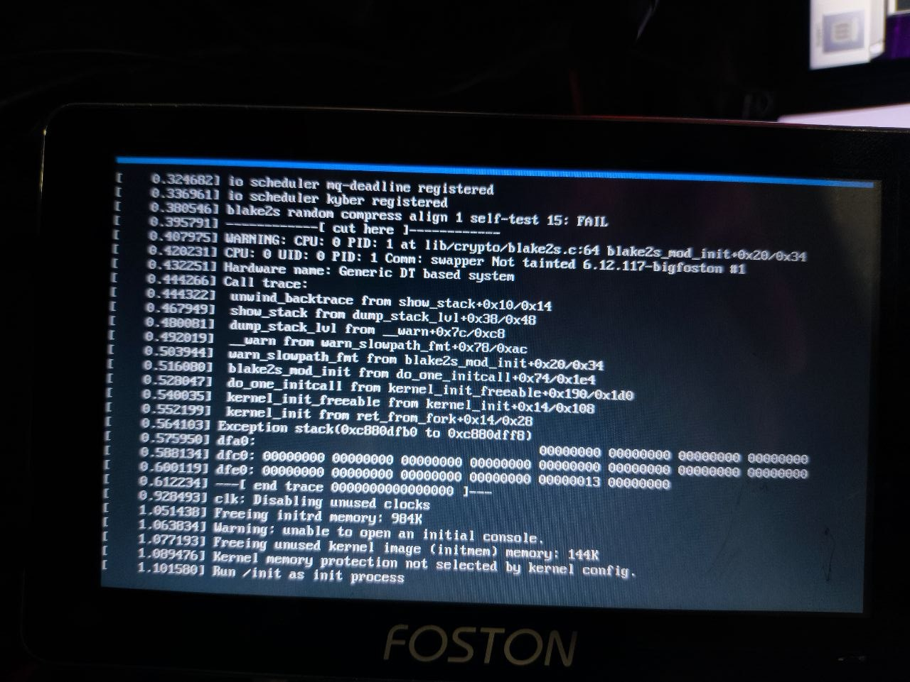

# 04 · Port do Linux para o MT3351

Não existe suporte público ao MT3351 no Linux (nem upstream, nem BSP do fabricante
encontrado). O port é feito a partir do zero, sobre o Linux **6.12 LTS**, com drivers
escritos para os registradores medidos no aparelho ([01-hardware.md](01-hardware.md)).

## Plataforma

| Item | Escolha | Motivo |
|---|---|---|
| Kernel | Linux 6.12.117 (LTS) | suporte longo; ARMv6 multiplataforma com device tree |
| Arquitetura | `ARCH_MULTI_V6`, `CPU_V6K`, sem SMP, sem VFP | ARM1176JZ-S medido; VFP não habilitado pelo CE |
| Errata | `ARM_ERRATA_411920` | ARM1176 r0p4 |
| Boot | zImage + DTB + initrd pelo `bfagent` ([05-bootloader.md](05-bootloader.md)) | sem gravar a flash |
| Userland | Buildroot 2026.02.3 (LTS), musl, soft-float, BusyBox | pequeno e reproduzível |

## Código do port

Fonte: [`firmware/kernel/overlay/`](../firmware/kernel/overlay/) (arquivos novos) +
[`firmware/kernel/apply-overlay.sh`](../firmware/kernel/apply-overlay.sh) (Kconfig/Makefile).
O patch do Buildroot é gerado por `firmware/kernel/mkpatch.sh`.

| Arquivo | Função | Base factual |
|---|---|---|
| `arch/arm/mach-mt3351/Kconfig` | plataforma `ARCH_MT3351` | — |
| `drivers/irqchip/irq-mt3351-cirq.c` | controlador de interrupções CIRQ, 64 linhas, `handle_fasteoi` | OAL desmontada: `OALInterruptInit`, `SetIRQMask`, `ClearIRQMask`, tratador de IRQ |
| `drivers/clocksource/timer-mt3351-gpt.c` | clocksource, sched_clock e clockevent one-shot no GPT1 | medição: contador a 14,625 MHz, compare em `+0x1C`, IRQ 39 |
| `drivers/video/fbdev/mt3351-bootcon.c` | console de texto no framebuffer do CE (antes do timer) | framebuffer medido em `0x03E00030` |
| `arch/arm/boot/dts/mediatek/mt3351-foston-fs707dc.dts` | device tree | tudo medido |

## Etapas e estado

| Etapa | Estado | Evidência |
|---|---|---|
| Tomar a CPU a partir do CE (payload bare-metal) | **FUNCIONANDO** | `fbtest` no aparelho, 19/11/2026 |
| Kernel compila | **FUNCIONANDO** | Buildroot 2026.02.3: zImage 1,4 MB, initrd 1,0 MB |
| Kernel inicia, mensagens na tela | **FUNCIONANDO** | log do kernel até `Run /init as init process` (1,10 s) — [foto](images/foto-linux-primeiro-boot.jpg) |
| Timer e interrupções | **PARCIAL** | timestamps do printk avançam (contador GPT/sched_clock ok); interrupção do timer **não comprovada** |
| initramfs descompactado | **FUNCIONANDO** | `Freeing initrd memory: 984K` na foto |
| userland (BusyBox) | **NÃO FUNCIONA** | nenhuma linha `bigfoston:` aparece; tela para em `Run /init` (confirmado pelo usuário) |
| self-test `blake2s` | **FALHA** | `random compress align 1 self-test 15: FAIL` — suspeita de acesso desalinhado/memória |

**Próximo diagnóstico:** autoteste de timer/IRQ e de acesso desalinhado no kernel, `/init`
que reporta cada passo em `/dev/kmsg`, `user_debug=31 print_fatal_signals=1`.
| Touchscreen | NÃO IMPLEMENTADO | ADC/registradores ainda não identificados |
| SD (MSDC) | NÃO IMPLEMENTADO | driver CE `sdhc_drv` (família MSDC) |
| USB device (rede/serial → SSH) | NÃO IMPLEMENTADO | base `0x80100000`, IRQ 8; IP ainda não identificado |
| UARTs | NÃO IMPLEMENTADO | 16550 MTK em `0x80026000…0x80029000`, IRQ 3–6; clock desconhecido |
| Luz de fundo (PWM) | NÃO IMPLEMENTADO | PWM em `0x8002B000` |

O estado de cada linha é atualizado conforme os testes no aparelho
([15-testes.md](15-testes.md)).
