# 09 · Interface (UX/UI) do BigFoston OS

O `bigfoston-shell` é a interface gráfica do BigFoston OS no FOSTON FS-707DC.
Código: [`src/ui/`](../src/ui/README.md) · C11 · **LVGL 9.2.2** · tela 800×480
RGB565 · toque resistivo de ponto único · ARMv6 sem VFP.

## Princípios

1. **Dedo e caneta resistiva primeiro.** Nenhum alvo de toque menor que 64 px; sem
   gestos multitoque; deslizar é sempre opcional (há setas e botões para tudo).
2. **Honestidade.** A interface nunca inventa dado nem mostra controle que não
   funciona. Hardware sem driver aparece como *"Não disponível neste hardware ainda"*,
   com o que falta. Valor desconhecido é "—". Valores simulados levam o selo **SIM**.
3. **Identidade BigLinux.** Grafite escuro, azul BigLinux e ciano; moderno, com
   detalhes retrô discretos (cursor de bloco no logotipo, filete ciano sob a barra,
   indicadores de página "pixel", informações do sistema em estilo fastfetch).
4. **Leve.** Sem animações caras, sem timers ociosos, um único quadro RGB565.

## Paleta

| Token | Escuro (padrão) | Claro | Uso |
|---|---|---|---|
| `bg` | `#1b1f27` | `#eef1f6` | fundo da tela |
| `surface` | `#232833` | `#ffffff` | barras, cartões |
| `surface2` | `#2d3341` | `#e2e7ef` | botões neutros, estado pressionado |
| `border` | `#3a4152` | `#cfd6e2` | contornos de cartão |
| `text` | `#e9edf4` | `#1b1f27` | texto principal |
| `text_dim` | `#98a2b3` | `#586274` | rótulos, subtítulos, ícones desligados |
| `primary` | `#3584e4` | `#3584e4` | azul BigLinux: botão principal, seleção |
| `accent` | `#33c7de` | `#1597ad` | ciano: item ativo, foco, detalhes retrô |
| `success` | `#2ec27e` | `#1f9d5f` | OK, SSH ativo, código de saída 0 |
| `warning` | `#f5a524` | `#b3650b` | "indisponível", selo SIM |
| `danger` | `#e5484d` | `#e5484d` | Desligar, Reset, erro |

Cada app da grade tem uma cor própria, aplicada como degradê vertical
(+30 % claro → −40 % escuro) num quadrado arredondado de 80 px com o ícone branco.

## Tipografia

| Fonte | Tamanho | Uso |
|---|---|---|
| Montserrat Medium | 28 px | títulos de página, valores grandes, ícones da barra inferior |
| Montserrat Medium | 20 px | texto padrão, botões, itens de lista |
| Montserrat Medium | 14 px | subtítulos, legendas, rótulos da barra inferior |
| DejaVu Sans Mono | 16 px | saída de comandos, Sistema de Informação (fastfetch) |

Todas geradas com **ASCII + Latin-1 completo** (á é í ó ú â ê ô ã õ ç ñ ¿ ¡ °)
mais — … • “ ” € e os símbolos LVGL/Font Awesome usados — ver
`src/ui/tools/make_fonts.sh`. Os acentos foram conferidos nas capturas
(ex.: "olá, ação, ñandú" na saída do Run, telas em espanhol).

## Espaçamento e tamanhos

- Grade de 4 px: `4 · 8 · 12 · 16 · 24`. Margem lateral das páginas: 24 px.
- Raios: 10 px (botões), 14 px (cartões), 20 px (tiles, diálogos).
- **Toque**: botões ≥ 64×64 px; linhas de lista 64–76 px; tiles 152×146 px;
  setas da grade 64×146 px; botões da barra inferior ≈ 129×64 px; switches 96×52 px
  com área extra de 12 px; slider com botão de 48 px e faixa de toque de 64 px;
  teclas do teclado ≈ 62×66 px.
- Layout fixo: barra superior **48 px** · conteúdo **800×360** · barra inferior **72 px**.

## Modelo de navegação

- Uma única tela LVGL; cada "tela" do sistema redesenha só a área de conteúdo
  (economiza RAM e evita recriar as barras).
- **Pilha** de navegação (até 16): abrir empilha; **Voltar** desempilha; abrir uma
  tela que já está na pilha volta até ela; **Início** zera a pilha.
- **Recentes**: últimas 6 telas visitadas (sem a inicial), em diálogo com botões grandes.
- **Terminal** (barra inferior) abre o Run em modo `sh -c` com o teclado já aberto.
- **Desligar** sempre pede confirmação (Cancelar · Reiniciar · Desligar).
- Diálogos e teclado ficam na camada superior com fundo escurecido que bloqueia
  toques atrás. A calibração ocupa a tela inteira.
- Ao voltar para Ajustes, a lista mantém a posição de rolagem.
- Troca de língua ou tema reconstrói a interface na hora, mantendo a pilha.

## Barra superior

Logotipo **Big**Foston + cursor ciano, título da tela, e à direita: selo **SIM**
(só no simulador), GPS, rede, Bluetooth, USB, volume, bateria, data (opcional) e hora.

Cada ícone vem do provedor de status (`src/ui/core/status.h`):

| Estado | Aparência |
|---|---|
| ligado/conectado | cor do texto (GPS com fix em ciano, Bluetooth em azul) |
| desligado | cinza 70 % |
| desconhecido (sem driver) | cinza 30 % |
| bateria desconhecida | ícone vazio apagado + **"—"** (nunca uma porcentagem inventada) |

No alvo o provedor `linux` lê sysfs/proc; no simulador o provedor `sim` devolve
valores falsos e liga o selo SIM (`--real-status` usa o provedor real no PC).
A barra é atualizada por um único timer de 1 s, e só redesenha o que mudou.

## Telas

| Captura | Tela |
|---|---|
|  | **Início** — grade 4×2 paginada (deslizar ou setas), indicador de página. |
| 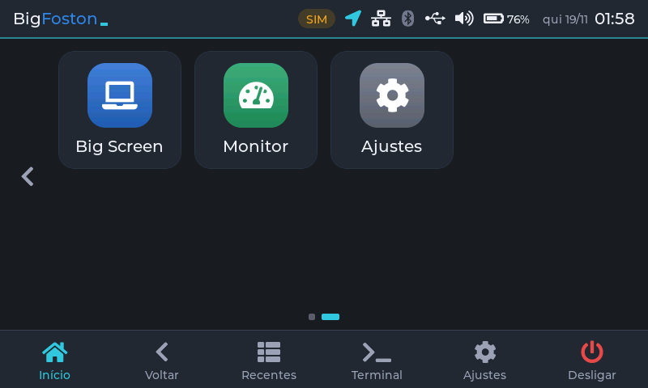 | **Início, página 2** — Big Screen, Monitor, Ajustes. |
|  | **Ajustes** — 14 itens em 2 colunas; itens sem driver mostram "indisponível". |
|  | **Ajustes (fim da lista)**. |
| 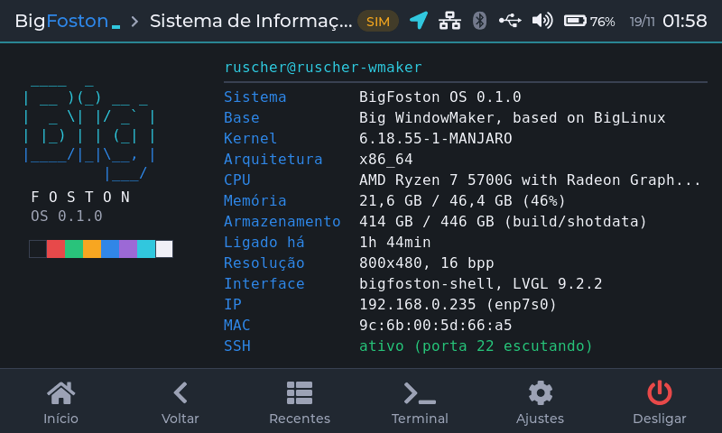 | **Sistema de Informação** — "fastfetch" gráfico com dados reais: SO, base, kernel, arquitetura, CPU, RAM, armazenamento, uptime, resolução, IP/MAC, SSH. |
| 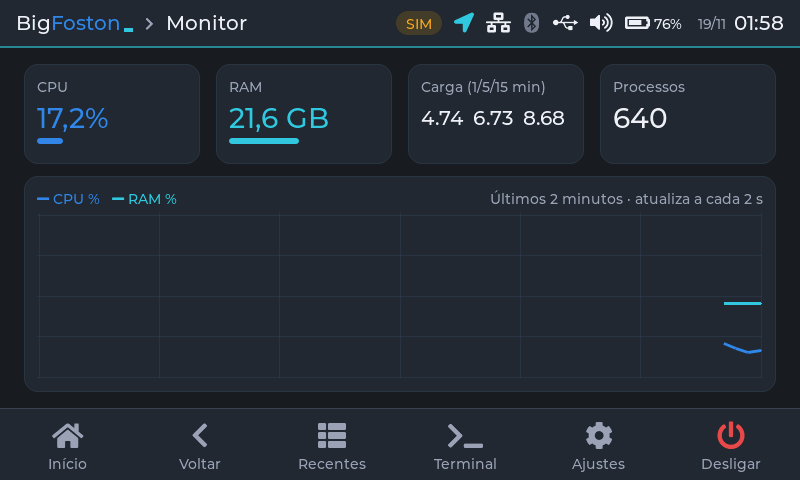 | **Monitor** — CPU % (/proc/stat), RAM, carga, processos; gráfico de 2 min, atualizado a cada 2 s. |
| 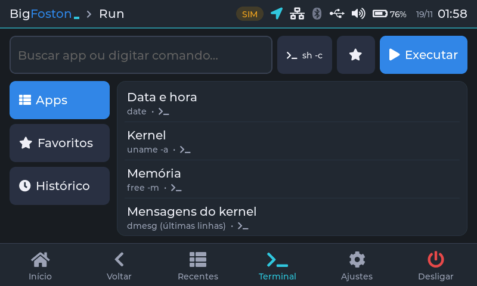 | **Run** — busca/comando, `sh -c`, favoritar, Executar; abas Apps/Favoritos/Histórico. |
| 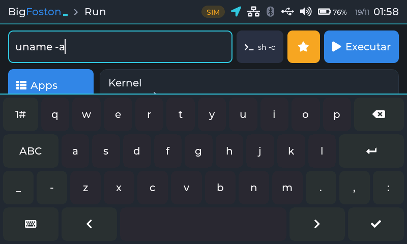 | **Run com teclado** — `lv_keyboard` de 296 px de altura (teclas ≈ 64 px). |
|  | **Run, saída** — stdout+stderr filtrados (sem escapes ANSI), código de saída colorido, Parar. |
| 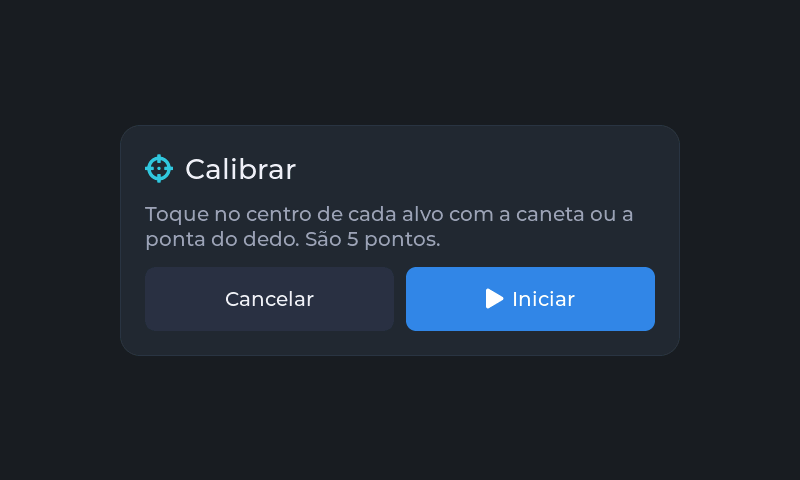 | **Calibrar** — introdução. |
|  | **Calibrar** — alvo 2 de 5 (média das amostras enquanto pressionado). |
|  | **Calibrar** — resultado com erro residual; aplicação no driver declarada como pendente. |
| 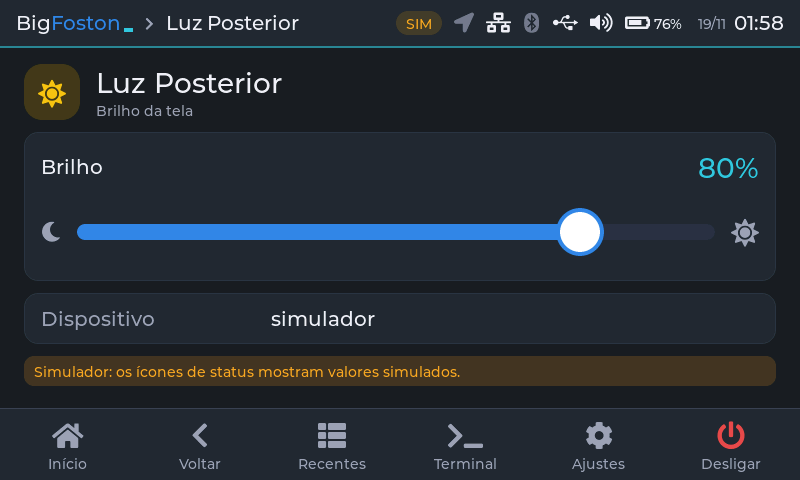 | **Luz Posterior** (simulador) — slider real com selo de simulação. |
| 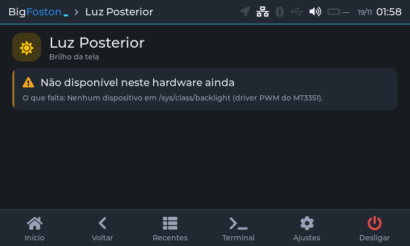 | **Luz Posterior** sem `/sys/class/backlight` — estado honesto. |
| 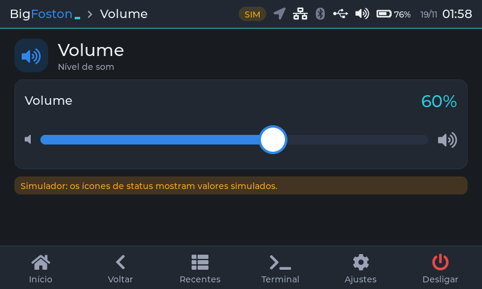 | **Volume**. |
| 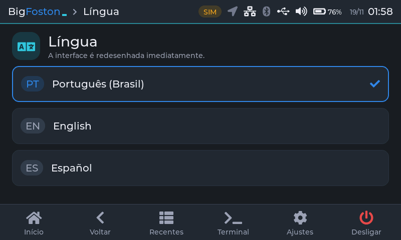 | **Língua** — pt-BR, English, Español. |
|  | **Data** — hora ao vivo, fuso, data na barra, relógio 24 h. |
|  | **Potência** (simulador) — bateria com selo "valor simulado". |
| 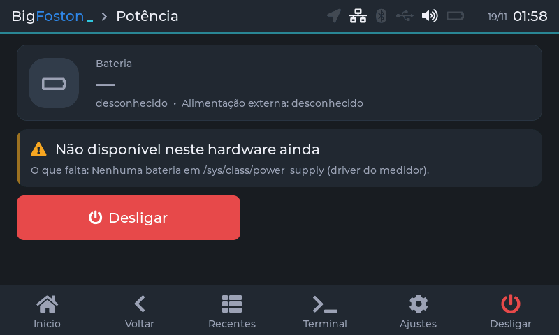 | **Potência** sem medidor de bateria — "—" + aviso. |
|  | **Reset Settings** — explica o que muda; confirmação obrigatória. |
| 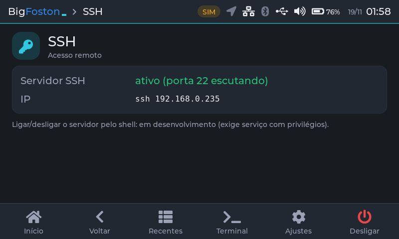 | **SSH** — estado real da porta 22 e endereço. |
| 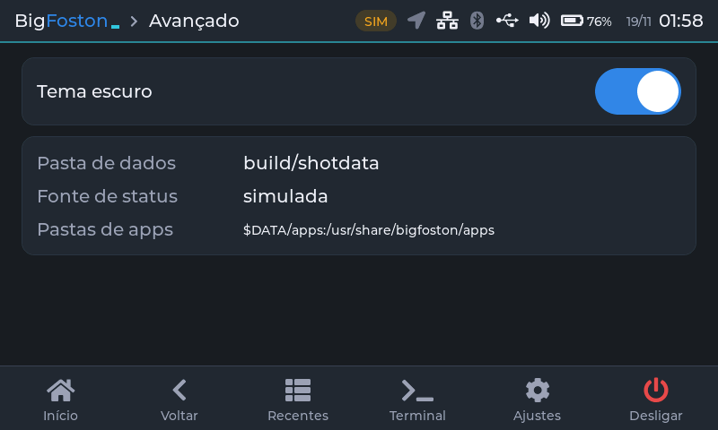 | **Avançado** — tema escuro/claro, pasta de dados, fonte de status. |
|  | **Multimídia** — página "em desenvolvimento" + "não disponível neste hardware". |
| 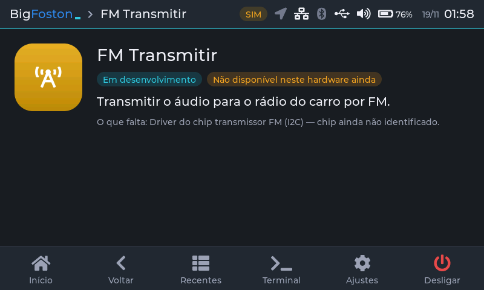 | **FM Transmitir** — chip FM ainda não identificado. |
| 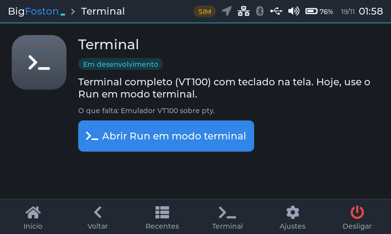 | **Terminal** — em desenvolvimento, com atalho para o Run em modo terminal. |
|  | **Livro** — só software, em desenvolvimento. |
|  | **Desligar** — diálogo de confirmação. |
|  | **Recentes**. |
| 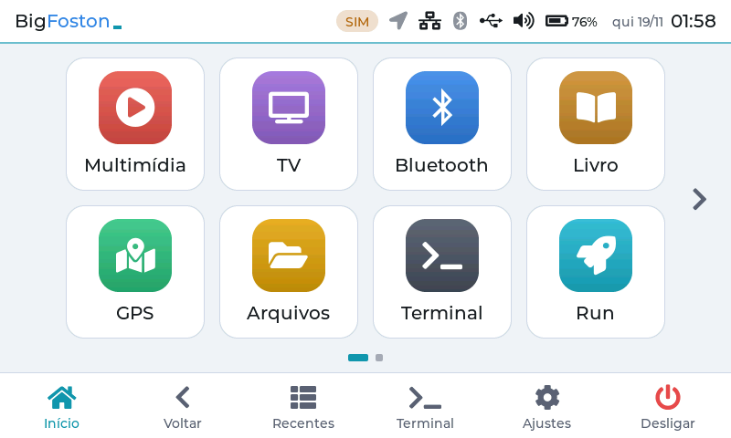 | **Tema claro** — início. |
|  | **Tema claro** — Ajustes. |
|  | **Tema claro** — Sistema de Informação. |
| 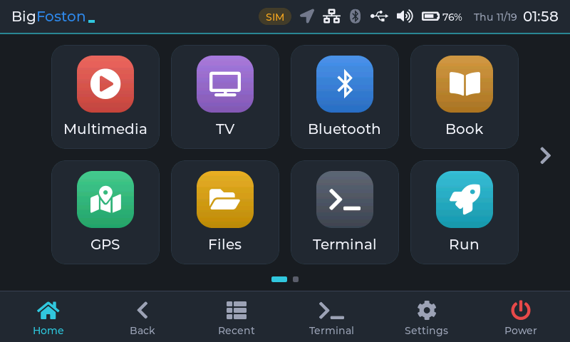 | **English** — início. |
|  | **English** — Settings. |
|  | **Español** — GPS (em desenvolvimento). |
| 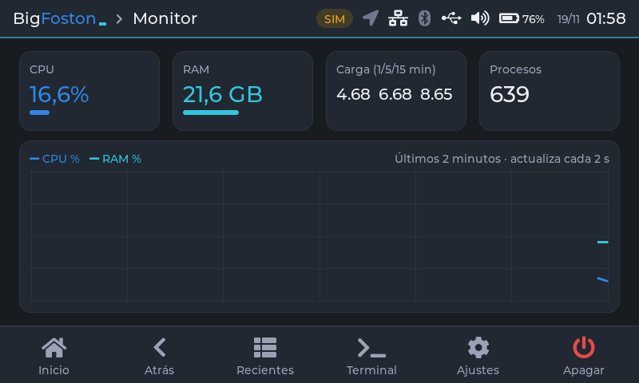 | **Español** — Monitor. |

As capturas são geradas sem display por `make -C src/ui screenshots`
(renderização LVGL em memória no mesmo formato RGB565 do aparelho).
Valores de CPU, RAM, kernel, IP etc. nelas são do PC onde foram geradas.

## Regras de honestidade para hardware sem suporte

1. Se o recurso depende de driver que não existe, a página mostra o cartão
   **"Não disponível neste hardware ainda"** e uma linha **"O que falta"** concreta
   (ex.: "Driver SPI do Siano SMS1xxx (ISDB-T)", "HCI via UART do CSR BlueCore").
2. Funções só de software ainda não escritas mostram **"Em desenvolvimento"**, sem
   botões falsos.
3. A detecção é feita em tempo de execução: Luz Posterior vira slider sozinha quando
   aparecer `/sys/class/backlight/*`; Volume, quando houver placa em `/proc/asound`;
   bateria, quando houver `power_supply` do tipo `Battery`.
4. Desconhecido ≠ desligado: ícone a 30 % e "—", nunca um valor padrão.
5. No simulador tudo que é falso tem o selo **SIM** / "valor simulado", e
   "Desligar" avisa que só fecha o programa.
6. Ações que não estão prontas (acertar o relógio, ligar/desligar SSH, aplicar a
   calibração no driver) dizem isso em texto, em vez de fingir que funcionaram.

| Item | Estado hoje |
|---|---|
| Luz Posterior, Volume, Potência | reais se o driver existir; senão aviso |
| Língua, Data (formato), Avançado (tema), Reset, Run, Monitor, Sistema de Informação, SSH (leitura) | funcionam |
| Calibrar | assistente completo; grava `pointercal`; `touch_calibration_apply()` é *stub* |
| GpsInfo, GPS, TV, Bluetooth, FM, USB, Multimídia, Big Screen | não disponível neste hardware ainda |
| Livro, Arquivos, Terminal | em desenvolvimento (só software) |

## Run — segurança

- Sem `sh -c`, o texto é dividido em argumentos (aspas respeitadas) e executado
  direto com `execvp` — sem shell, sem expansão.
- Com `sh -c` (modo terminal), roda `/bin/sh -c`, captura stdout+stderr num painel
  rolável (últimos 6 KB) e mostra o código de saída ou o sinal.
- **Nunca como root implicitamente**: se o shell roda como root, o filho troca
  para `$BIGFOSTON_RUN_USER` (padrão `bigfoston`) e confere que não consegue voltar
  a root; se o usuário não existir, recusa — só `BIGFOSTON_ALLOW_ROOT=1` libera.
- Apps `.desktop` com `Terminal=true` mostram a saída; os demais rodam em
  segundo plano numa nova sessão (sem zumbis). Histórico (50) e favoritos ficam
  em `$BIGFOSTON_DATA/history.txt` e `favorites.txt` (prefixo `$ ` = modo shell).

## Calibração

Cinco alvos (cantos a 50 px da borda + centro), média das amostras enquanto o
toque dura, ajuste afim por mínimos quadrados e erro residual exibido. Salva em
`$BIGFOSTON_DATA/pointercal` no formato do tslib (`a b c d e f s 800 480`).
A aplicação no driver é `touch_calibration_apply()` em `src/ui/core/touch_calib.c`,
hoje um *stub* porque o driver do touchscreen do MT3351 ainda não existe — ponto de
integração previsto: envolver o `read_cb` do `lv_evdev` com a transformação.

## Internacionalização

Textos em `src/ui/core/i18n_strings.def`: `X(ID, "chave.estável", "pt-BR", "en", "es")`.
O código usa `tr(S_ID)`. A chave estável funciona como *msgid*: um arquivo
`$BIGFOSTON_DATA/lang/<pt_BR|en|es>.txt` com linhas `chave = texto` sobrescreve
qualquer texto, preparando o caminho para catálogos estilo gettext.

## Desempenho e memória

- `lv_conf.h`: RGB565, `malloc` da libc (sem pool fixo), buffers parciais de 48 linhas
  (1/10 da tela) duplos no fbdev, sem GPU, só os widgets usados (label, botão, imagem,
  slider, switch, barra, gráfico, textarea, teclado, tileview), sem ponto flutuante na UI.
- Binário stripped (x86-64 `-Os`, gc-sections): ≈ 583 KB. RSS de pico renderizando as
  36 telas sem janela: ≈ 7,1 MB.
- Em repouso: timer de 1 s da barra, leitura do toque a cada 30 ms e refresh do LVGL
  (sem desenho se nada mudou). Monitor (2 s) e Run (100 ms) só criam timers enquanto
  precisam.

## Integração com o firmware

| O quê | Valor |
|---|---|
| Binário | `bigfoston-shell` (`make -C src/ui target CROSS_COMPILE=arm-buildroot-linux-musleabi-`) |
| Framebuffer | `/dev/fb0` (ou `BIGFOSTON_FBDEV`), 800×480 16 bpp |
| Toque | `BIGFOSTON_TOUCH` ou autodetecção do 1º `/dev/input/event*` com `ABS_X/ABS_Y/BTN_TOUCH` |
| Dados | `/data/bigfoston` (ou `BIGFOSTON_DATA`), gravável pelo usuário do shell |
| Apps | `.desktop` em `$BIGFOSTON_DATA/apps` e `/usr/share/bigfoston/apps` |
| Usuário do Run | conta sem privilégios `bigfoston` (ou `BIGFOSTON_RUN_USER`) |
| Desligar | `BIGFOSTON_POWEROFF_CMD` / `BIGFOSTON_REBOOT_CMD` (padrão `/sbin/poweroff`, `/sbin/reboot`) |
| Volume | `amixer` em `/usr/bin` ou `/bin` (controle `Master`) |
