# 09 · Interface (UX/UI) do BigFoston OS

O `bigfoston-shell` é a interface gráfica do BigFoston OS no FOSTON FS-707DC.
Código: [`src/ui/`](../src/ui/README.md) · C11 · **LVGL 9.2.2** · tela 800×480
RGB565 · toque resistivo de ponto único · ARMv6 sem VFP.

## Princípios

1. **Dedo e caneta resistiva primeiro.** Nenhum alvo de toque menor que 64 px; sem
   gestos multitoque; deslizar é sempre opcional (há setas e botões para tudo).
2. **Honestidade.** A interface nunca inventa dado nem mostra controle que não
   funciona. Hardware sem driver aparece como *"Não disponível neste hardware ainda"*,
   com o que falta. Valor desconhecido é "—". Valores simulados levam o selo **SIM**.
3. **Identidade FOSTONOS.** O logotipo (`src/ui/assets/logo/fostonos.svg`) abre o
   sistema e assina a barra superior; o tema padrão usa as cores dele (azul-marinho,
   violeta da esfera, verde da órbita). Outros cinco temas de cores, modo claro,
   escuro ou automático (Ajustes > Aparência).
4. **Leve.** Papel de parede pré-calculado (redesenhar é copiar), animações curtas
   e desligáveis, sem timers ociosos, um único quadro RGB565.

## Paleta e temas de cores

Cada tema de cores (`core/theme.c`, tabela `presets`) define `primary`, `accent`,
um *tint* que entra nos neutros e a luz (*glow*) do papel de parede. As paletas
escura e clara são calculadas a partir disso:

| Token | Escuro | Claro | Uso |
|---|---|---|---|
| `bg` | `#15181e` + tint | `#eef1f6` + tint leve | fundo da tela |
| `surface` | `#1f232b` + tint | `#ffffff` | barras, cartões |
| `surface2` | `#2a2f39` + tint | `#e2e7ef` + tint | botões neutros, pressionado |
| `border` | `#3a4050` + tint | `#cfd6e2` + tint | contornos |
| `text` / `text_dim` | `#eef1f6` / `#98a2b3` | `#1b1f27` / `#586274` | texto, rótulos |
| `primary` / `accent` | as do tema | escurecidas p/ contraste | seleção, destaque |
| `success` / `warning` / `danger` | `#2ec27e` / `#f5a524` / `#e5484d` | `#1f9d5f` / `#b3650b` / `#e5484d` | estados |

| Tema | primary | accent | tint |
|---|---|---|---|
| **FOSTON** (padrão) | `#6c5ce7` | `#26dda8` | `#0a226a` (34 %) |
| Clássico (BigLinux) | `#3584e4` | `#33c7de` | `#1b2433` (10 %) |
| Esmeralda | `#1f9d6b` | `#6bed48` | `#0d3b2c` (26 %) |
| Pôr do sol | `#e5484d` | `#ff9a2e` | `#3d1424` (24 %) |
| Violeta | `#8b5cf6` | `#e879f9` | `#2a1450` (28 %) |
| Grafite | `#5f6b7e` | `#a3adbd` | `#1f2329` (6 %) |

Cada app da grade tem uma cor própria, aplicada como degradê vertical
(+30 % claro → −40 % escuro) num quadrado arredondado de 80 px com o ícone branco.
Os cartões da grade são translúcidos (70 % no escuro) sobre o papel de parede.

## Tipografia

| Fonte | Tamanho | Uso |
|---|---|---|
| Montserrat Medium | 28 px | títulos de página, valores grandes, ícones da barra inferior |
| Montserrat Medium | 20 px | texto padrão, botões, itens de lista |
| Montserrat Medium | 14 px | subtítulos, legendas, rótulos da barra inferior |
| DejaVu Sans Mono | 16 px | saída de comandos, Sistema de Informação (fastfetch) |

Todas geradas com **ASCII + Latin-1 completo** (á é í ó ú â ê ô ã õ ç ñ ¿ ¡ °)
mais — … • “ ” € e os símbolos LVGL/Font Awesome usados — ver
`src/ui/tools/make_fonts.sh`. Os acentos foram conferidos nas capturas
(ex.: "olá, ação, ñandú" na saída do Run, telas em espanhol).

## Espaçamento e tamanhos

- Grade de 4 px: `4 · 8 · 12 · 16 · 24`. Margem lateral das páginas: 24 px.
- Raios: 10 px (botões), 14 px (cartões), 20 px (tiles, diálogos).
- **Toque**: botões ≥ 64×64 px; linhas de lista 64–76 px; tiles 152×146 px;
  setas da grade 64×146 px; botões da barra inferior ≈ 129×64 px; switches 96×52 px
  com área extra de 12 px; slider com botão de 48 px e faixa de toque de 64 px;
  teclas do teclado ≈ 62×66 px.
- Layout fixo: barra superior **48 px** · conteúdo **800×360** · barra inferior **72 px**.

## Modelo de navegação

- Uma única tela LVGL; cada "tela" do sistema redesenha só a área de conteúdo
  (economiza RAM e evita recriar as barras).
- **Pilha** de navegação (até 16): abrir empilha; **Voltar** desempilha; abrir uma
  tela que já está na pilha volta até ela; **Início** zera a pilha.
- **Recentes**: últimas 6 telas visitadas (sem a inicial), em diálogo com botões grandes.
- **Terminal** (barra inferior) abre o Run em modo `sh -c` com o teclado já aberto.
- **Desligar** sempre pede confirmação (Cancelar · Reiniciar · Desligar).
- Diálogos e teclado ficam na camada superior com fundo escurecido que bloqueia
  toques atrás. A calibração ocupa a tela inteira.
- Ao voltar para Ajustes, a lista mantém a posição de rolagem.
- Troca de língua, modo ou tema de cores reconstrói a interface na hora, mantendo a pilha.

## Barra superior

Símbolo FOSTONOS (40×30) + **Big**Foston, título da tela, e à direita: selo **SIM**
(só no simulador), GPS, rede, Bluetooth, USB, volume, bateria, data (opcional) e hora.

Cada ícone vem do provedor de status (`src/ui/core/status.h`):

| Estado | Aparência |
|---|---|
| ligado/conectado | cor do texto (GPS com fix em ciano, Bluetooth em azul) |
| desligado | cinza 70 % |
| desconhecido (sem driver) | cinza 30 % |
| bateria desconhecida | ícone vazio apagado + **"—"** (nunca uma porcentagem inventada) |

No alvo o provedor `linux` lê sysfs/proc; no simulador o provedor `sim` devolve
valores falsos e liga o selo SIM (`--real-status` usa o provedor real no PC).
A barra é atualizada por um único timer de 1 s, e só redesenha o que mudou.

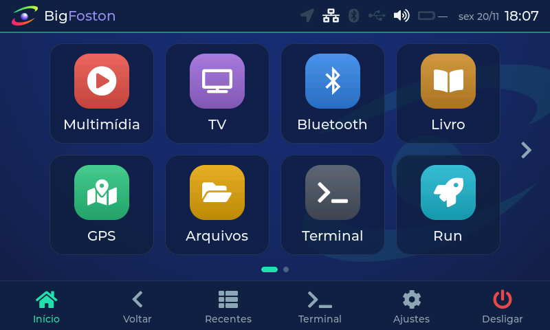

## Telas

| Captura | Tela |
|---|---|
|  | **Início** — grade 4×2 paginada (deslizar ou setas), indicador de página. |
|  | **Início, página 2** — Big Screen, Monitor, Ajustes. |
| 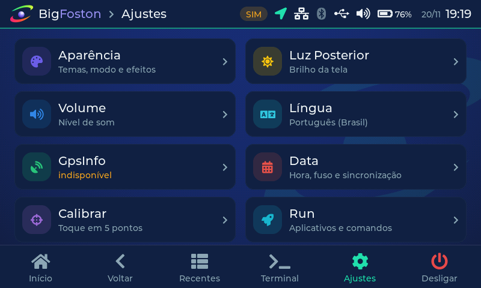 | **Ajustes** — 14 itens em 2 colunas; itens sem driver mostram "indisponível". |
| 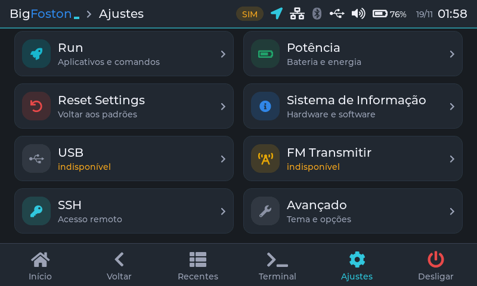 | **Ajustes (fim da lista)**. |
| 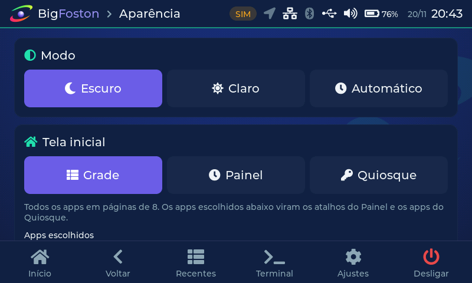 | **Aparência** — modo, temas de cores (amostra com as duas cores), papel de parede. |
| 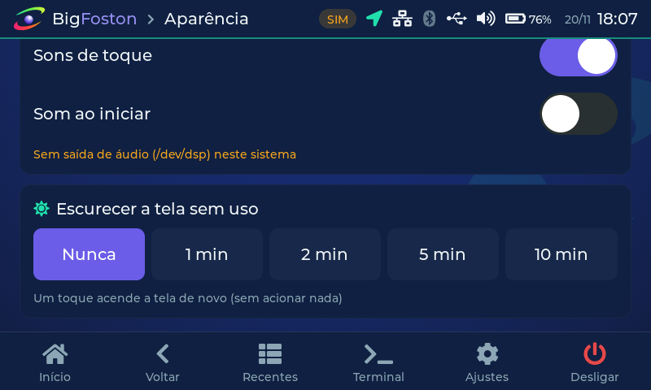 | **Aparência (fim)** — animações, sons, som ao iniciar, escurecer a tela. |
|  | **Sistema de Informação** — "fastfetch" gráfico com dados reais: SO, base, kernel, arquitetura, CPU, RAM, armazenamento, uptime, resolução, IP/MAC, SSH. |
|  | **Monitor** — CPU % (/proc/stat), RAM, carga, processos; gráfico de 2 min, atualizado a cada 2 s. |
|  | **Run** — busca/comando, `sh -c`, favoritar, Executar; abas Apps/Favoritos/Histórico. |
|  | **Run com teclado** — `lv_keyboard` de 296 px de altura (teclas ≈ 64 px). |
| 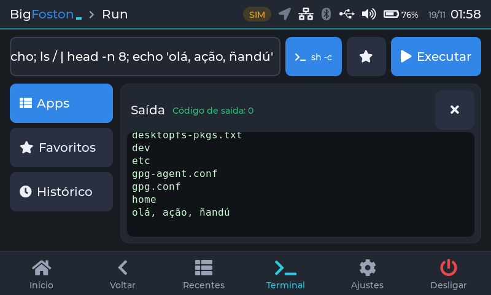 | **Run, saída** — stdout+stderr filtrados (sem escapes ANSI), código de saída colorido, Parar. |
|  | **Calibrar** — introdução. |
| 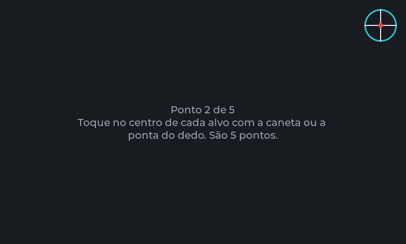 | **Calibrar** — alvo 2 de 5 (média das amostras enquanto pressionado). |
| 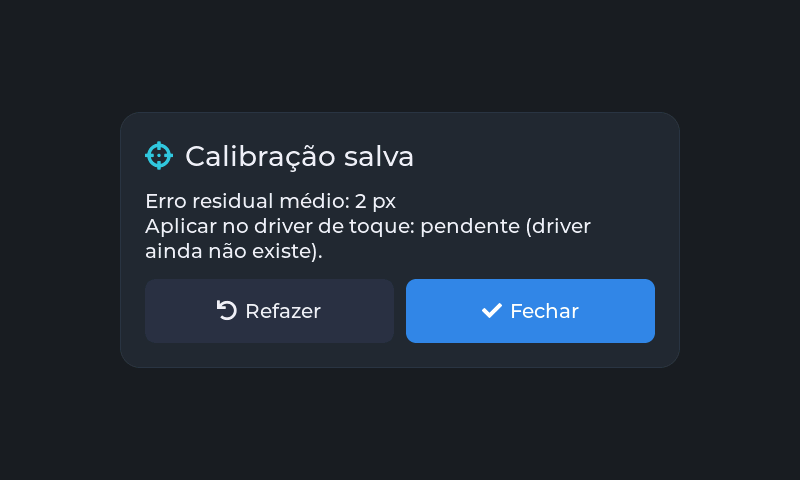 | **Calibrar** — resultado com erro residual; aplicação no driver declarada como pendente. |
|  | **Luz Posterior** (simulador) — slider real com selo de simulação. |
|  | **Luz Posterior** sem `/sys/class/backlight` — estado honesto. |
|  | **Volume**. |
|  | **Língua** — pt-BR, English, Español. |
| 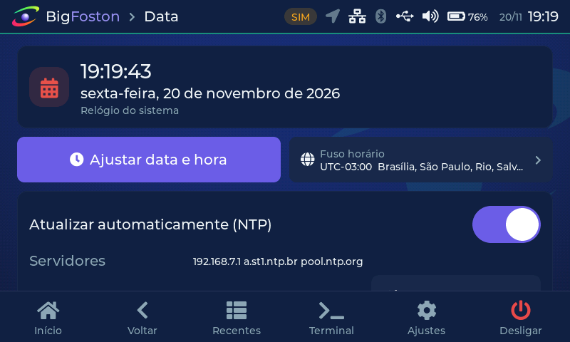 | **Data** — hora atual com a origem (início do sistema, à mão, NTP), atalhos para ajustar e para o fuso, atualização automática. |
| 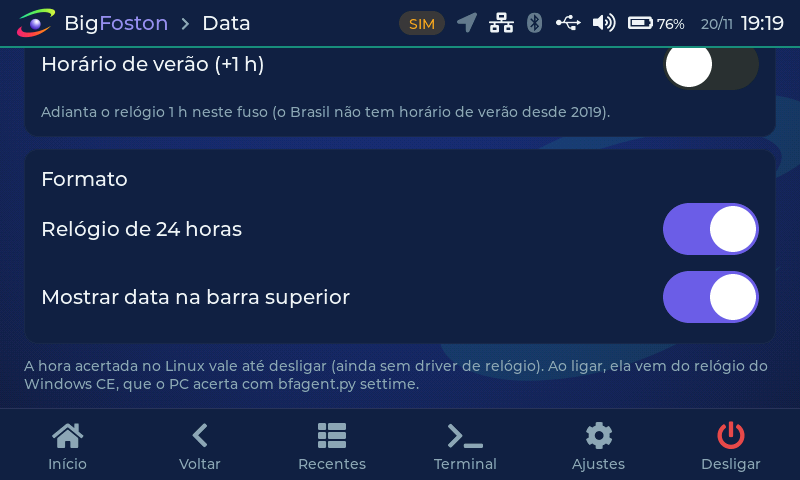 | **Data (fim)** — horário de verão, formato e o aviso de que a hora vale até desligar. |
| 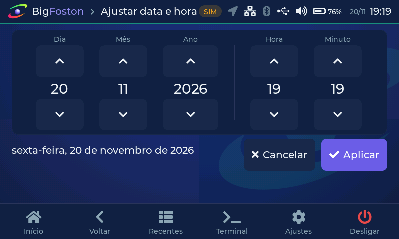 | **Ajustar data e hora** — dia, mês, ano, hora e minuto com ▲/▼ (segurar repete); prévia por extenso. |
| 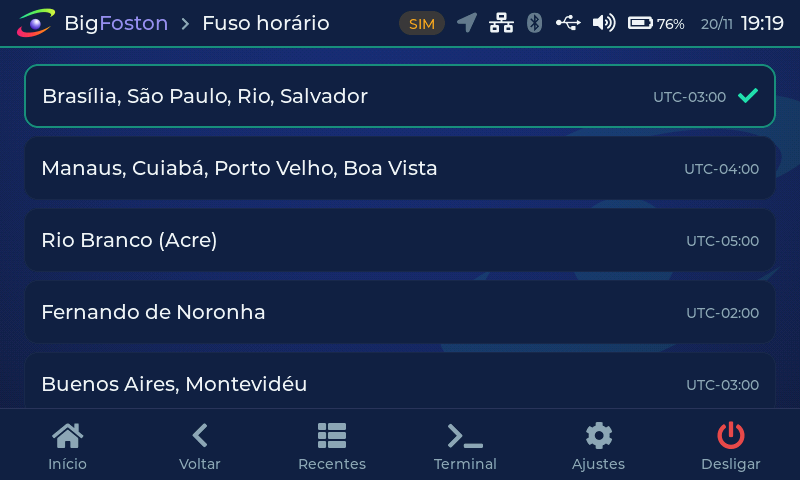 | **Fuso horário** — 20 fusos (4 do Brasil); os com regra de horário de verão têm o selo "verão". |
| 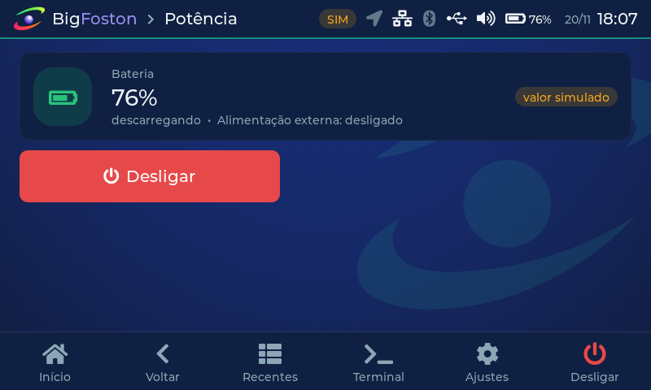 | **Potência** (simulador) — bateria com selo "valor simulado". |
|  | **Potência** sem medidor de bateria — "—" + aviso. |
| 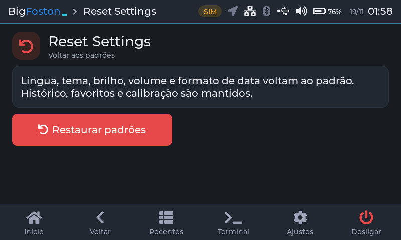 | **Reset Settings** — explica o que muda; confirmação obrigatória. |
|  | **SSH** — estado real da porta 22 e endereço. |
|  | **Avançado** — pasta de dados, fonte de status, pastas de apps. |
| 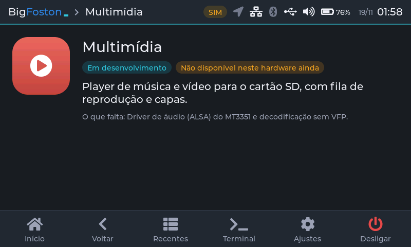 | **Multimídia** — página "em desenvolvimento" + "não disponível neste hardware". |
|  | **FM Transmitir** — chip FM ainda não identificado. |
|  | **Terminal** — em desenvolvimento, com atalho para o Run em modo terminal. |
| 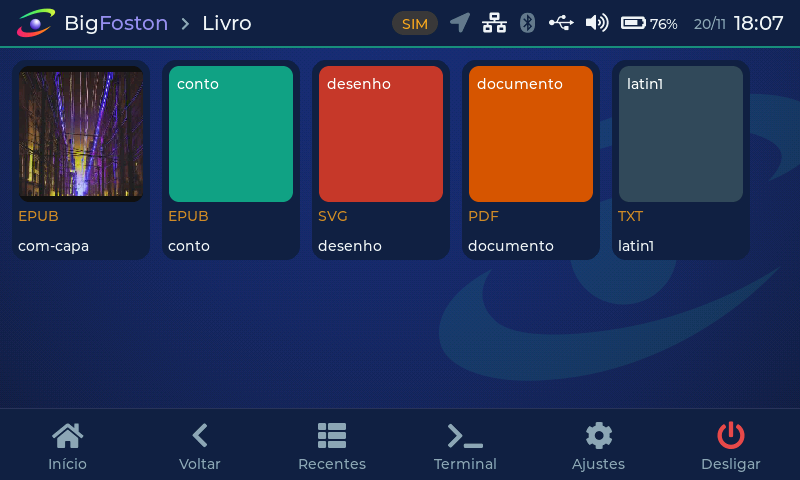 | **Livro** — só software, em desenvolvimento. |
| 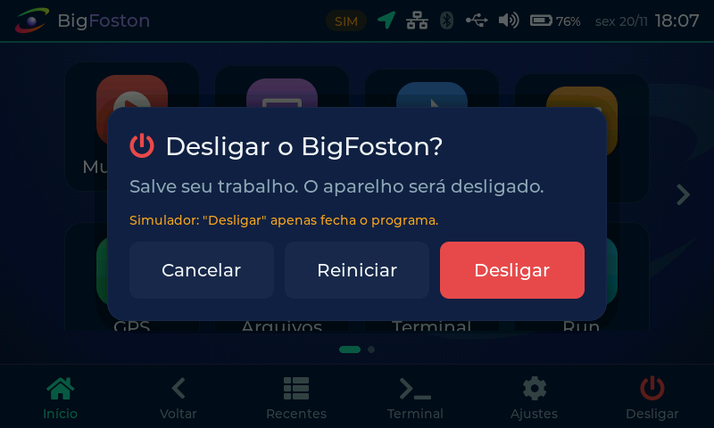 | **Desligar** — diálogo de confirmação. |
| 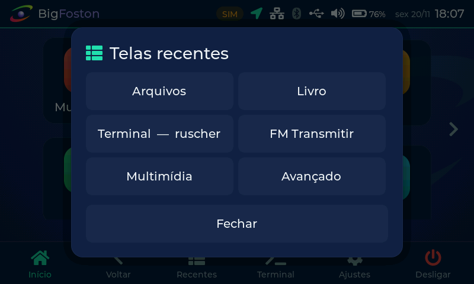 | **Recentes**. |
|  | **Tema claro** — início. |
| 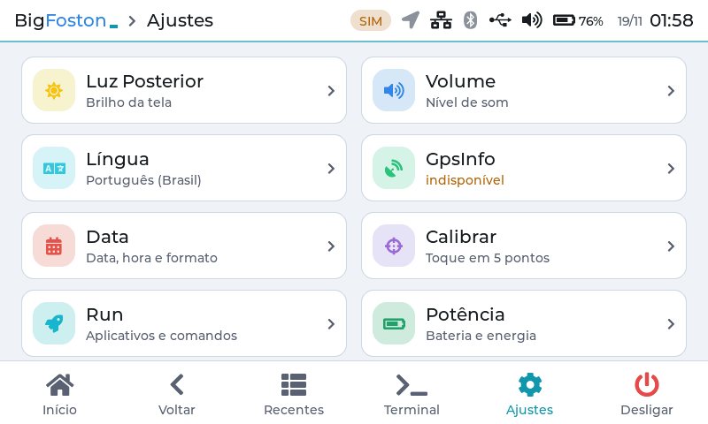 | **Tema claro** — Ajustes. |
| 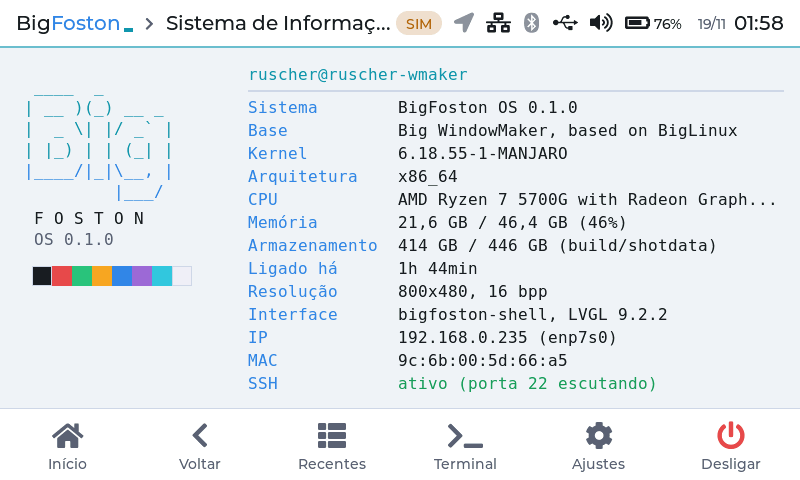 | **Tema claro** — Sistema de Informação. |
| 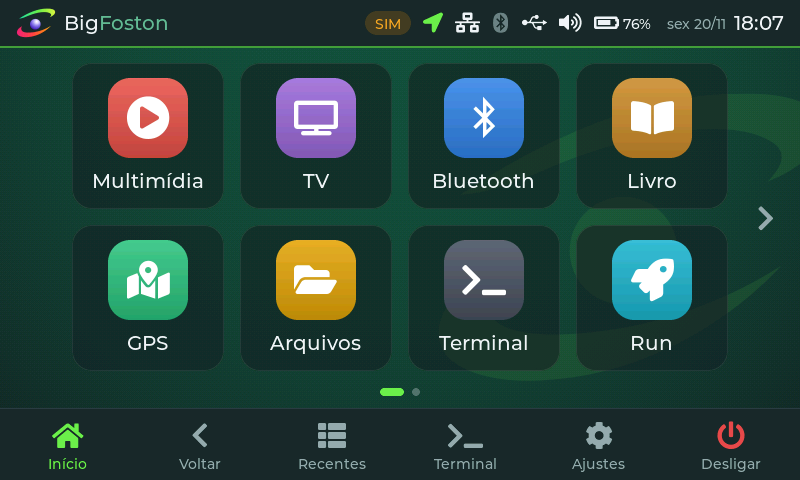 | **Tema Esmeralda** — escuro. |
| 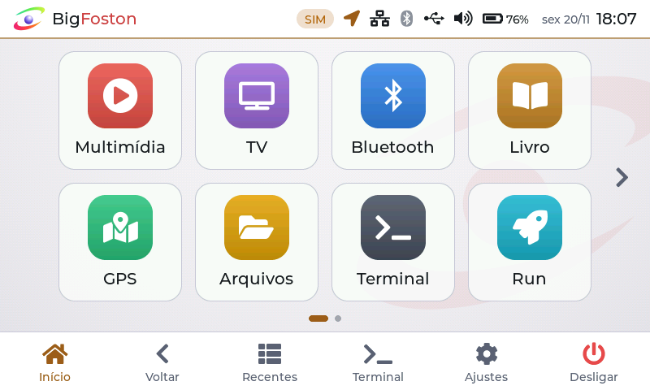 | **Tema Pôr do sol** — claro. |
| 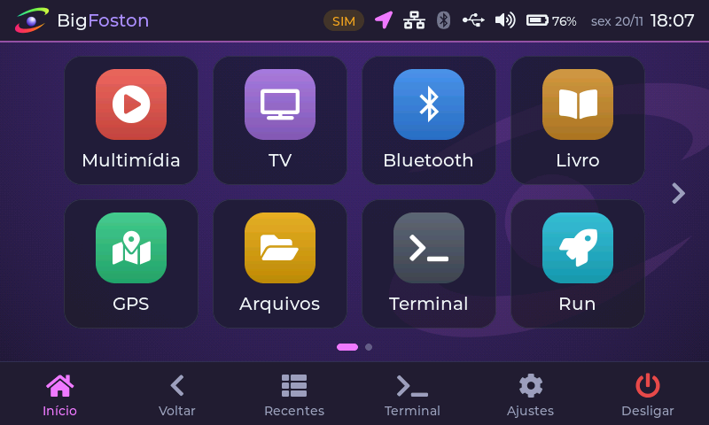 | **Tema Violeta** — escuro. |
| 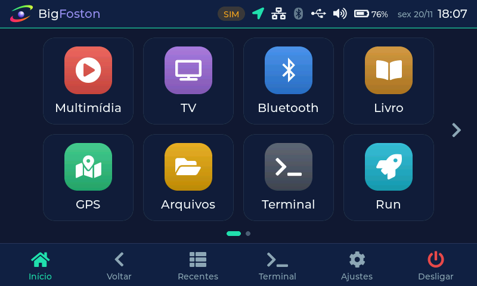 | **Papel de parede liso** (o mais leve). |
|  | **English** — início. |
| 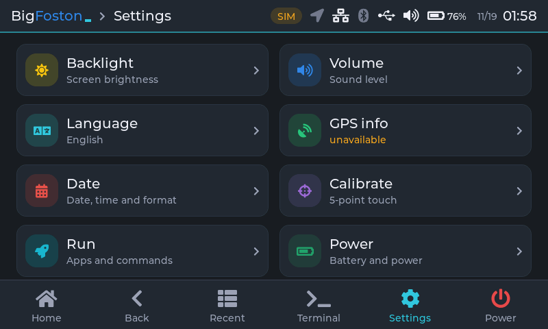 | **English** — Settings. |
| 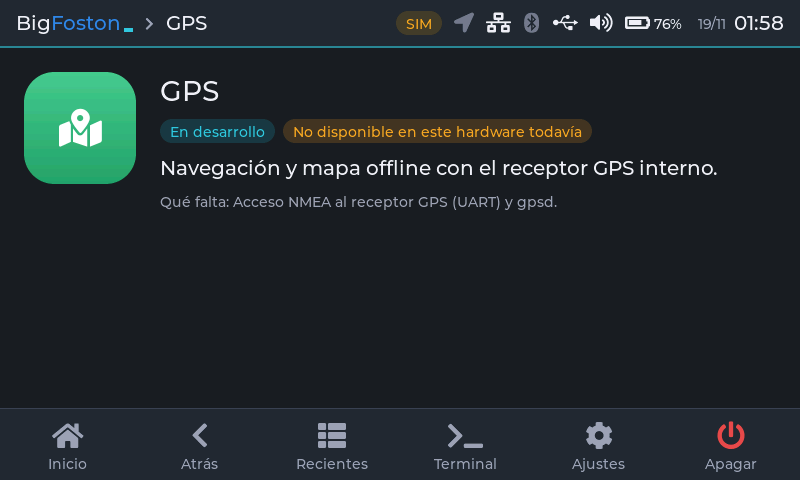 | **Español** — GPS (em desenvolvimento). |
|  | **Español** — Monitor. |

As capturas são geradas sem display por `make -C src/ui screenshots`
(renderização LVGL em memória no mesmo formato RGB565 do aparelho).
Valores de CPU, RAM, kernel, IP etc. nelas são do PC onde foram geradas.

## Aparência (Ajustes > Aparência)

| Opção | Valores | Como funciona |
|---|---|---|
| Modo | Escuro (padrão), Claro, Automático | Automático: claro das 7h às 19h; com o relógio não acertado (antes de 2024) fica escuro. A troca reconstrói a interface sozinha na virada da hora. |
| Tema de cores | FOSTON, Clássico, Esmeralda, Pôr do sol, Violeta, Grafite | tabela acima; reconstrói a interface mantendo a tela e a rolagem |
| Papel de parede | Liso, Degradê, Logotipo (padrão) | `core/wallpaper.c`: degradê radial com pontilhado Bayer 4×4 (sem faixas no RGB565) e o símbolo como marca d'água tingida (A8, 400 px). Calculado uma vez por troca de tema numa imagem RGB565 800×360 (576 KB); redesenhar é cópia. Liso não aloca nada. |
| Animações | ligado (padrão) / desligado | a tela nova entra deslizando 32 px (170 ms); os ícones da Início sobem em sequência (220 ms, 30 ms entre eles); setas da Início com rolagem animada |
| Sons de toque | ligado (padrão) / desligado | `core/fx.c`: PCM 16 bits mono 22050 Hz sintetizado na inicialização (seno inteiro, sem FPU): clique 22 ms em botões, dois tons 70 ms em interruptores. Tocado numa thread em `/dev/dsp` aberto sem bloquear; pulado se o Multimídia estiver tocando ou pausado (ele é dono do dispositivo). |
| Som ao iniciar | desligado (padrão) / ligado | acorde dó-mi-sol-dó, 0,9 s, quando a interface abre |
| Escurecer a tela sem uso | Nunca (padrão), 1, 2, 5, 10 min | luz posterior a 5 %; o toque seguinte só acende a tela (é consumido, não aciona nada). Só aparece com o driver de luz posterior. |

**Persistência:** os ajustes vão para `$BIGFOSTON_DATA/settings.conf`. Com um cartão SD
liberado para gravação (ver [sd-controller.md](sd-controller.md)) a pasta de dados fica
no cartão; sem ele fica na RAM e vale até desligar, e a tela avisa isso
(`data_dir_volatile()`, por `statfs`). A RAM não sobrevive ao desligar: o pstore do
boot anterior volta vazio (testado em 20/11/2026), então não serve de ponte.

## Tela de abertura

O kernel desenha a abertura no console de boot (`mt3351-bootcon.c`, parâmetro
`splash`): o degradê radial do ícone é calculado pelo próprio kernel (inteiros,
pontilhado Bayer 4×4) e por cima vão o logotipo FOSTONOS e a legenda, compactados
em `mt3351-splash.h` (pular / repetir / literais, 37 KB) por
`tools/bigfoston/make_splash.py`. A barra de progresso tem o degradê verde-amarelo
da órbita e pontas arredondadas; os scripts de boot a avançam (5 → 30 → 50 → 70 → 100 %).
As imagens do shell (ícone 72 px, símbolo da barra, marca d'água) saem de
`src/ui/tools/make_logo.py`; ambos rasterizam o SVG com `rsvg-convert`
(`src/ui/tools/logo_svg.py`).

## Data e hora (Ajustes > Data)

`core/clock.c`. O Linux não tem driver de RTC: a hora vem do boot (carimbo do PC
ou do relógio do Windows CE no DTB; `S05clock` marca `/run/bigfoston-clock`),
do ajuste manual (`settimeofday`, só no alvo como root) ou do NTP, e vale até
desligar. Antes de 2024 é "não acertada" e a barra mostra `--:--`.

| Recurso | Como funciona |
|---|---|
| Ajustar data e hora | editor com ▲/▼; aplica no fuso atual (`mktime`) |
| Fuso horário | tabela de TZ POSIX (o rootfs não tem zoneinfo); vale para o shell, os programas que ele abre e as sessões SSH novas (`/etc/profile.d/tz.sh`) |
| Horário de verão | automático nos fusos com regra (Santiago, Nova York, Lisboa, Paris, Sydney…); manual (+1 h) nos demais |
| Atualizar automaticamente | `ntpd -n -q` do BusyBox numa thread, 12 s por servidor, ao abrir e a cada 60 min (10 min após falha); servidores em `ntp_servers` (padrão `192.168.7.1 a.st1.ntp.br pool.ntp.org`) |
| Formato | 24 h e data na barra superior |

**Hora pelo PC:** a rede USB não tem rota para a internet, então o primeiro
servidor é o próprio PC. `tools/bigfoston/sntp_server.py` é um servidor SNTP
mínimo (`sudo python3 tools/bigfoston/sntp_server.py`, porta 123 em
192.168.7.1); com firewall (ufw) é preciso liberar a porta:
`sudo ufw allow from 192.168.7.0/24 to any port 123 proto udp`. Testado no
aparelho em 20/11/2026: de 2025-03-03 para a hora do PC em menos de 14 s.
O GPS não serve de fonte: o MT3328 fala um protocolo binário proprietário
(ver [uart.md](uart.md)).

## Tela de encerramento

Desligar e Reiniciar mostram o logotipo com "Desligando…" / "Reiniciando…"
(`app_bye_screen`, camada do sistema) e o shell deixa o console de texto do
kernel pausado mesmo ao receber o SIGTERM do desligamento, então o log não
aparece. O kernel desliga pelo watchdog (`mt3351-reboot.c`, modos RESTART e
POWER_OFF): neste aparelho esse reset deixa o FOSTON apagado, e reiniciar
também o desliga (a tela avisa).

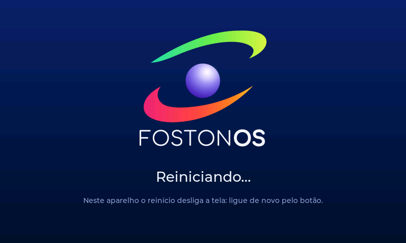

## Regras de honestidade para hardware sem suporte

1. Se o recurso depende de driver que não existe, a página mostra o cartão
   **"Não disponível neste hardware ainda"** e uma linha **"O que falta"** concreta
   (ex.: "Driver SPI do Siano SMS1xxx (ISDB-T)", "HCI via UART do CSR BlueCore").
2. Funções só de software ainda não escritas mostram **"Em desenvolvimento"**, sem
   botões falsos.
3. A detecção é feita em tempo de execução: Luz Posterior vira slider sozinha quando
   aparecer `/sys/class/backlight/*`; Volume, quando houver placa em `/proc/asound`;
   bateria, quando houver `power_supply` do tipo `Battery`.
4. Desconhecido ≠ desligado: ícone a 30 % e "—", nunca um valor padrão.
5. No simulador tudo que é falso tem o selo **SIM** / "valor simulado", e
   "Desligar" avisa que só fecha o programa.
6. Ações que não estão prontas (acertar o relógio, ligar/desligar SSH, aplicar a
   calibração no driver) dizem isso em texto, em vez de fingir que funcionaram.

| Item | Estado hoje |
|---|---|
| Luz Posterior, Volume, Potência | reais se o driver existir; senão aviso |
| Língua, Data (ajuste, fuso, horário de verão, NTP, formato), Aparência, Avançado, Reset, Run, Monitor, Sistema de Informação, SSH (leitura) | funcionam |
| Calibrar | assistente completo; grava `pointercal`; `touch_calibration_apply()` é *stub* |
| GpsInfo, GPS, TV, Bluetooth, FM, USB, Multimídia, Big Screen | não disponível neste hardware ainda |
| Livro, Arquivos, Terminal | em desenvolvimento (só software) |

## Run — segurança

- Sem `sh -c`, o texto é dividido em argumentos (aspas respeitadas) e executado
  direto com `execvp` — sem shell, sem expansão.
- Com `sh -c` (modo terminal), roda `/bin/sh -c`, captura stdout+stderr num painel
  rolável (últimos 6 KB) e mostra o código de saída ou o sinal.
- **Nunca como root implicitamente**: se o shell roda como root, o filho troca
  para `$BIGFOSTON_RUN_USER` (padrão `bigfoston`) e confere que não consegue voltar
  a root; se o usuário não existir, recusa — só `BIGFOSTON_ALLOW_ROOT=1` libera.
- Apps `.desktop` com `Terminal=true` mostram a saída; os demais rodam em
  segundo plano numa nova sessão (sem zumbis). Histórico (50) e favoritos ficam
  em `$BIGFOSTON_DATA/history.txt` e `favorites.txt` (prefixo `$ ` = modo shell).

## Calibração

Cinco alvos (cantos a 50 px da borda + centro), média das amostras enquanto o
toque dura, ajuste afim por mínimos quadrados e erro residual exibido. Salva em
`$BIGFOSTON_DATA/pointercal` no formato do tslib (`a b c d e f s 800 480`).
A aplicação no driver é `touch_calibration_apply()` em `src/ui/core/touch_calib.c`,
hoje um *stub* porque o driver do touchscreen do MT3351 ainda não existe — ponto de
integração previsto: envolver o `read_cb` do `lv_evdev` com a transformação.

## Internacionalização

Textos em `src/ui/core/i18n_strings.def`: `X(ID, "chave.estável", "pt-BR", "en", "es")`.
O código usa `tr(S_ID)`. A chave estável funciona como *msgid*: um arquivo
`$BIGFOSTON_DATA/lang/<pt_BR|en|es>.txt` com linhas `chave = texto` sobrescreve
qualquer texto, preparando o caminho para catálogos estilo gettext.

## Desempenho e memória

- `lv_conf.h`: RGB565, `malloc` da libc (sem pool fixo), buffers parciais de 48 linhas
  (1/10 da tela) duplos no fbdev, sem GPU, só os widgets usados (label, botão, imagem,
  slider, switch, barra, gráfico, textarea, teclado, tileview), sem ponto flutuante na UI.
- Binário stripped (x86-64 `-Os`, gc-sections): ≈ 583 KB. RSS de pico renderizando as
  36 telas sem janela: ≈ 7,1 MB.
- Em repouso: timer de 1 s da barra, leitura do toque a cada 30 ms e refresh do LVGL
  (sem desenho se nada mudou). Monitor (2 s) e Run (100 ms) só criam timers enquanto
  precisam.

## Integração com o firmware

| O quê | Valor |
|---|---|
| Binário | `bigfoston-shell` (`make -C src/ui target CROSS_COMPILE=arm-buildroot-linux-musleabi-`) |
| Framebuffer | `/dev/fb0` (ou `BIGFOSTON_FBDEV`), 800×480 16 bpp |
| Toque | `BIGFOSTON_TOUCH` ou autodetecção do 1º `/dev/input/event*` com `ABS_X/ABS_Y/BTN_TOUCH` |
| Dados | `/data/bigfoston` (ou `BIGFOSTON_DATA`), gravável pelo usuário do shell |
| Apps | `.desktop` em `$BIGFOSTON_DATA/apps` e `/usr/share/bigfoston/apps` |
| Usuário do Run | conta sem privilégios `bigfoston` (ou `BIGFOSTON_RUN_USER`) |
| Desligar | `BIGFOSTON_POWEROFF_CMD` / `BIGFOSTON_REBOOT_CMD` (padrão `/sbin/poweroff`, `/sbin/reboot`) |
| Volume | `amixer` em `/usr/bin` ou `/bin` (controle `Master`) |
