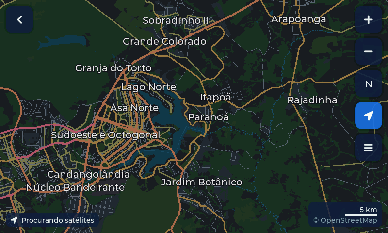
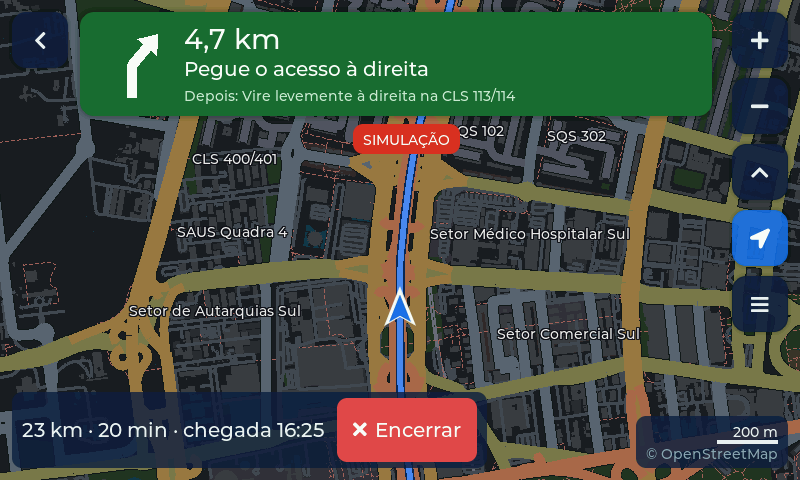
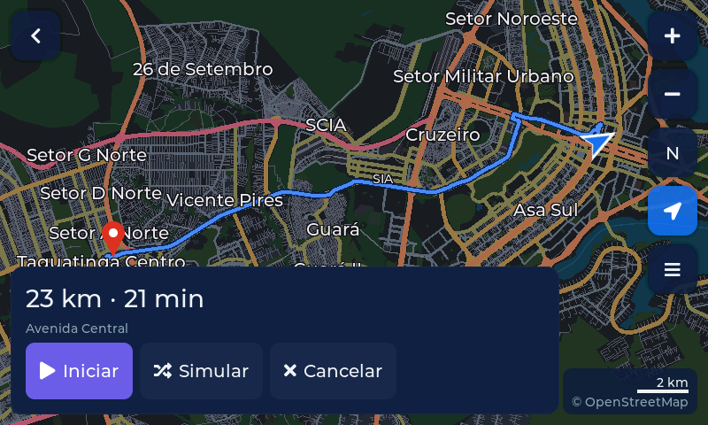

# Big GPS — navegação curva a curva

Código: [src/ui/biggps/bgnav.c](../../src/ui/biggps/bgnav.c) (manobras e acompanhamento),
[src/ui/biggps/bgrouter.c](../../src/ui/biggps/bgrouter.c) (cálculo em segundo plano),
[src/ui/biggps/bgicons.c](../../src/ui/biggps/bgicons.c) (ícones),
[src/ui/screens/scr_map.c](../../src/ui/screens/scr_map.c) (tela).

## Uso

1. Abra **GPS** na Início (mapa em tela cheia).
2. **Toque longo** no ponto de destino → escolha **Carro, Moto, Bicicleta ou A pé** (só os
   modos com arquivo de rotas no cartão ficam ativos).
3. A rota aparece enquadrada com distância e tempo → **Iniciar** (precisa de posição do GPS)
   ou **Simular** (percorre a rota sem GPS; a tela mostra **SIMULAÇÃO** o tempo todo).
4. Durante a navegação: faixa verde com a próxima manobra (ícone, distância, instrução e
   "Depois: …" quando a seguinte vem em menos de 150 m), mapa no sentido da viagem com zoom
   pela velocidade, barra de baixo com distância, tempo e hora de chegada (só com o relógio
   acertado) e **Encerrar**. Ao chegar, encerra sozinho depois de 5 s.

Sem posição do GPS, a rota parte da última posição conhecida (avisado na tela) e só a
simulação fica disponível.

## Manobras

Geradas no cruzamento entre dois arcos da rota, com o ângulo entre o último trecho de um e
o primeiro do outro e as outras saídas do nó:

| Situação | Instrução |
|---|---|
| sem outra saída (curva da via) | nenhuma |
| em frente num cruzamento | nenhuma |
| bifurcação de vias comparáveis (< 25°, alternativa < 40°) | Mantenha-se à direita/esquerda |
| saída para uma alça seguindo na via principal | nenhuma |
| entrada numa alça (`*_link`) | Pegue o acesso à direita/esquerda |
| 25–60° / 60–140° / > 140° | Vire levemente / Vire / Vire acentuadamente |
| > 170°, ou duas à esquerda a menos de 30 m (canteiro central) | Faça o retorno |
| rotatória | Na rotatória, pegue a Nª saída (conta as saídas no sentido de circulação) |
| fim | Você chegou ao destino |

"Mantenha-se" repetido para o mesmo lado a menos de 200 m vira um aviso só. Artigo da via
por heurística ("no Eixo…", "na Avenida…", "pelo/pela").

## Acompanhamento (cada posição)

- Projeção na polilinha da rota numa janela à frente do último trecho (não volta mais de
  3 trechos), com penalidade para trechos no sentido contrário ao rumo do GPS.
- Fora da rota: distância > 40 m (carro/moto), 30 m (bicicleta), 25 m (a pé) em **3
  posições seguidas** → recálculo automático a partir da posição e do rumo atuais (só a via
  no sentido de viagem é aceita como início, para não sugerir retorno no lugar).
- Distâncias pelo comprimento geodésico dos arcos; tempo restante pelos tempos dos arcos
  escalados para o tempo total da rota (inclui custos de conversão).
- Chegada: a menos de 20 m do destino.

## Avisos falados (agendamento)

Para cada manobra, no máximo dois avisos: um antecipado ("Em 300 metros, vire à direita na
…") a 300 m na cidade, 1 km acima de 50 km/h e 2 km acima de 80 km/h; e um imediato a ~6 s
(mínimo 30 m), com "e depois …" quando a seguinte vem logo. Os textos já são os finais; a
síntese de voz é a próxima fase ([docs/big-gps](00-visao-geral.md)) — por enquanto vão para o
registro do shell (`biggps: voz: …`).

## Testes

`bgroute ROTAS.bgr LAT1 LON1 LAT2 LON2 -s` simula o percurso no PC ou no aparelho (uma
posição por segundo, ruído de ±5 m, desvio lateral de 80 m por 8 s a 40 % da rota):

| Teste (DF, carro, Rodoviária → Taguatinga) | Resultado |
|---|---|
| Manobras | 21 (de 41 antes das regras de bifurcação/alça) |
| Desvio de 80 m | "FORA DA ROTA" na 3ª posição fora; volta reconhecida |
| Chegada | detectada a 19,4 m do destino |

No aparelho (`BIGGPS_DEMO=1` abre o mapa, marca o mesmo destino e simula; 2026-11-21):

| Medida | Valor |
|---|---|
| Cálculo da rota (cache frio: encaixe + busca + instruções) | 2368 ms, 23,8 km |
| Quadro da visão geral (z12, 44 151 feições) | 722 ms |
| Quadros navegando (mapa girado, z16) | 125–180 ms (z15,5: até 258 ms) |
| Memória do shell navegando | 12,5 MB (pico) |
| CPU do shell navegando (1 quadro/s) | ~38 % (amostra do `top`) |

**Nada disso foi testado dirigindo ainda.** As rotas não estão aprovadas para uso no
trânsito real.
