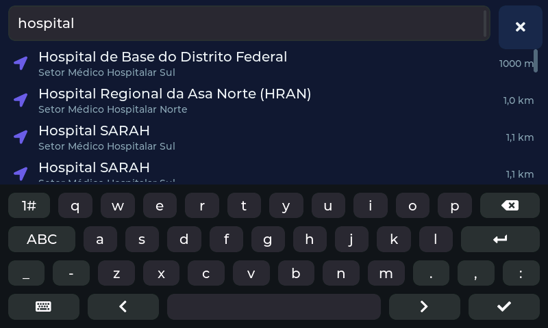

# Big GPS — busca offline

Código: construtor [tools/big-gps/builder/bgsearch-build.cpp](../../tools/big-gps/builder/bgsearch-build.cpp)
(PC, libosmium), formato e normalização [src/ui/biggps/bgsearch_format.h](../../src/ui/biggps/bgsearch_format.h),
consulta [src/ui/biggps/bgsearch.c](../../src/ui/biggps/bgsearch.c), ferramenta
[src/ui/biggps/bgsearch-cli.c](../../src/ui/biggps/bgsearch-cli.c), tela em
[src/ui/screens/scr_map.c](../../src/ui/screens/scr_map.c).

## O que entra no índice

| Tipo | Origem no OSM | Importância |
|---|---|---|
| Lugar | `place=city/town/village/suburb/quarter/neighbourhood/hamlet/locality` com nome | 100 (cidade) … 30 |
| Rua | vias com `highway` e `name`; trechos de mesmo nome no mesmo bairro viram uma entrada (ponto no meio do trecho mais longo) | 75 (rodovia) … 20 (serviço) |
| Local | `amenity`, `shop`, `tourism`, `leisure`, `aeroway=aerodrome`… com nome, em 18 categorias (postos, hospitais, farmácias, mercados, comida, bancos, hotéis…) | 90 (aeroporto), 50 (hospital, shopping), 25 |
| Endereço | `addr:street` + `addr:housenumber` | 10 |

Contexto de cada entrada: bairro mais próximo (até 3 km) ou cidade (até 30 km); endereços
usam `addr:suburb`/`addr:city` quando existem.

## Busca

- Texto normalizado: minúsculas, sem acentos, só letras e números; "de/da/do/e…" ignorados.
- Cada palavra digitada vale como **prefixo** de alguma palavra do nome ou do contexto, em
  qualquer ordem ("hosp base" acha "Hospital de Base do Distrito Federal").
- A palavra com menos ocorrências guia a busca; as outras filtram. Ordem: importância +
  bônus para palavras completas − distância (log) da posição atual (ou do centro do mapa).
- O mesmo lugar mapeado duas vezes (ponto e prédio, a menos de 300 m) aparece uma vez.
- Categorias: os pontos da categoria mais próximos (até 30 km).

## Na tela

Botão da lupa ao lado do Voltar → campo de busca com teclado; com o campo vazio, atalhos de
categoria e os **favoritos**. Tocar num resultado centraliza o mapa e abre a folha de
destino com o nome do lugar; **Salvar** guarda nos favoritos
(`$BIGFOSTON_DATA/biggps-favoritos.txt`, uma linha "lat lon nome").

## Medições (DF, 2026-11-21)

| Medida | Valor |
|---|---|
| Construção no PC | 1–2 s; 33 933 entradas (624 lugares), 9 787 palavras, 114 688 referências |
| Arquivo | 1,9 MB |
| Consulta no PC | 0,1–0,3 ms |
| Consulta no aparelho (cache do sistema limpo) | 22–194 ms ("w3 sul" 22 ms, "padaria" 194 ms) |

Exemplos (perto da Rodoviária): "rodoviaria" → Rodoviária do Plano Piloto (0,1 km);
"hospital" → Hospital de Base (1,0 km), HRAN (1,1 km), SARAH (1,1 km); "aeroporto" →
Aeroporto Internacional de Brasília; categoria postos → 0,6 km, 0,7 km…

## Limitações conhecidas

- Nomes do jeito que estão no OSM: em Brasília "quadra 302 norte" não acha "SQN 302"
  (sinônimos/abreviações ainda não tratados).
- A busca por categoria percorre o índice inteiro: serve para uma região; o índice nacional
  precisa de ordem espacial (fase dos dados do Brasil).
- Sem interpolação de números de casa (só endereços mapeados um a um).
