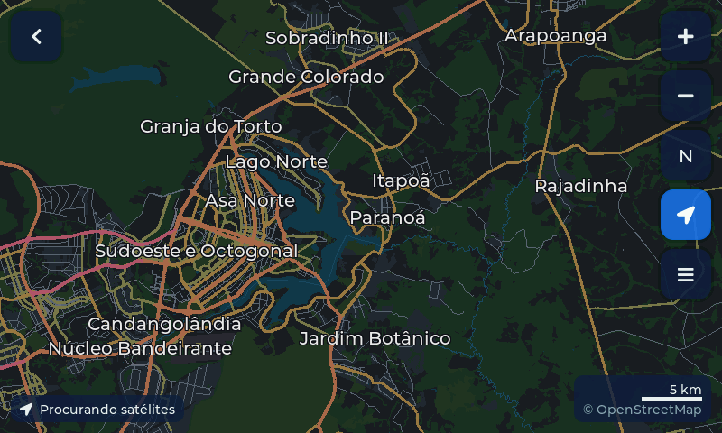
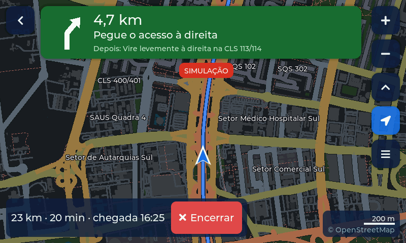
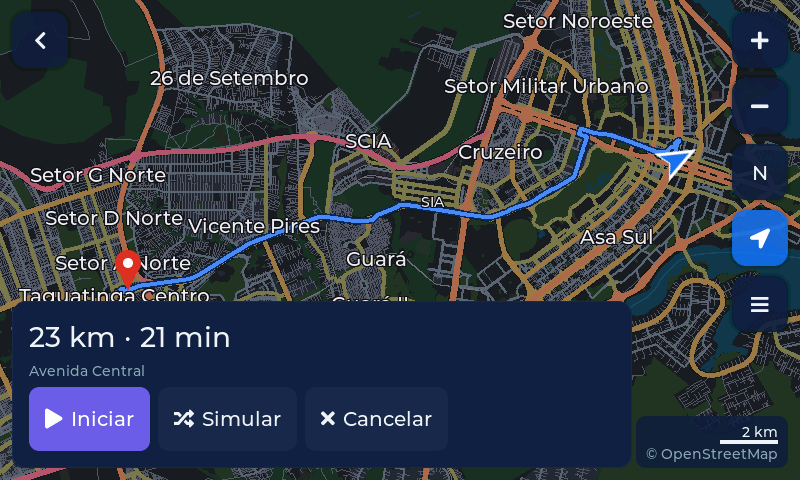
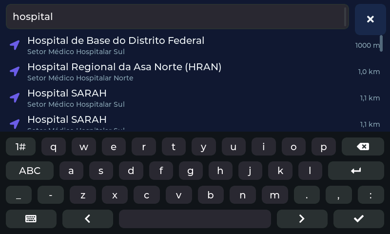

# Big GPS — interface

Tela: [src/ui/screens/scr_map.c](../../src/ui/screens/scr_map.c). Abre pelo app **GPS** da
Início, em tela cheia (800×480), por cima das barras do shell.

## Mapa

| Elemento | Onde | Função |
|---|---|---|
| Voltar | canto superior esquerdo | sai do mapa (guarda a última posição e o zoom) |
| Lupa | ao lado do Voltar | busca ([10-busca.md](10-busca.md)) |
| + / − | coluna da direita | zoom (5 a 19) |
| N / ↑ | coluna da direita | norte para cima ou sentido da viagem |
| Seguir | coluna da direita (azul quando ativo) | centraliza na posição do GPS; arrastar o mapa desliga |
| Satélites | coluna da direita | tela de estado do GPS (céu, sinal, posição) |
| Som | coluna da direita (só com a voz instalada) | liga/desliga a voz das instruções (salvo nos ajustes) |
| Estado do GPS | canto inferior esquerdo | "Procurando satélites", "38 km/h · 9 sat." |
| Escala e atribuição | canto inferior direito | "500 m" e "© OpenStreetMap" (sempre visível, ODbL) |

- **Arrastar** move o mapa na hora (a imagem anterior é deslocada) e pede quadros novos.
- **Toque longo** marca um destino.
- Paleta dia/noite segue o tema do shell (claro, escuro ou automático pelo relógio).
- Nomes de lugares em texto com contorno; nomes de vias ao longo da via (imagens giradas
  montadas com as fontes do shell); nenhum rótulo embaixo dos botões ou do marcador.
- Marcador: seta azul no rumo quando anda (≥ 3 km/h), ponto azul parado, ponto cinza com a
  posição antiga (sem GPS no momento).
- Com o GPS seguindo e o aparelho parado, o mapa só é redesenhado se o centro andar 2 px.

## Destino e rota

Folha de destino (embaixo, à esquerda): nome do lugar (ou "Destino"), **Salvar** (favorito)
e os modos **Carro / Moto / Bicicleta / A pé** (inativos sem arquivo de rotas). Depois do
cálculo: distância e tempo, nome da via de destino, **Iniciar** (precisa de GPS), **Simular**
e **Cancelar**; o mapa enquadra a rota.

## Navegação

Faixa verde no alto (ícone da manobra, distância, instrução e "Depois: …"), barra de baixo
(distância, tempo, hora de chegada e **Encerrar**), selo vermelho **SIMULAÇÃO** quando a
posição é simulada, recálculo automático ("Recalculando rota…"), encerramento sozinho 5 s
depois de chegar. Ver [08-navegacao.md](08-navegacao.md) e [09-voz.md](09-voz.md).

## Busca, favoritos e recentes

Campo com teclado; com o campo vazio: atalhos de categoria (Postos, Hospitais, Farmácias,
Mercados, Comer, Hotéis), **Favoritos** e **Recentes** (os 10 últimos destinos de
navegação). Arquivos na pasta de dados do shell: `biggps-favoritos.txt`,
`biggps-recentes.txt`, `biggps-last` (última posição/zoom).

## Relógio

Sem NTP nas últimas 2 h, a hora UTC do GPS (só com posição) acerta o relógio do sistema
quando difere mais de 2 s (Ajustes > Data: "Acertada pelo GPS às hh:mm").

## Capturas

| | |
|---|---|
|  |  |
|  |  |
