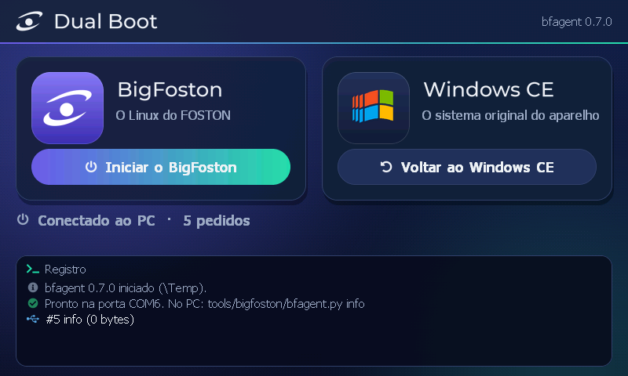
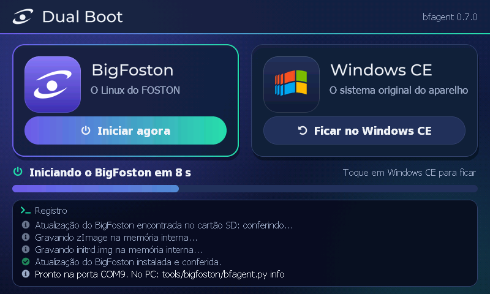
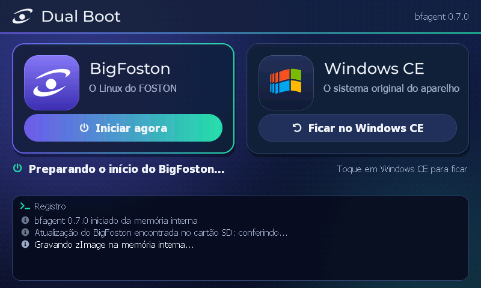
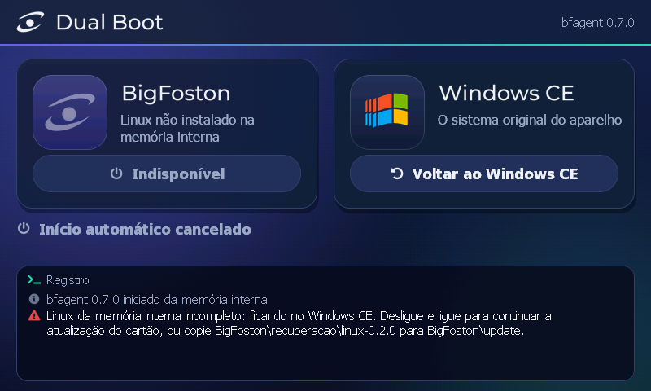

# Dual Boot — a tela de escolha do agente no Windows CE

Ao ligar, o Windows CE do FOSTON abre o agente (`\ResidentFlash\BigFoston\bfagent.exe`). Desde
o **bfagent 0.7.0**, a tela dele se chama **Dual Boot** (antes era "BigFoston • modo
diagnostico") e tem o visual do BigFoston.



## O que tem na tela

- **Barra superior**: o símbolo do BigFoston (versão symbolic), "Dual Boot" na Montserrat e a
  versão do agente.
- **Cartão BigFoston** (símbolo FOSTONOS num quadrado roxo): "Iniciar agora" durante a contagem,
  "Iniciar o BigFoston" fora dela, "Indisponível" sem Linux na memória interna.
- **Cartão Windows CE** (a bandeira clássica): "Ficar no Windows CE" durante a contagem (cancela),
  "Voltar ao Windows CE" fora dela (fecha o agente; substitui o antigo botão Sair).
- **Contagem**: "Iniciando o BigFoston em N s" e uma barra roxo → verde-água que anda a cada
  100 ms. Antes dela, enquanto uma atualização do cartão é conferida e gravada, "Preparando o
  início do BigFoston...". Depois: "Início automático cancelado", "Iniciando o BigFoston...",
  "Conectado ao PC · N pedidos" ou "Pronto na porta COM6 · aguardando o PC".
- **Registro**: as últimas linhas do que o agente fez, como um terminal, com ícone por tipo
  (informação, ok, alerta, erro, pedido do PC). Linhas longas quebram; os pedidos do PC (milhares
  numa cópia) ocupam uma linha só.

O cartão tocado fica destacado enquanto o dedo está nele; soltar fora não faz nada.

| Contagem | Preparando | Cancelado | Sem Linux |
|---|---|---|---|
|  |  |  |  |

## Como é desenhada (`src/wince/agent/ui.c`)

O CE do FOSTON só tem Tahoma e Arial, sem SVG nem anti-aliasing garantido. Então:

- tudo é desenhado num buffer RGB565 próprio (o formato da tela): degradê com pontilhado
  ordenado (sem faixas em 16 bits), brilhos radiais, cantos arredondados suaves, ícones com alfa;
- o fixo vem pronto de `tools/make_art.py` → `art.h`: o símbolo FOSTONOS e ícones Font Awesome
  como máscaras (tingidas na tela), a bandeira em RGBA, os títulos na Montserrat;
- o GDI só escreve o texto que muda (Tahoma) e copia o quadro pronto para a tela de uma vez
  (sem piscar). A base (fundo, cartões) só é refeita quando muda o estado dos botões;
- sem ponto flutuante nem divisão no caminho de cada pixel (o ARM926 não tem FPU nem divisão);
- redesenho limitado a ~12 quadros/s (uma cópia do PC gera milhares de pedidos).

## Compatibilidade com o coredll do aparelho

O CE não abre — e não avisa — um `.exe` que importa uma função que o `coredll.dll` não tem.
`make imports` compara cada importação com as exportações do `coredll.dll` do backup da NAND
(`tools/check_imports.py`). Em relação ao 0.6.2 a única função nova é `KillTimer`; `wcscmp` foi
evitada de propósito (é da CRT do coredll, como o `_vsnwprintf`, que já falhou no aparelho).

## Ver a tela no PC

```
cd src/wince/agent
make preview        # build/preview-shots/*.png (winegcc + a Tahoma da ROM do FOSTON)
```

`preview.c` desenha os estados com o mesmo `ui.c`. Dois cuidados com o wine: rode o script que
o winegcc gera (`./build/preview.exe`), não `wine build/preview.exe` (sai com código 3); e com
a saída redirecionada o wine perde os argumentos — por isso a pasta vai em `BF_PREVIEW_DIR`.

## Testado no FOSTON (25/11/2026)

- 0.7.0 rodando de `\Temp` (sem tocar no instalado): abre, conversa com o PC, tela idêntica à
  prévia (foto acima, tirada pelo `bfagent.py shot`).
- Gravado em `\ResidentFlash\BigFoston\bfagent.exe` com `bfagent.py install-agent` (SHA-256
  conferido). Desligar e ligar: contagem de 12 s e início do BigFoston sozinho.
- Recuperação: `BigFoston\recuperacao\bfagent-0.6.2.exe` e `BigFoston\bfagent-0.5.1.exe` no cartão
  (abrir pelo menu "caminho da navegação" do CE).
