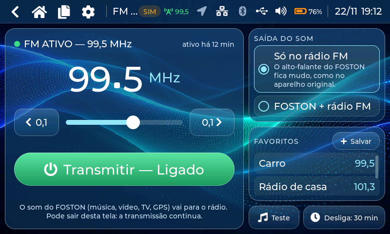
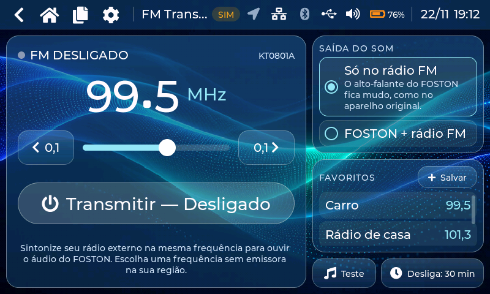
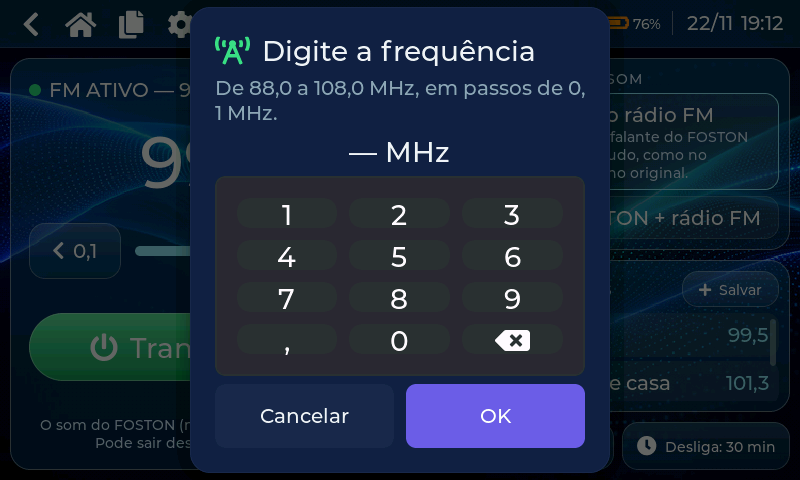
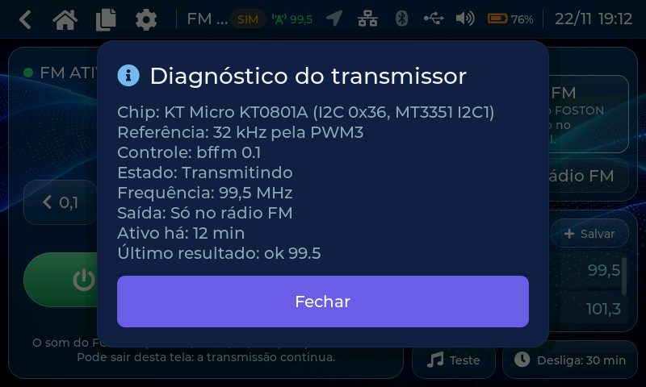

# FM Transmitir: transmissor do FOSTON

O FOSTON FS-707DC tem um **transmissor FM KT Micro KT0801A** que leva o som do aparelho a um
rádio externo (carro, casa) sintonizado na mesma frequência. O BigFoston recuperou o
transmissor com o mesmo controle do Windows CE (`FMC.dll`) e ganhou o app **FM Transmitir**.

**O FOSTON não tem receptor AM/FM** ([08-investigacao-receptor-am-fm.md](08-investigacao-receptor-am-fm.md)):
o app não mostra controles de ouvir rádio.

| Transmitindo | Desligado | Digitar a frequência | Diagnóstico |
|---|---|---|---|
|  |  |  |  |

(Capturas do simulador com estado de demonstração; no aparelho o estado é o do hardware.)

## Estado (22/11/2026)

| Parte | Estado | Evidência |
|---|---|---|
| Chip identificado | **KT0801A**, I²C 0x36 | textos do `FMC.dll` ("KT0801A"); o chip responde no 0x36 e dá PW_OK |
| Clock de referência (32 kHz pela PWM3) | **FUNCIONANDO** | registradores iguais aos do CE (1785/892) |
| Ligar / desligar | **FUNCIONANDO** | `bffm on`: PW_OK = 1 (reg 0x0F bit 4); `bffm off` devolve GPIO4, PWM3 e o clock do I²C ao estado do boot |
| Frequência | **FUNCIONANDO** no chip | 88,1 MHz escrita e **lida de volta** (reg0 = 0x71, reg1 = 0xC3) |
| Áudio no rádio externo | **FUNCIONANDO** | ouvido num rádio a 88,1 MHz: Multimídia, TV, sons do sistema, teste de som ([14](14-testes.md)) |
| "Só no rádio" (alto-falante mudo) | implementado | controle ALSA "Speaker Playback Switch" (GPIO5), como o `waveOutMessage(0x41C)` do CE |
| App FM Transmitir, indicador na barra, temporizador, favoritos, aviso de bateria | implementado e testado na tela | ligar/desligar pelo app no aparelho |
| Receptor AM/FM | **não existe** no hardware | [08](08-investigacao-receptor-am-fm.md) |

## Como usar

1. Abra **FM Transmitir** no dock do Foston Glass (ou Ajustes > FM Transmitir).
2. Escolha a frequência: botões ‹ 0,1 / 0,1 ›, a régua, ou toque no número grande e digite.
   Use uma frequência **sem emissora** na sua região (o FOSTON não consegue procurar canais livres,
   porque não recebe rádio).
3. Toque em **Transmitir**. O botão só fica verde ("Transmitir — Ligado", "FM ATIVO") quando o
   chip confirma a alimentação e a frequência; se não confirmar, o transmissor é desligado e
   aparece "Problema no transmissor".
4. Sintonize o rádio externo na mesma frequência e toque música, vídeo, TV ou GPS no FOSTON.
5. Pode sair do app: a transmissão continua, e a barra de cima mostra o indicador (toque para voltar).

**Saída do som**: *Só no rádio FM* (padrão, como o aparelho original: o alto-falante fica mudo)
ou *FOSTON + rádio FM*. Desligar o FM sempre devolve o alto-falante.

**Teste**: bipes de 440/880 Hz por 8 s (−12 dBFS), para conferir a sintonia do rádio.
**Temporizador**: sem / 15 / 30 / 60 / 120 min (o desligamento programado vale até o shell reiniciar).
**Favoritos**: até 8; toque para sintonizar, segure para subir, renomear ou excluir (o primeiro é
o padrão). Uma frequência salva fora da faixa é avisada e não é usada.
**Diagnóstico**: toque no texto à direita do estado (chip, referência, estado, frequência, saída,
tempo ligado, último resultado).

## Segurança e regulamentação

- Nunca liga sozinho: o `S44bffm` desliga o transmissor no boot e ao desligar o aparelho; o app
  só liga quando o usuário toca em Transmitir; o último estado não é restaurado.
- Mesma potência do aparelho original: o `bffm` escreve só o que o `FMC.dll` escreve (reg0/reg1
  com o RFGAIN e o PGA do CE) e não tem opção de potência ou alcance.
- Faixa: 88,0–108,0 MHz em passos de 0,1 MHz (o chip vai de 76 a 108 MHz; o CE usava passos de
  0,1 MHz). Escolha frequências livres: o transmissor é um equipamento de radiação restrita
  (Anatel) e não deve interferir em emissoras.
- Falha de confirmação (sem PW_OK ou frequência diferente da pedida) desliga tudo.
- Bateria em 10 % ou menos, sem carregador, com o FM ligado: aviso oferecendo desligar.

## Peças

| Peça | Papel |
|---|---|
| `src/fm/bffm.c` | controle do KT0801A pelo `/dev/mem` (I²C1, PWM3, GPIO4) e do alto-falante (ALSA); estado em `/run/bigfoston-fm` |
| `firmware/buildroot/package/bigfoston-fm` | pacote (instala `/usr/sbin/bffm`) |
| `rootfs-overlay/etc/init.d/S44bffm` | desliga o transmissor no boot e no desligamento |
| `src/ui/core/fmstat.c` | estado, comandos em segundo plano, configuração (`fm.conf`), temporizador, bateria |
| `src/ui/screens/scr_fm.c` | o app |
| `src/ui/widgets/topbar.c` | indicador "FM 99,5" |

Por que não um driver V4L2 no kernel: o kernel do BigFoston não tem o subsistema I²C nem um
driver do controlador I²C do MT3351; o transmissor só precisa de 6 transações I²C ao ligar e 3
ao mudar a frequência, sem interrupções nem fluxo de dados. Um programa pequeno em C, no mesmo
modelo do `bftv` e do `bfvoice`, evita um driver de barramento novo no kernel e não deixa nada
rodando (não há laço nem polling: o chip fica ligado sozinho).

`bffm status | on [MHZ] [fm|ambos] | freq MHZ | saida fm|ambos | off | dump | tom [S]`

## Documentos

- [03-engenharia-reversa-fmc.md](03-engenharia-reversa-fmc.md): `FMC.dll`, `buses.dll`, `Gui.dll`, `wavedev_drv.dll`.
- [08-investigacao-receptor-am-fm.md](08-investigacao-receptor-am-fm.md): por que não há recepção.
- [14-testes.md](14-testes.md): o que foi testado e o que falta.
