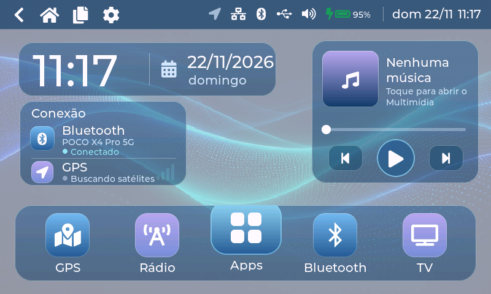
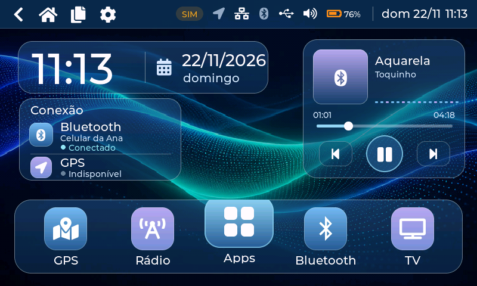

# Foston Glass: a quarta tela inicial

**Ajustes > Aparência > Tela inicial > Foston Glass.** Cartões de vidro azul-lavanda sobre o papel
de parede, com relógio, conexões, música e um dock de aplicativos; a navegação passa para a barra
superior. Os outros modos (Grade, Painel, Quiosque) continuam iguais.

| No aparelho (22/11/2026) | No simulador, com música do celular |
|---|---|
|  |  |

Estado: **FUNCIONANDO NO HARDWARE** (firmware com Bluetooth, 22/11/2026; instalação pela
atualização do cartão).

## Arquitetura

Tudo dentro do shell LVGL existente; nenhum processo ou serviço novo.

| Peça | Papel |
|---|---|
| `core/settings.h` | `BF_HOME_GLASS = 3`, acrescentado no fim (os valores antigos de `home_mode` e os bits de `home_apps` não mudam) |
| `core/theme.c/.h` | `theme_glass()`; `BF_BOTBAR_H` = 0 e `BF_CONTENT_H` = 432 no Glass |
| `core/app.c` | moldura do Glass: papel de parede na tela inteira (atrás da barra superior), sem barra inferior |
| `widgets/topbar.c` | barra de vidro: Voltar, Início, Recentes, Ajustes (área de toque 50x44) e o status real |
| `widgets/glass.c/.h` | paleta, cartões translúcidos, ícones em degradê, barras de sinal |
| `screens/scr_home_glass.c` | relógio, Conexão, player e dock |
| `screens/scr_music.c` | `music_status()`: a fonte ativa da Multimídia (cartão ou celular); `music_service_init()` no início do shell |
| `screens/scr_home.c` | `HOME_ARG_APPS`: a grade com todos os apps (botão Apps) |
| `core/wallpaper.c` | o papel de parede (configuração global) é preparado no tamanho da moldura; o cache guarda a altura |

## Geometria (800x480; conteúdo de y = 48 a 480)

| Peça | Posição no conteúdo |
|---|---|
| Barra superior | y 0-48 (vidro azul-profundo, 70 %) |
| Relógio e data | (30, 21) 420x88 |
| Conexão | (32, 117) 272x138 |
| Player | (508, 18) 272x233 |
| Dock | (24, 287) 752x124; Apps 116x88, 16 px acima do dock |

## Dados reais

- **Relógio:** hora do sistema (24 h ou 12 h conforme Ajustes); sem hora acertada mostra `--:--` e
  "hora não acertada", nunca uma data inventada. Data e dia da semana mudam na virada do dia.
- **Bluetooth:** `bfbt-agent` (`/run/bigfoston-bt`): indisponível, desligado, procurando, nenhum
  aparelho, ou o nome do aparelho conectado (e "mais N" com vários). Sem barras de sinal: não há
  RSSI de uma conexão ativa.
- **GPS:** `bfgps` (`/run/bigfoston-gps`): indisponível, desligado, iniciando, buscando satélites,
  sem sinal; com posição, fraco/moderado/bom/forte pelos satélites usados e pelo HDOP (forte: 8+
  satélites e HDOP até 1,5; bom: 6+ e até 2,5; moderado: 4+).
- **Player:** o da Multimídia (não há outro motor de áudio). Cartão: capa da faixa, espectro real,
  busca na faixa pelo toque. Celular: título, artista, tempo e estado do AVRCP, ícone do
  Bluetooth no lugar da capa (o celular não manda a imagem), sem busca na faixa.
- **Dock:** GPS (Big GPS), Rádio (página honesta: nenhum receptor de rádio identificado no FOSTON),
  Apps (grade com todos os aplicativos), Bluetooth, TV (página de disponibilidade).

## Desempenho (FOSTON, shell compilado pelo Buildroot)

| Shell parado na tela inicial, 20 s | CPU do shell | RSS | CPU livre total |
|---|---|---|---|
| Grade | 7,00 % | 4,2 MB | 81 % |
| Foston Glass | 7,05 % | 3,6 MB | 80 % |

Os timers só trocam textos que mudaram; o espectro (100 ms) só redesenha com música tocando.
Sem desfoque nem sombras: o vidro é transparência simples e degradê vertical.

## Testes

- Simulador (`make screenshots`): 44 (início), 44b (Apps), 44c (Aparência), 44d (Rádio), 44e
  (música do celular).
- Aparelho: início com o POCO X4 conectado e o GPS buscando; toques em Apps, Início e no player
  (abre a Multimídia); boot direto no Glass pelo firmware completo (kexec), Bluetooth reconectado,
  nenhuma falha do shell.

## Limitações

- Barras de sinal do Bluetooth: não mostradas (sem RSSI de uma conexão ativa).
- Rádio e TV: dependem de hardware ainda não suportado.
- O papel de parede da referência (estrada e montanhas) não foi incluído: é preciso um arquivo
  com direito de redistribuição; qualquer imagem pode ser escolhida em Aparência > Papel de parede.
- Voltar para a 0.2.0 (`BigFoston/recuperacao`): ela não conhece o modo 3 e o lê como Quiosque;
  basta escolher a tela inicial de novo em Ajustes.
