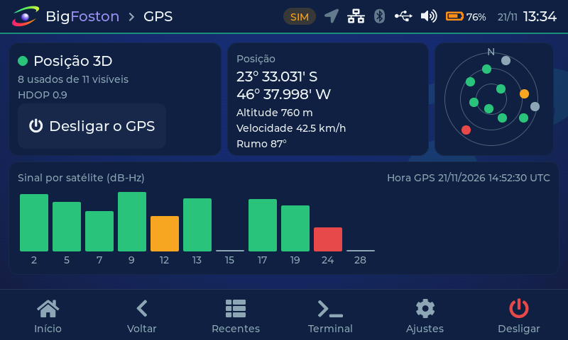

# GPS (MT3328) no BigFoston

Estado: **funcionando no Linux, com posição real** (21/11/2026) — o `gps.dll` do aparelho roda no `bfgps`, inicia no boot (`S60gps`) e a interface mostra estado, satélites, sinal e posição. Posição conferida ao ar livre pelo usuário; de volta dentro de casa o motor seguiu rastreando 12 satélites visíveis (2 com sinal), CPU do `bfgps` ~10 %. Detalhes no fim.

## Como o GPS funciona no aparelho

O MT3328 é *host-based* e **não tem modo autônomo**: não guarda firmware. A cada vez que
o chip liga, o `gps.dll` do Windows CE carrega o firmware do DSP pela UART (embutido no
DLL, 32 774 bytes) e, daí em diante, o chip só fala um protocolo binário de medidas. O
motor de navegação da MediaTek (MNL, `AXN_1.33`) roda na CPU principal, dentro do
`gps.dll`, e é ele que monta o NMEA (`$GPGGA`, `$GPRMC`, `$GPGSA`, `$GPGSV`, `$GPVTG`).
Não existe NMEA fora do `gps.dll`.

| Item | Valor | Fonte |
|---|---|---|
| `gps.dll` | módulo da ROM (XIP região 1), base `0x01DC0000`, 1,35 MB, **sem relocações** (só carrega nesse endereço) | NAND, `cerom.py` |
| Interface | stream driver `COM_*` (é o próprio `COM1:` dos aplicativos); entrega o NMEA por `VCOM_Driver.dll` / `VCOM_Driver2.dll` (buffer em memória compartilhada); `GPS2.dll` = `COM9:` | exportações, registro `Drivers\BuiltIn\GPS` |
| UART | `COM2:` do CE = UART1 `0x80026000` = **ttyS0** no Linux; início a 38 400, depois **921 600** baud, sem RTS/CTS, TCXO 26 MHz | estrutura de configuração em `0x01ECC0A0` |
| Reset | **GPIO 64** (DIR `0x80002020` b0, OUT `0x80002320` b0): pulso 1→0→1 (10 ms), espera 100 ms, até 3 tentativas | `IOCTL_HAL_GET_GPS_HW_PIN` do OAL; `0x1DF8D3C` |
| Standby | **GPIO 63** (DIR `0x80002010` b31, OUT `0x80002310` b31) | idem |
| Alimentação | PMU **`0x8006136C` bit 0** (`BusIoControl` recurso 3) | `bus.dll` |
| Arquivos | `\ResidentFlash\mtkgps.dat` (NV), `BEE.BIN`, `ARC.BIN` (assistência), `\Program Files\BEE_CE\*` | strings; partição 3 da NAND |
| Código | 1 160 funções, todas ARM 32 bits; sem chamadas de sistema do CE, sem SEH, **sem VFP** (ponto flutuante em software: `__muld`, `__addd`… pela tabela de imports) | pdata, desmontagem |
| Imports | 142 (coredll por ordinal + 2 do CEDDK): threads/eventos/filas de mensagens, arquivos, serial, registro, tempo (inclui `SetSystemTime`), `KernelIoControl`, `DeviceIoControl` (`GIO1:`) | tabela de imports |

GPIO/PMU lidos no Linux logo após o CE (21/11/2026, só leitura): GPIO 64 e 63 como saída,
ambos em 1; PMU `0x8006136C` = `0x1`. O CE deixa o chip ligado, com o DSP carregado.

## Caminho escolhido

Carregar o `gps.dll` **do próprio aparelho** num processo Linux, com uma camada que imita
as funções do CE que ele importa (um "Wine" mínimo para este DLL):

- mapear o código em `0x01DC1000` e os dados em `0x01EC9000` (`MAP_FIXED`), copiar os
  dados iniciais e preencher a tabela de imports com as funções da camada;
- `COM2:` → `/dev/ttyS0`; `GIO1:` → GPIO 63/64; recurso 3 → PMU `0x8006136C`;
  `\ResidentFlash\` → pasta de dados no cartão SD;
- a saída NMEA (`VCOM_Driver`) vai para um pseudo-terminal lido pela interface (e por
  `gpsd`, se um dia for preciso).

O DLL não é redistribuído: é extraído da memória interna do próprio aparelho na
instalação. Descartados: modo NMEA do chip (não existe) e reimplementar o motor (meses).

Cuidados de ABI: `printf` do CE recebe doubles sem alinhamento de 8 bytes (precisa de um
`printf` próprio); pilha alinhada em 4 bytes; código ARMv4 (`mov pc`), camada com `-marm`;
`__rt_sdiv(divisor, dividendo)`; `wchar_t` de 16 bits.

## Marcos (cada um conferível no aparelho)

| # | Marco | Teste | Estimativa |
|---|---|---|---|
| M0 | UART sem perdas (hoje 126 estouros em 4 s a 921 600: FIFO de 16 bytes) | zero estouros em 10 min; alternativa: baixar a velocidade do link (o motor aceita 115 200…921 600) | 1–2 semanas |
| M1 | carregador: mapear, imports que registram cada chamada, `COM_Init` | log até `GPS_HWInit: GPS_Reset=64; GPS_Standby=63` | 3–5 dias |
| M2 | núcleo da camada: threads, eventos, filas, registro, arquivos, tempo, ponto flutuante, `printf` | o motor inicia sem chamadas pendentes | 1–2 semanas |
| M3 | hardware: ttyS0, GPIO, PMU | `MT3328 Init Success` com o DSP carregado pelo Linux | ~1 semana |
| M4 | saída NMEA num pseudo-terminal; tela GPS da interface | `$GPRMC`/`$GPGSV` com satélites; primeira posição ao ar livre | 3–5 dias |
| M5 | robustez: guardar NV/BEE, religar o chip, consumo de CPU, `SetSystemTime` | horas de uso sem falha | ~1 semana |

Ferramentas e saídas da análise (desmontagem, imports, strings) ficaram em
`scratchpad/re-gps/` da sessão de 21/11/2026; os endereços acima permitem refazer.

## Andamento (21/11/2026)

**M1/M2 (sem hardware):** `src/gps/bfgps` carrega o `gps.dll` (imagem BFX1 feita por
`tools/bigfoston/gps-extract.py` do backup da NAND, guardada só no cartão do próprio
aparelho), resolve os 140 imports e roda o motor: `GPS_HWInit: GPS_Reset=64;
GPS_Standby=63`, tabela `GIO1:`, threads, filas, registro, VCOM e o boot do DSP em
38400/921600.

**No Windows CE o GPS funciona:** `src/wince/gpsopen` (abre `COM1:` e grava o NMEA no
cartão) recebeu 36 928 bytes de `$GPGGA/$GPGSA/$GPGSV/$GPRMC/$GPVTG` em 150 s (dentro de
casa, partida a frio: 0 satélites).

**M3 no Linux (`bfgps --hw -s`): o chip não responde.** O `gps.dll` manda, a cada tentativa,
pacotes binários `04 24 … 0d 0a` em 38400 e em 921600 depois do reset (GPIO 64) e só chega
um `00` (o *break* do próprio reset); nunca há resposta, então o firmware do DSP nunca é
enviado.

| Hipótese | Resultado |
|---|---|
| UART em modo 16x com `RATE_FIX`=1 deixado pelo CE | corrigido: o `8250_mt3351` programa como o `uart.dll` (HIGHSPEED 3, amostras, `RATE_FIX`); continua sem resposta |
| ordem reset/standby | conferida no OAL (`nk.exe` 0x8C04A0D0): `{64, 63}` |
| RTS/DTR | aplicados como o DCB do `gps.dll` (DTR 0, RTS 1); sem mudança |
| pinmux da UART1 (`uart.dll`) | o `uart.dll` não mexe em pinos; `0x80001000–0x80001703` (pinmux e clocks) iguais no CE e no Linux |
| alimentação (PMU `0x8006136C`) | igual; o `gps.dll` desliga e religa no mesmo milissegundo (sem efeito real) |
| GPIO 30/33 saída no CE, entrada no Linux; bloco `0x800027x0` | diferença real, mas o `gps.dll` não usa esses pinos; continuam assim no CE com o GPS parado — provavelmente outro driver |

**Avanço (mesmo dia):** a causa era a **perda de bytes na recepção** (FIFO com gatilho de
8 bytes: 202 *overruns* em ~500 bytes a 921 600). Com gatilho de 1 byte o boot do DSP
funciona no Linux: `mtk_gps_init success in 1 time`, versão `$PMTK705,AXN_1.33,0914,
MNL_VER_10061801335101`, 33 KB enviados (firmware do DSP), medidas recebidas sem perda e o
motor escreve `$PMTK010,001*2E` no VCOM. **Falta o NMEA de 1 Hz**: depois da partida o motor
não emite mais nada (CPU ~5 %, quase só `Sleep` e mutexes), mesmo com o registro igual ao do
CE (`NMEALog`, `FileLogSerial`, `WriteFileLogAsCOMOpen` = 1) e o `mtkgps.dat` original.
Corrigidos na camada pelo caminho: `PulseEvent` (o pulso não liberava quem esperava) e logs
do driver sem buffer.

**NMEA de 1 Hz no Linux (mesmo dia).** A análise do `gps.dll` mostrou que o ritmo vem dos
quadros de medida do DSP: a thread da serial (0x1DF8414) envia uma mensagem por quadro e o
`mtk_gps_run` (0x1DFF3C8) espera numa fila (`ReadMsgQueue` infinito); o *callback* do motor
(0x1DF85E8, tipo 0) monta as frases (0x1DF77C0) e escreve no VCOM (0x1DF76D8). Os dois lados
dessa fila são criados com o nome `L""` (0x1DF8890/0x1DF88B4) e a camada só juntava filas com
nome não vazio: eram duas filas separadas e o motor esperava para sempre. Corrigido, junto
com: `WriteMsgQueue` que espera com a fila cheia; VCOM nas duas direções (handle 1 = o
driver; handles de aplicativo < 0x7530, como o `COM_Read` do `gps.dll` exige); `COM_Open`
só depois de `MTK_GPS_INITIALIZATION_SUCCESS_EVENT`; VCOM2 descartado.

Resultado no aparelho: `$GPGGA/$GPGSA/$GPGSV/$GPRMC/$GPVTG` a cada segundo (20 de cada em
20 s), lidos por `COM_Read` como um aplicativo, CPU baixa (carga 0,10). Dentro de casa, 0
satélites — o mesmo que o CE mostrou no mesmo lugar.

**Teste anterior (já feito):** provar se a transmissão do Linux chega ao chip — com o GPS ligado pelo
CE (`gpsopen`), iniciar o Linux, ouvir a 921600 (o DSP carregado transmite medidas) e
enviar um dos pacotes do `gps.dll` ao DSP em execução, sem reset.

## Serviço e tela (21/11/2026)

| Peça | O que faz |
|---|---|
| `/usr/bin/bfgps` (pacote `bigfoston-gps`) | `--hw -q -t 0 -d /mnt/sd/BigFoston/gps --status /run/bigfoston-gps --pty /run/gps-nmea` |
| `/etc/init.d/S60gps` | inicia depois do cartão se `BigFoston/gps/gps.bfx` existir e `/data/bigfoston/gps-off` não; reinicia se cair; `stop` encerra e limpa |
| `/run/bigfoston-gps` | estado a cada segundo (chave=valor): hora/data UTC, válido, modo 2D/3D, lat/lon, altitude, velocidade, rumo, HDOP, usados/visíveis e cada satélite (PRN, elevação, azimute, sinal) |
| `/run/gps-nmea` | NMEA cru num pseudo-terminal (para gpsd ou testes; descarta se ninguém lê) |
| Tela GPS (app GPS e Ajustes > GpsInfo) | estado, satélites, HDOP, posição, altitude, velocidade, rumo, hora GPS (só com posição), mapa do céu, sinal por satélite, ligar/desligar |

Arquivos do aparelho no cartão (copiados do próprio aparelho, não distribuídos): `gps.bfx`
(`tools/bigfoston/gps-extract.py`), e em `gps/root/ResidentFlash/` o `mtkgps.dat`, `BEE.BIN`
e `ARC.BIN` da partição 3 da NAND.

Conferido no aparelho: o serviço sobe sozinho (motor iniciado aos 8 s de boot), a tela mostra
"Procurando satélites" dentro de casa, `S60gps stop/start` desliga e religa sem sobras.

