# Grupos de apps — interação e visual

Tela 800×480, toque resistivo de **um ponto**, sem multitoque. Tudo funciona com um dedo,
com o mouse no simulador e com o cursor do controle de jogo; o teclado físico digita nas
janelas de nome e Esc fecha os menus.

## Toque e toque longo (`widgets/hold.c`)

| Gesto | Resultado |
|---|---|
| toque rápido (até 0,7 s) | abre o app ou a pasta |
| dedo parado 0,25 s | aparece o anel de progresso em volta do ícone |
| dedo parado 2 s | abre o menu; o ícone fica com borda de destaque; soltar não abre o app |
| soltar entre 0,7 s e 2 s | desiste (nem abre nem menu): o anel já mostrava que era um toque longo |
| mexer o dedo mais de 18 px ou rolar a página | cancela o toque longo (deslizar troca a página normalmente) |

Por que 18 px: o toque calibrado do aparelho usa limite de rolagem de 16 px e o resistivo
treme alguns pixels parado. Por que 0,7 s: um toque normal no resistivo dura bem menos que
isso; acima disso o usuário já está vendo o anel.

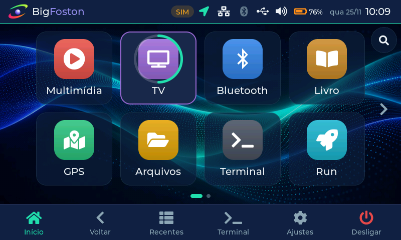

## Menu do app

Título com o nome do app e onde ele está ("Na tela Apps" / "No grupo X"). Opções:

- **Abrir**
- **Criar novo grupo** — o app vai junto para o grupo novo
- **Enviar para o grupo** — lista dos grupos
- **Mover aplicativo** — modo mover (abaixo)
- dentro de um grupo: **Remover do grupo** e **Renomear grupo**
- pacote `.bfapp`: **Desinstalar** (vermelho); WebApp: **Remover WebApp** (vermelho)

O menu abre ao lado do ícone (à direita; sem espaço, à esquerda) e é empurrado para dentro da
tela; com muitas linhas a lista rola. Toque fora, o botão Voltar (fica sob o fundo escuro, o
toque nele fecha o menu), Esc ou o botão B do controle fecham.

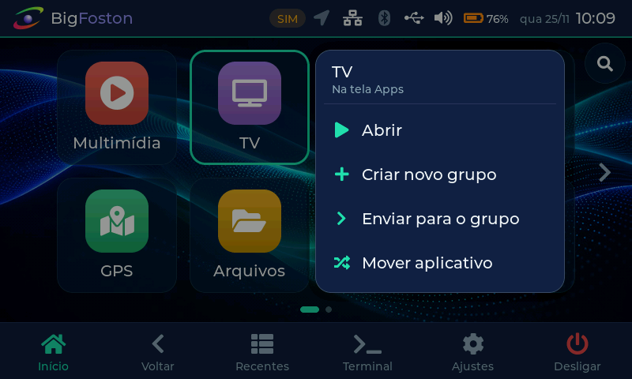
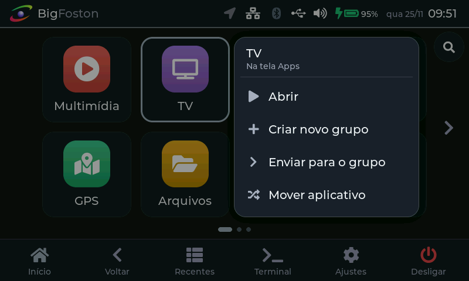

## Menu da pasta

Segurar uma pasta por 2 s: **Abrir grupo, Renomear grupo, Cor e ícone, Mover pasta,
Ordenar por nome, Excluir grupo**. Dentro do grupo, o mesmo menu vem do botão **Opções** no
cabeçalho (sem "Abrir" e "Mover pasta").

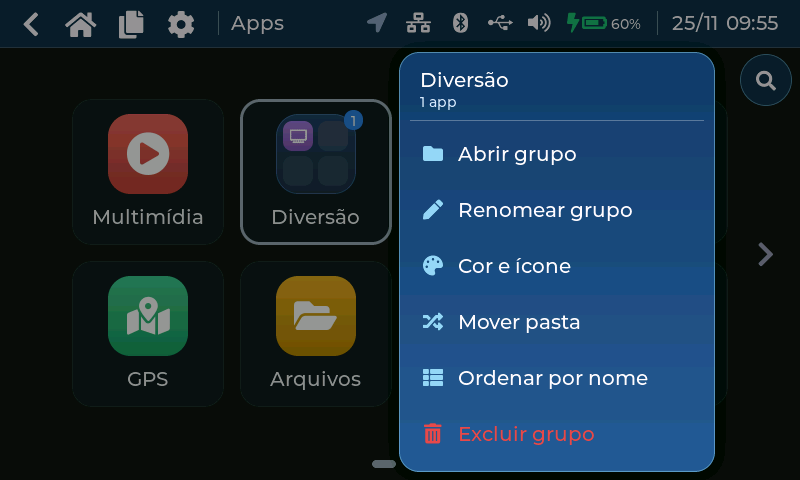

## Criar e renomear (`widgets/namebox.c`)

Janela no alto com o campo, Cancelar e Criar grupo (Salvar ao renomear), e o teclado pt-BR
embaixo (tecla **áã** para os acentos; ç direto). O campo para em 24 letras. Erros aparecem
em vermelho embaixo do campo e a janela continua aberta para corrigir:

- vazio (ou só espaços): "Digite um nome para o grupo."
- repetido: "Já existe um grupo com esse nome." (sem diferença de maiúsculas: "jogos" = Jogos)
- 48 grupos: "Limite de 48 grupos atingido. Exclua um grupo antes."
- cartão sem gravar: "Não foi possível salvar no cartão. Nada foi alterado."

Enter do teclado físico confirma; Esc cancela.

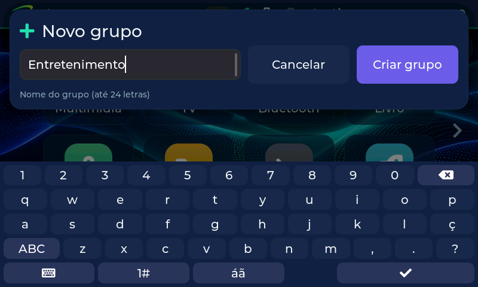
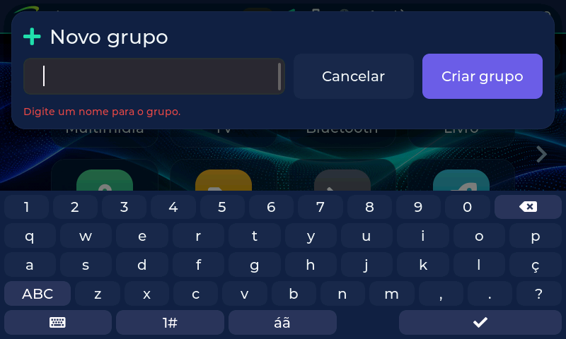
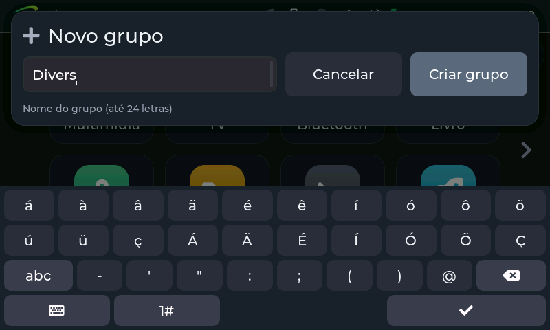

## Enviar para o grupo

Lista centralizada: cada grupo com o ícone na cor dele e quantos apps tem; o grupo atual tem
um ✓. Dentro de um grupo aparece também "Nenhum (tela Apps)". No fim, "Criar novo grupo" e
"Cancelar". Sem grupos, o subtítulo diz "Você ainda não tem grupos. Crie o primeiro:".
Escolher o grupo em que o app já está só avisa "Já está em X".

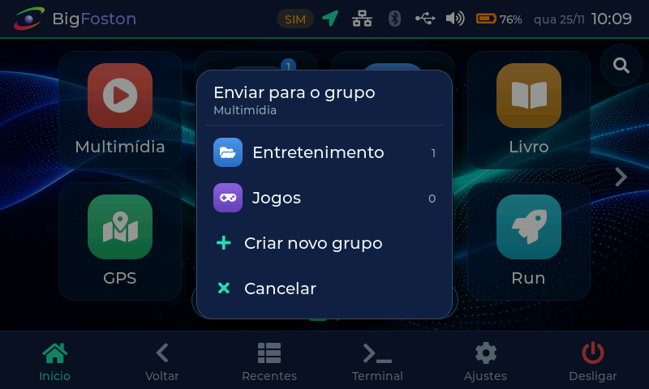

## Modo mover (no lugar do arrastar)

Arrastar ícones no toque resistivo de um ponto, numa grade paginada que já usa o deslizar
para trocar de página e o dedo parado para o menu, gera conflito e erros. Em vez disso:

1. Menu > **Mover aplicativo** (ou **Mover pasta**).
2. Uma faixa no rodapé diz "X: toque no novo lugar ou numa pasta", com **No fim** e
   **Cancelar**; o item em movimento fica destacado.
3. Tocar num ícone põe o item **antes** dele. Tocar numa **pasta** põe o app **dentro** dela
   (o "arrastar para dentro do grupo"). Tocar no próprio item cancela. As páginas continuam
   passando com o dedo ou as setas.

Dentro de um grupo o mesmo modo reordena os apps do grupo. Tirar do grupo é "Remover do
grupo" (o app vai para logo depois da pasta). Isso cobre todas as operações do arrastar:
reordenar apps, reordenar pastas, pôr num grupo e tirar de um grupo.

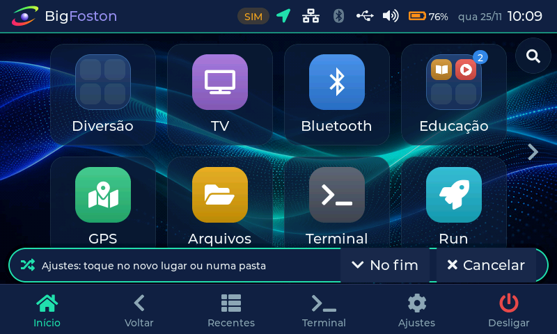

## Visual dos grupos

Pasta = o tile da grade com um quadrado de vidro na cor do grupo, até 4 miniaturas dos apps
de dentro, selo com quantos apps (sem selo quando vazia) e o nome. Os temas mudam a pele, não
a estrutura:

- **Grade / Apps**: cartões nas cores do tema de cores escolhido (claro ou escuro).
- **Foston Glass**: menus, janelas e a faixa do modo mover em vidro azul (as cores fixas do
  Glass), sobre o papel de parede.
- **Painel**: o ícone Apps no canto direito da fileira de atalhos, com o quadrado 2×2 na cor
  de destaque e borda de destaque, para não se confundir com um atalho. Os seis atalhos
  ficaram com 102 px de largura (antes 118) para caber Apps sem apertar os cartões de cima.

**Cor e ícone**: 8 cores e 16 ícones do sistema. Grupos de categoria começam com a cor e o
ícone da categoria; grupos do usuário, azul com a pasta.

Confirmações discretas: uma pílula no rodapé com o ícone do grupo ("Enviado para Util ·
Multimídia") que some em 2 s e não pega toques.

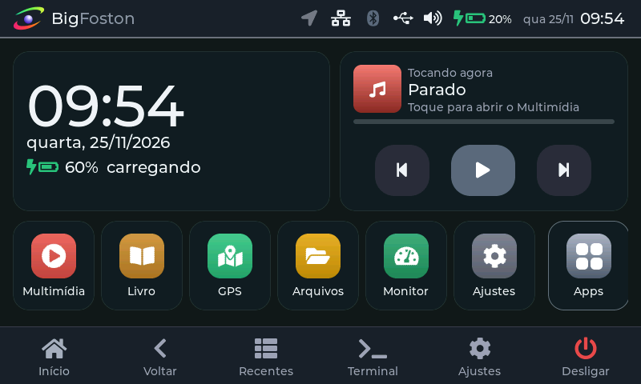
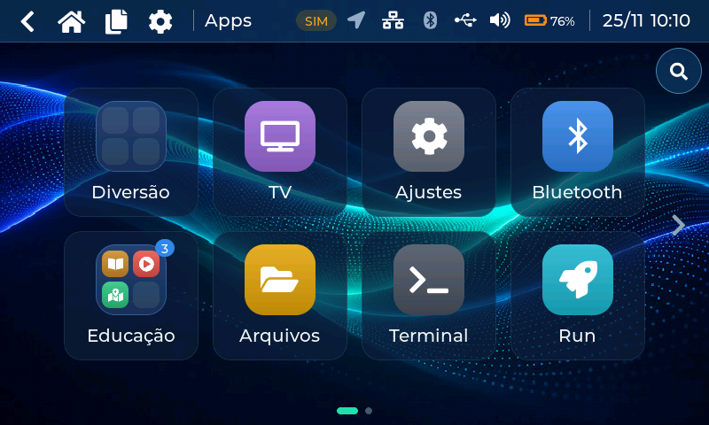
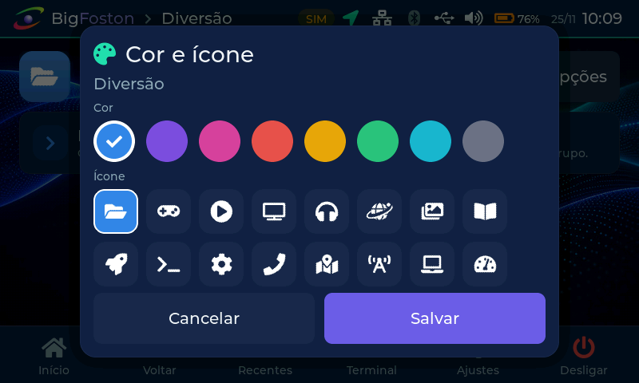
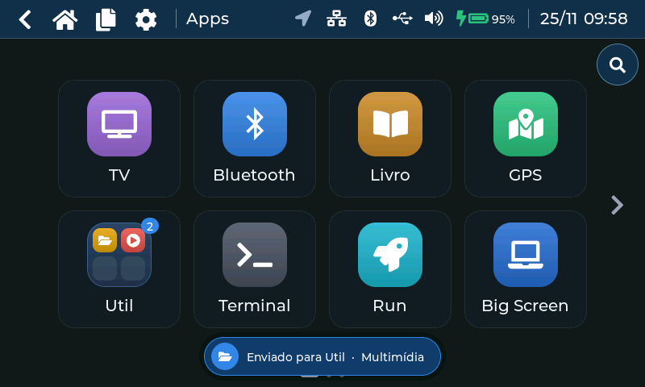

## Busca

Lupa no canto superior direito da tela Apps (todos os temas). Procura sem acento e sem
diferença de maiúsculas ("multimidia" acha Multimídia), também dentro dos grupos; o
resultado mostra em que grupo o app está e um toque o abre.

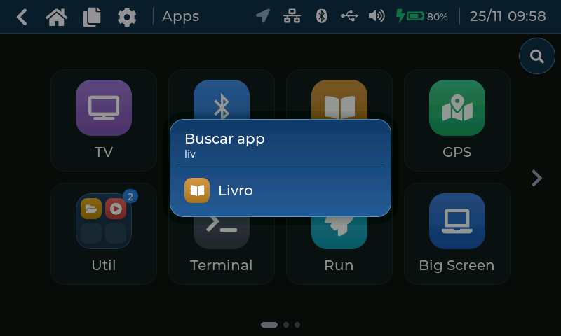

## Ordenação

- **Personalizada**: a ordem que o usuário montou (padrão).
- **Por nome**: "Ordenar por nome" no menu do grupo (sem acento: Álbum fica junto de Arte).
- **Mais usados / instalados recentemente**: não há registro local de uso nem data de
  instalação confiável (o relógio pode não estar certo no boot); não foi feito para não
  inventar dados.

## Acessibilidade

Linhas de menu com 54 px de altura; botões de 52 px; textos 14/20/28 px; nomes compridos
com reticências na grade e inteiros nos menus; contraste dos temas existentes; tudo
alcançável sem gesto de arrastar.
