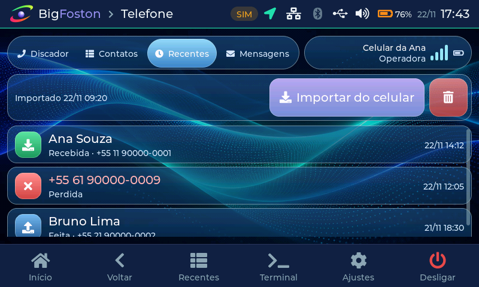
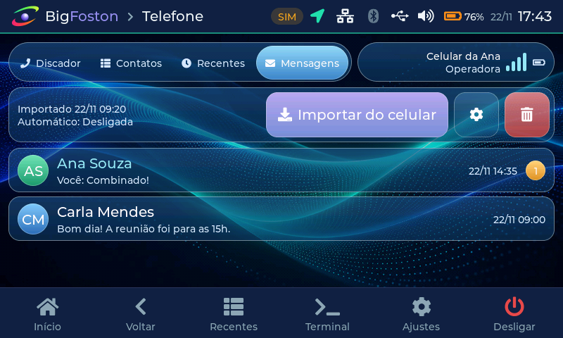
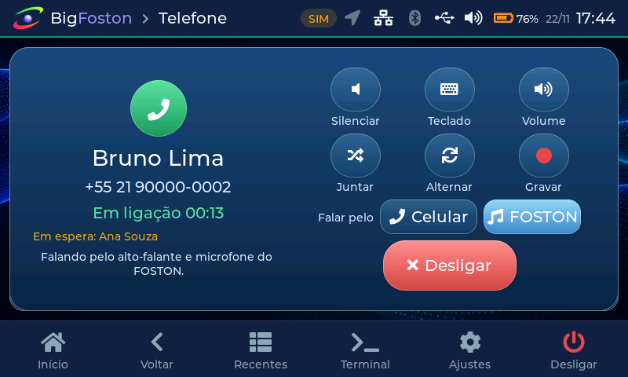
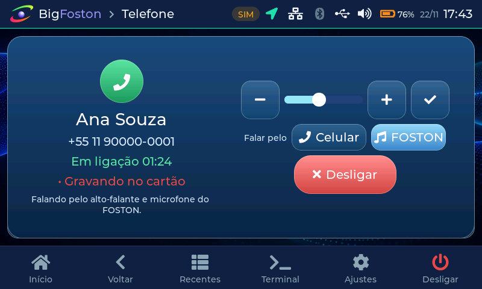
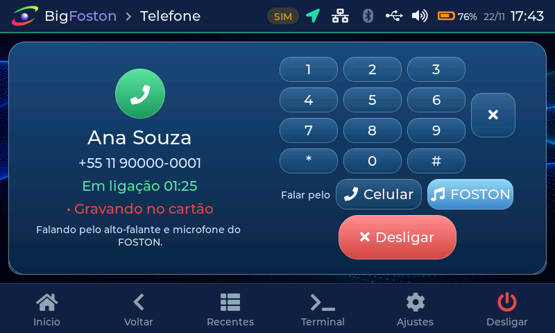
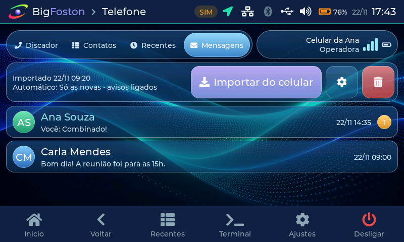
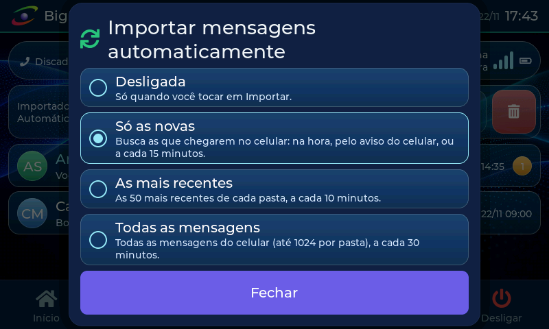
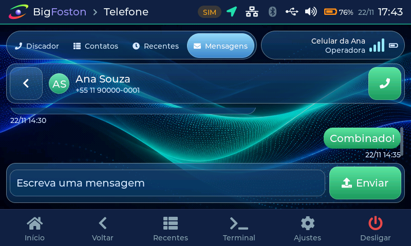
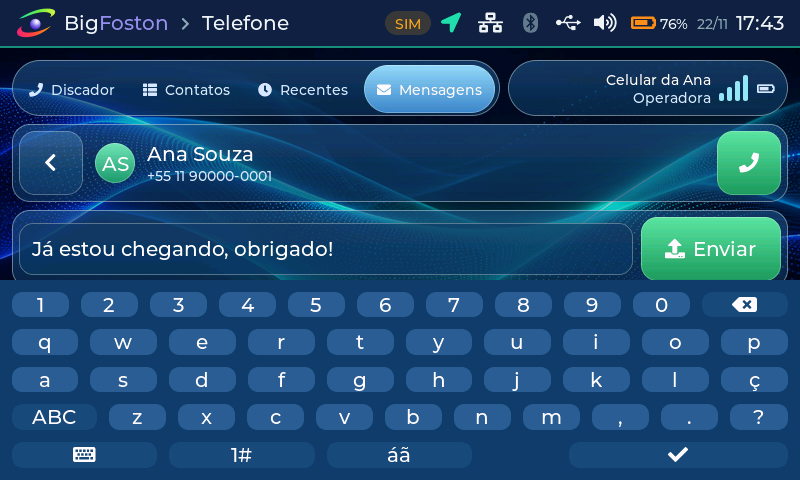

# Telefone: ligações, contatos e mensagens pelo celular

O FOSTON controla as ligações do celular conectado por Bluetooth. O app **Telefone** fica no
dock do Foston Glass e na grade Apps (página 2). Pelo FOSTON dá para discar, atender, recusar,
desligar e mandar teclas (DTMF), e ver quem está ligando com o nome da agenda. A agenda, o
histórico e as mensagens podem ser importados do celular.

| Discador | Contatos | Recentes |
|---|---|---|
|  |  |  |

| Mensagens | Em ligação | Chamada recebida (em qualquer tela) |
|---|---|---|
|  |  |  |



| Volume da ligação | Teclado (DTMF) |
|---|---|
|  |  |

O visual segue o Foston Glass (cartões de vidro sobre o papel de parede, ícones em degradê,
iniciais coloridas nos contatos e conversas), nos dois modos da tela inicial.

### Mensagens: conversas, resposta e importação automática

| Conversas | Importação automática | Conversa | Responder |
|---|---|---|---|
|  |  |  |  |

- Recebidas e enviadas ficam agrupadas por conversa (os 8 últimos dígitos do número), a mais
  recente em cima, com a bolinha das não lidas. Tocar abre a conversa em balões (até as 60
  últimas) com Ligar e o campo de resposta.
- **Responder**: o texto vai pelo MAP (`PushMessage`, bMessage SMS em `telecom/msg/outbox`,
  UTF-8); o celular envia o SMS. "Enviando…", "Enviada pelo celular" ou o erro aparecem no topo
  da conversa; a mensagem enviada fica na conversa até a próxima importação trazê-la do celular.
  Teclado com ç e acentos (tecla "áã").
- **Importação automática** (engrenagem): Desligada; Só as novas (o celular avisa pelo MNS, ou a
  cada 15 min, 20 por pasta); As mais recentes (50 por pasta, a cada 10 min); Todas (até 1024
  por pasta, a cada 30 min). As novas são mescladas com as já importadas (pelo identificador do
  MAP), sem apagar as antigas. A escolha fica em `/data/bigfoston/telefone-msg-auto`.

#### Por que o celular não mostrava "acesso às mensagens"

O Android só oferece a permissão de mensagens (e o interruptor em Bluetooth > aparelho) para quem
usa o MAP de verdade. O `bfphone` agora registra no BlueZ o perfil **MNS** (Message Notification
Server, UUID 0x1133, RFCOMM 17) e, com a importação automática ligada, mantém uma sessão MAP
aberta pedindo avisos (`SetNotificationRegistration`): o celular passa a ver o BigFoston como
cliente de mensagens, mostra o pedido "Permitir acesso às mensagens?" e conecta no MNS para
avisar das que chegam (`NewMessage`). A primeira importação espera até 45 s pela resposta no
celular (antes, 15 s: o pedido expirava sem que desse tempo de aceitar).

### Botões da ligação

| Botão | O que faz |
|---|---|
| Silenciar | desliga o microfone do FOSTON (ADC do microfone, `0x80061108`); com a voz no FOSTON |
| Teclado | teclas (DTMF, `AT+VTS`) |
| Volume | −/+ de 1 a 10 (ganho da voz no FOSTON: 100 % + 30 % por nível; 5 = 250 %); com a voz no celular manda `AT+VGS` |
| Nova chamada | abre o discador por cima da ligação ("Voltar à ligação" no canto); a nova chamada põe a atual em espera |
| Em espera | `AT+CHLD=2`: põe em espera / retoma |
| Gravar | grava as duas vozes (8 kHz, WAV) em `BigFoston/telefone/gravacoes/ligacao-AAAAMMDD-HHMMSS.wav`; aviso "Gravando no cartão" na tela; com a voz no FOSTON. As gravações aparecem no **Multimídia** como "Ligação DD/MM HH:MM" (o player toca WAV) |
| Juntar / Alternar | com duas chamadas: conferência (`AT+CHLD=3`) e troca da ativa com a em espera (`AT+CHLD=2`); a outra chamada aparece em laranja |
| Falar pelo Celular / FOSTON | onde fica a voz |
| Desligar / Atender | — |


(Capturas do simulador, com nomes e números inventados.)

## Estado (22/11/2026, POCO X4 Pro 5G)

| Função | Estado |
|---|---|
| Canal de chamadas (HFP 1.6, o FOSTON é o Hands-Free) | **funcionando**: conecta sozinho com o celular |
| Sinal, bateria, operadora do celular | **funcionando** (`+CIND`, `+COPS`) |
| Chamadas: estado, número, nome | **funcionando** com uma ligação real (`AT+CLCC`; nome pela agenda importada) |
| Discar, rediscar, atender, recusar/desligar, DTMF | implementado (`ATD`, `AT+BLDN`, `ATA`, `AT+CHUP`, `AT+VTS`) |
| Voz mantida no celular | **funcionando**: ao reconectar no meio da ligação o celular abriu o canal de voz duas vezes e o FOSTON desfez as duas |
| Escolha "Falar pelo: Celular / FOSTON" | no painel da ligação; FOSTON explica que falta o caminho do DSP (`voice_foston=0`) |
| Aviso de chamada recebida em qualquer tela | implementado (simulador); falta o teste real |
| Agenda (PBAP) | **funcionando**: 5363 contatos em ~1 min |
| Histórico de chamadas (PBAP) | **funcionando** |
| Mensagens SMS (MAP) | implementado: listar, conversas, responder (`PushMessage`), importação automática e avisos (MNS registrado no BlueZ: "perfil MNS registrado"); o POCO responde "serviço indisponível" (0xD3) até que o acesso às mensagens seja permitido no celular — falta o teste com a permissão aceita |
| **Voz da ligação no FOSTON** (alto-falante e microfone) | **funcionando** com os arquivos do aparelho no cartão ([02-audio-da-chamada.md](02-audio-da-chamada.md)) |

## Arquitetura

```
celular (AG) ──HFP/RFCOMM── BlueALSA (-p hfp-hf) ──RFCOMM1.Open (D-Bus)──┐
            ──PBAP/MAP (OBEX/RFCOMM)── bfpbap (filho do bfphone) ─────────┤
            ──SCO (voz)── HCI ── bfphone desfaz o canal de voz ───────────┤
                                                                     bfphone
                                       /run/bigfoston-phone (estado) ─────┤
                                       /run/bigfoston-phone.cmd (FIFO) ───┘
                                                                         │
                                         shell: core/phonestat.c, screens/scr_phone.c
```

| Peça | Papel |
|---|---|
| `src/bt/bfphone.c` | serviço (S43bfphone): canal AT, estado, comandos, sincronização, voz |
| `src/bt/bfpbap.c` | cliente OBEX próprio (sem o obexd, que exige C++ no Buildroot): PBAP (agenda, histórico) e MAP (lista de mensagens com mescla, envio `push`, sessão de avisos `notify`); acha o canal pelo SDP |
| `rootfs-overlay/etc/init.d/S41bluealsa` | BlueALSA com `-p hfp-hf` (antes só A2DP: o celular não abria o HFP) |
| `src/ui/core/phonestat.c` | leitura do estado, comandos e o aviso global de chamada recebida |
| `src/ui/screens/scr_phone.c` | o app: Discador, Contatos (busca), Recentes, Mensagens e o painel da ligação |

O BlueALSA repassa as respostas finais do celular com `:` na frente (`:OK`, `:ERROR`); o
`bfphone` as aceita assim (sem isso a lista de chamadas nunca era confirmada).

O `bfphone` consulta `AT+CLCC` a cada 5 s parado e a cada 1 s com chamada, e logo depois de
`RING`, `+CIEV` ou `+CLIP`. Indicadores e operadora são relidos a cada 30 s. Se o celular
conectar só o A2DP, o `bfphone` pede o HFP uma vez (`Device1.ConnectProfile`).

Comandos (`echo ... > /run/bigfoston-phone.cmd`): `dial NÚMERO`, `redial`, `answer`, `hangup`,
`dtmf C`, `voice phone|foston`, `sync`, `syncmsg [MAX]` (só mensagens), `msgauto 0-3`,
`sms NÚMERO` (texto em `/run/bfphone-sms.txt`, apagado depois do envio), `erase`. `voice foston` só vale quando o firmware tiver
a voz do DSP (`voice_foston=1`); `voice foston-teste` deixa o canal de voz aberto para
diagnóstico (a ligação fica muda).

## Privacidade

- A importação só acontece quando o usuário toca em **Importar do celular** e confirma. A
  primeira vez, o Android pede a autorização no próprio celular.
- Os dados ficam no cartão SD, em `BigFoston/telefone/<aparelho>/` (`contatos.tsv`,
  `historico.tsv`, `mensagens.tsv`, `enviadas.tsv`, `sincronizado`), criados só para o root
  (o cartão FAT, lido num PC, não guarda permissões). O botão da lixeira apaga tudo (nada muda no celular).
- Números, nomes e mensagens não vão para o syslog. O estado das chamadas fica só na RAM
  (`/run`).

## Como testar

1. Conecte o celular em Bluetooth (o celular precisa permitir "ligações" para o BigFoston).
2. Abra o Telefone: no cartão à direita aparecem o celular, o sinal e a bateria.
3. Ligue para o celular de outro aparelho: o aviso aparece em qualquer tela. Atender no FOSTON
   atende no celular; a conversa é pelo celular.
4. Discador: digite um número e toque em Ligar. O celular disca e a voz fica nele.
5. Contatos: Importar do celular, confirme no celular se ele pedir, e busque pelo nome ou
   número.
6. Mensagens: toque em Importar e aceite no celular o pedido de acesso às mensagens (pode vir
   como notificação). Se ele não aparecer, ligue a importação automática (engrenagem) e confira
   em Bluetooth > BigFoston > engrenagem o interruptor de mensagens; em último caso, esqueça o
   BigFoston no celular e pareie de novo.

Diagnóstico (no terminal do FOSTON): `cat /run/bigfoston-phone` (tem números: não publicar),
`logread | grep bfphone`.

## Voz no FOSTON e o som do sistema

O driver ALSA divide clocks (ids 37/43), amplificador e analógico com a voz da ligação. Ao fechar o
som (por exemplo a música pausada pela ligação) ele os desliga; durante a ligação o `bfvoice`
confere e restaura tudo a cada 200 ms e registra em `/var/log/bfvoice.log` (a cada 10 s: blocos,
nível da voz do celular e do microfone, restaurações; sem áudio).
