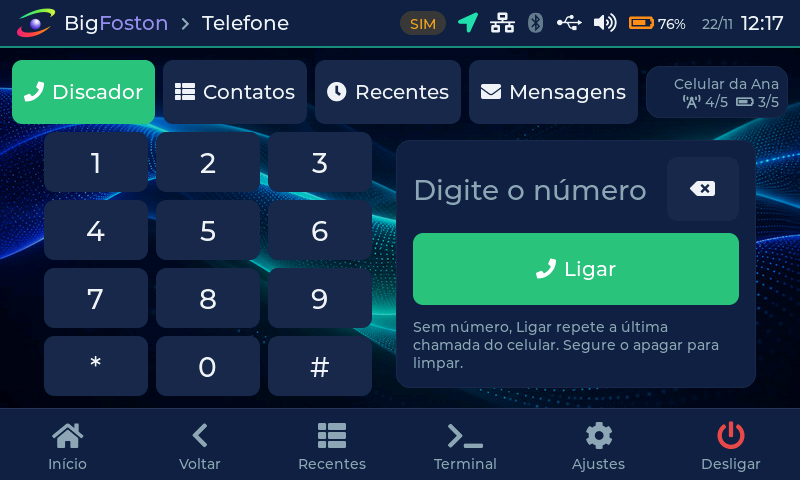
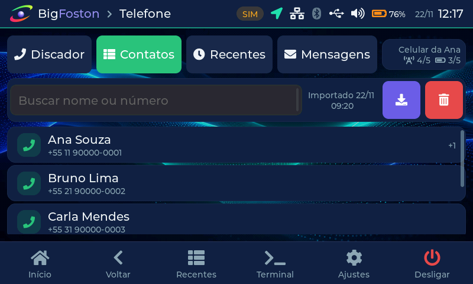
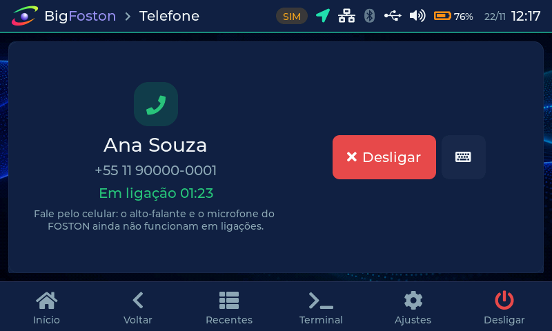
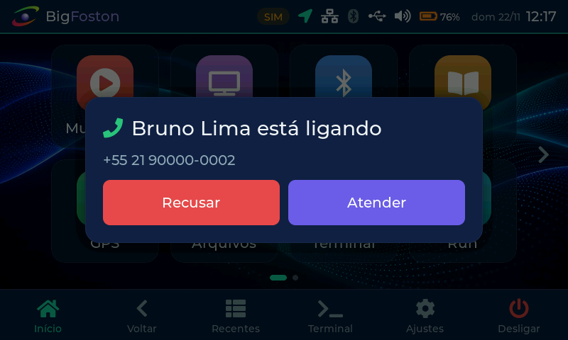

# Telefone: ligações, contatos e mensagens pelo celular

O FOSTON controla as ligações do celular conectado por Bluetooth. O app **Telefone** fica no
dock do Foston Glass e na grade Apps (página 2). Pelo FOSTON dá para discar, atender, recusar,
desligar e mandar teclas (DTMF), e ver quem está ligando com o nome da agenda. A agenda, o
histórico e as mensagens podem ser importados do celular.

| Discador | Contatos | Recentes |
|---|---|---|
|  |  |  |

| Mensagens | Em ligação | Chamada recebida (em qualquer tela) |
|---|---|---|
|  |  |  |

(Capturas do simulador, com nomes e números inventados.)

## Estado (22/11/2026, POCO X4 Pro 5G)

| Função | Estado |
|---|---|
| Canal de chamadas (HFP 1.6, o FOSTON é o Hands-Free) | **funcionando**: conecta sozinho com o celular |
| Sinal, bateria, operadora do celular | **funcionando** (`+CIND`, `+COPS`) |
| Chamadas: estado, número, nome | **funcionando** (`AT+CLCC`; nome pela agenda importada) |
| Discar, rediscar, atender, recusar/desligar, DTMF | implementado (`ATD`, `AT+BLDN`, `ATA`, `AT+CHUP`, `AT+VTS`); falta o teste com uma ligação real |
| Aviso de chamada recebida em qualquer tela | implementado (simulador); falta o teste real |
| Agenda (PBAP) | **funcionando**: 5363 contatos em ~1 min |
| Histórico de chamadas (PBAP) | **funcionando** |
| Mensagens SMS (MAP) | implementado; o POCO responde "serviço indisponível" (0xD3) até que o acesso às mensagens seja permitido no celular |
| **Voz da ligação no FOSTON** | **não**: a voz fica no celular (ver [02-audio-da-chamada.md](02-audio-da-chamada.md)) |

## Arquitetura

```
celular (AG) ──HFP/RFCOMM── BlueALSA (-p hfp-hf) ──RFCOMM1.Open (D-Bus)──┐
            ──PBAP/MAP (OBEX/RFCOMM)── bfpbap (filho do bfphone) ─────────┤
            ──SCO (voz)── HCI ── bfphone desfaz o canal de voz ───────────┤
                                                                     bfphone
                                       /run/bigfoston-phone (estado) ─────┤
                                       /run/bigfoston-phone.cmd (FIFO) ───┘
                                                                         │
                                         shell: core/phonestat.c, screens/scr_phone.c
```

| Peça | Papel |
|---|---|
| `src/bt/bfphone.c` | serviço (S43bfphone): canal AT, estado, comandos, sincronização, voz |
| `src/bt/bfpbap.c` | cliente OBEX próprio (sem o obexd, que exige C++ no Buildroot): PBAP (agenda, histórico) e MAP (lista de mensagens); acha o canal pelo SDP |
| `rootfs-overlay/etc/init.d/S41bluealsa` | BlueALSA com `-p hfp-hf` (antes só A2DP: o celular não abria o HFP) |
| `src/ui/core/phonestat.c` | leitura do estado, comandos e o aviso global de chamada recebida |
| `src/ui/screens/scr_phone.c` | o app: Discador, Contatos (busca), Recentes, Mensagens e o painel da ligação |

O `bfphone` consulta `AT+CLCC` a cada 5 s parado e a cada 1 s com chamada, e logo depois de
`RING`, `+CIEV` ou `+CLIP`. Indicadores e operadora são relidos a cada 30 s. Se o celular
conectar só o A2DP, o `bfphone` pede o HFP uma vez (`Device1.ConnectProfile`).

Comandos (`echo ... > /run/bigfoston-phone.cmd`): `dial NÚMERO`, `redial`, `answer`, `hangup`,
`dtmf C`, `voice phone|foston`, `sync`, `erase`.

## Privacidade

- A importação só acontece quando o usuário toca em **Importar do celular** e confirma. A
  primeira vez, o Android pede a autorização no próprio celular.
- Os dados ficam no cartão SD, em `BigFoston/telefone/<aparelho>/` (`contatos.tsv`,
  `historico.tsv`, `mensagens.tsv`, `enviadas.tsv`, `sincronizado`), criados só para o root
  (o cartão FAT, lido num PC, não guarda permissões). O botão da lixeira apaga tudo (nada muda no celular).
- Números, nomes e mensagens não vão para o syslog. O estado das chamadas fica só na RAM
  (`/run`).

## Como testar

1. Conecte o celular em Bluetooth (o celular precisa permitir "ligações" para o BigFoston).
2. Abra o Telefone: no cartão à direita aparecem o celular, o sinal e a bateria.
3. Ligue para o celular de outro aparelho: o aviso aparece em qualquer tela. Atender no FOSTON
   atende no celular; a conversa é pelo celular.
4. Discador: digite um número e toque em Ligar. O celular disca e a voz fica nele.
5. Contatos: Importar do celular, confirme no celular se ele pedir, e busque pelo nome ou
   número.
6. Mensagens: no celular, em Bluetooth > BigFoston, permita o acesso às mensagens, e importe
   de novo.

Diagnóstico (no terminal do FOSTON): `cat /run/bigfoston-phone` (tem números: não publicar),
`logread | grep bfphone`.
