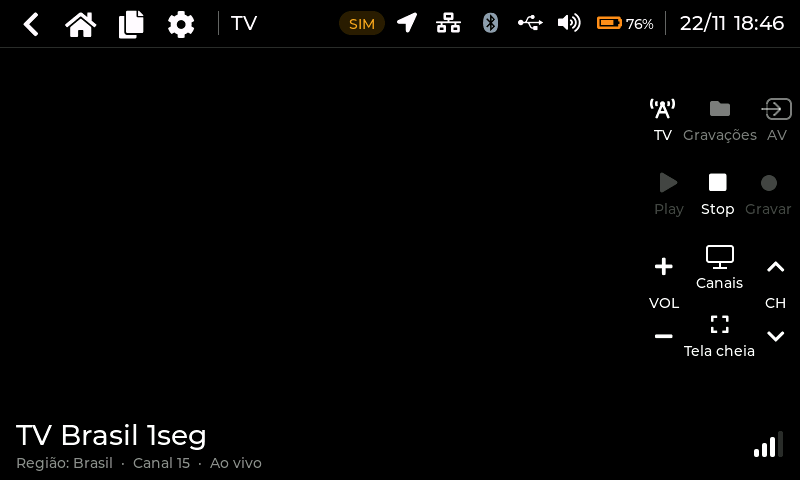
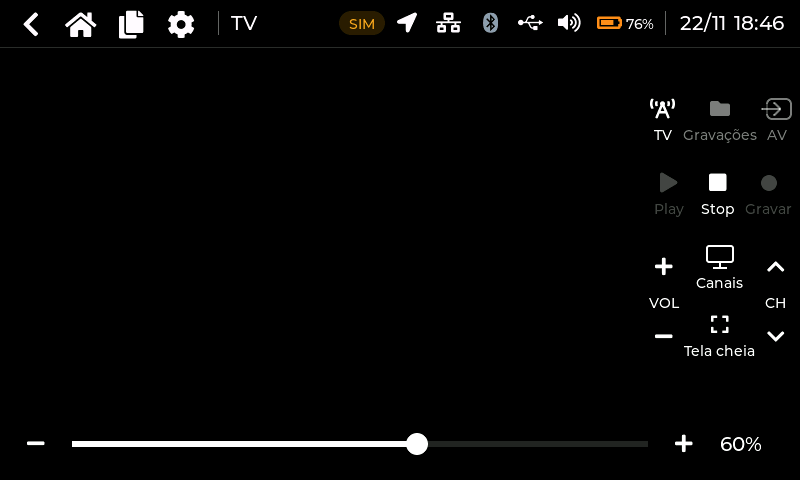
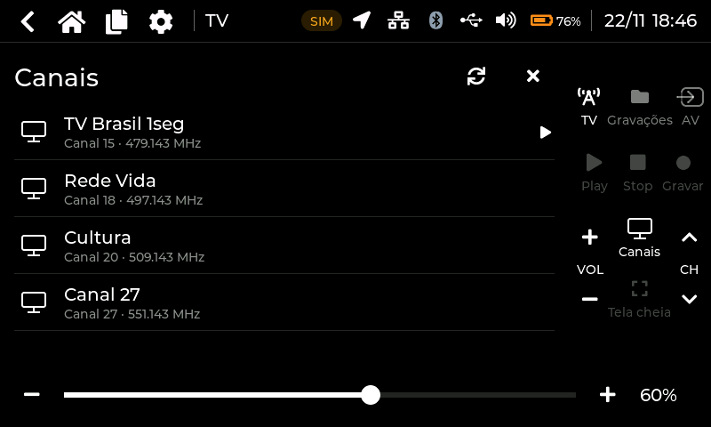
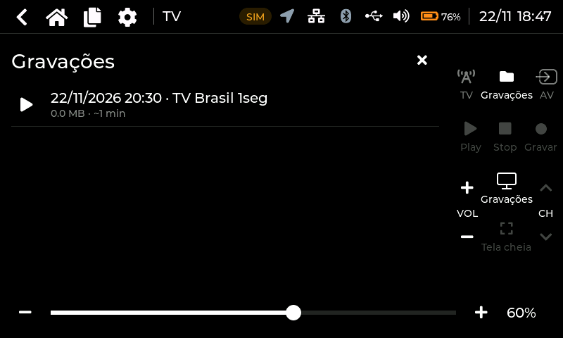
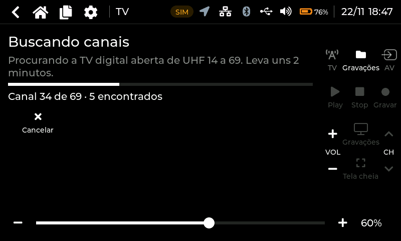
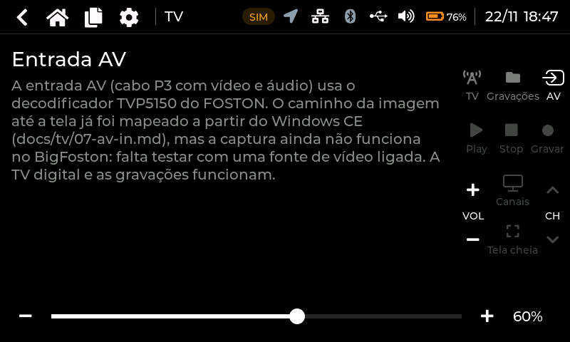
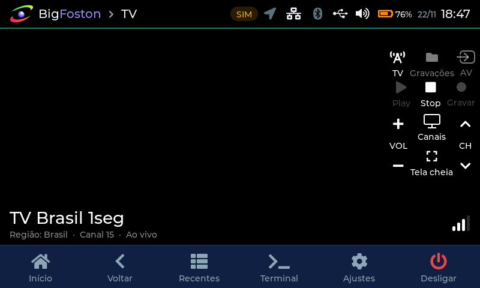

# TV do FOSTON: visão geral e estado

Recuperar a **TV digital (ISDB-T 1seg)** e a **entrada AV-IN** reais do FS-707DC no BigFoston OS.

## Estado (22/11/2026)

| Parte | Estado | Evidência |
|---|---|---|
| Sintonizador Siano (SPI) ligado pelo Linux | **FUNCIONANDO** | `bftv boot`: firmware carregado em 2,1 s; versão: chip 0x2130, ROM 7.1.1, "ISDBT 02.02.17 PELE" |
| Sintonia ISDB-T 1seg | **FUNCIONANDO** | canal 15 UHF (479,143 MHz): demodulador travado, TS chegando (mensagens 607 com múltiplos de 188 bytes) |
| Fluxo de transporte (TS) | **FUNCIONANDO** | 15 s = 682 KB (~364 kbit/s); `ffprobe`: TV Brasil 1seg, H.264 Constrained Baseline 320×180 15 qps, HE-AAC LATM 48 kHz estéreo (2 faixas); um quadro decodificado no PC |
| Decodificação e exibição no FOSTON | **FUNCIONANDO** | `bftvd`: 13,7 qps no app TV, com o shell rodando |
| App TV (shell) | **FUNCIONANDO** | vídeo 640×360 + controles; testado no aparelho: TV Brasil, Globo, Band, canais 39/40 |
| Busca de canais | **FUNCIONANDO** | UHF 14-69 em ~2 min: 11 canais com nome (lido do SDT, ISO 8859-15) |
| Gravação (PVR) | **FUNCIONANDO** | o TS vai para o cartão sem parar a imagem (~340 kbit/s, ~160 MB/h); reprodução pelo app |
| EPG, pausa ao vivo (timeshift) | a fazer | o EIT vem no mesmo TS; o timeshift pode ler da gravação em andamento |
| AV-IN (TVP5150) | mapeado (análise estática), a testar | [07-av-in.md](07-av-in.md) |
| TV analógica por antena | não existe | o Siano é só digital; a analógica terrestre acabou no Brasil |

Os arquivos proprietários (firmware `.inp` da Siano) ficam só no cartão do usuário:
`tools/bigfoston/voice-extract.py OUT --tvfw ISDBT.inp`, copiado para `BigFoston/tv/`.

## O app TV

| Ao vivo | Volume (rodapé) | Canais | Gravações |
|---|---|---|---|
|  |  |  |  |

| Busca | Entrada AV | Modo clássico |
|---|---|---|
|  |  |  |

(Capturas do simulador: o vídeo só aparece no aparelho.)

- Abre pelo dock do Foston Glass (TV) ou pela grade Apps. Na primeira vez, sem canais, abre a
  lista com a busca.
- Tudo sobre preto (o papel de parede some e a barra de cima fica preta enquanto a TV está
  aberta; ao sair, voltam como eram). Sem cartões, bordas ou cores: só ícones e textos brancos.
- O `bftvd` desenha o vídeo direto no framebuffer: 640×360 no Foston Glass (512×288 centrado no
  modo clássico, que tem a barra de baixo), num retângulo que a tela deixa preto e nunca
  redesenha enquanto o vídeo toca.
- **Coluna da direita, como um controle remoto**: fonte (TV, Gravações, AV); Play, Stop, Gravar;
  VOL +/−, Canais, Tela cheia, CH ▲/▼. A fonte atual fica acesa e as outras apagadas; o que
  não se aplica fica apagado (por exemplo Tela cheia sem imagem).
- **Rodapé**: nome do canal; embaixo, menor e mais escuro, "Região: Brasil · Canal N ·
  situação"; à direita, a força do sinal (SNR).
- **Volume**: VOL +/− e o ícone de som da barra de cima mostram a barra de volume na horizontal
  no rodapé, por 4 s, sem cobrir o vídeo (o painel de volume normal ficava por baixo da imagem).
- **Tela cheia**: o vídeo vai para 800×450 (faixas pretas em cima e embaixo); uma camada preta
  cobre a tela e o LVGL para de desenhar (`lv_display_enable_invalidation`), então nada pisca
  por cima. Tocar em qualquer lugar volta. Sai sozinha se o vídeo parar ou se algo precisar
  aparecer (chamada recebida, aviso). Medido: 13,8 qps em tela cheia.
- **Stop** para o vídeo (o sintonizador continua ligado); **Play** volta.
- Trocar de canal reinicia o `bftvd` com o firmware já carregado: a imagem volta em ~5-8 s.
- **Gravar** manda `SIGUSR1` ao `bftvd`: começa/para de gravar o TS em
  `BigFoston/tv/gravacoes/tv-AAAAMMDD-HHMMSS-cNN.ts` sem parar a imagem (ponto vermelho
  enquanto grava). As gravações tocam pelo próprio app (`bftvd -p`), com posição e duração.
- Sair do app desliga o sintonizador (`bftvd -O`).
- Último canal: `/data/bigfoston/tv-canal`. Canais: `BigFoston/tv/canais.tsv` (canal, MHz, nome,
  SNR, RSSI).
- TV analógica: não há hardware (o Siano é só digital). IPTV: fora do alcance do ARM1176 sem
  aceleração de vídeo para as resoluções usuais; não incluído.

### Correções no caminho

- Em alguns canais (Globo) o vídeo vem no TS bem à frente do áudio: com fila de 6 quadros o
  decodificador parava esperando o mostrador, que esperava o relógio do áudio que não chegava
  (tela preta para sempre). Agora a fila tem 32 quadros (2 s) e, se o relógio do áudio parar por
  0,4 s, o vídeo segue no próprio ritmo.
- Sondagem do fluxo menor (120 KB, 1 s): o canal abre ~5 s mais rápido.
- Sintonizador que ficou ligado e travado de antes: se o firmware não carrega, o `bftvd` desliga,
  liga e tenta de novo.
- Avisos do ffmpeg (quadros com erro de sinal) não vão mais para o log do shell (que fica na RAM).

### Compilar

`tools/bigfoston/build-tv.sh` compila o ffmpeg mínimo, a fdk-aac e o `bftvd`/`bftv`
(reprodutível: o mesmo binário que está no aparelho).

```
bftvd [-f FW.inp] [-r X,Y,L,A] [-F X,Y,L,A] [-s STATE] [-w REC.ts] [-W PASTA] MHZ   assistir
bftvd [-r X,Y,L,A] [-F X,Y,L,A] [-s STATE] -p ARQUIVO.ts                            tocar uma gravação
bftvd [-f FW.inp] [-s STATE] -S CANAIS.tsv                           buscar canais
bftvd -O                                                             desligar o sintonizador
```

Sinais: `SIGUSR1` grava/para; `SIGUSR2` vai para o retângulo de tela cheia (`-F`), `SIGWINCH`
volta. `-r` com o dobro do quadro usa o caminho rápido (2×); outros tamanhos convertem cada
linha do quadro uma vez e esticam (vizinho mais próximo).

Estado em `/run/bigfoston-tv`: `state` (ligando, sintonizando, abrindo, tocando, sem_sinal, sem_imagem (travado, mas nada decodificado em 20 s), busca,
busca_fim, fim, parado, erro_*), `freq`, `locked`, `snr`, `rssi`, `ts_kbps`, `fps`, `late`,
`rec_kb`/`rec_file` (gravando), `scan_ch`/`scan_found` (busca), `pos`/`dur` (arquivo).

## Documentos

- [02-hardware-sintonizador.md](02-hardware-sintonizador.md): SPI, pinos, energia e protocolo.
- [07-av-in.md](07-av-in.md): entrada AV (decodificador TVP5150, captura, escalador).

## Player (bftvd) — primeira medição no aparelho (22/11/2026)

| Parte | Escolha | CPU (15 s de TV) |
|---|---|---|
| Vídeo H.264 320×180 | ffmpeg 6.1.5 mínimo (ARMv6, sem ARMv6T2/VFP/NEON), sem filtro de desblocagem | 7,4 s (49 %); com filtro: 10,3 s (69 %) |
| Áudio HE-AAC LOAS/LATM | fdk-aac 2.0.3 (ponto fixo) | 2,1 s (14 %); decodificador do ffmpeg (ponto flutuante): 8,8 s (59 %) |
| Imagem | YUV420 → RGB565 ampliado 2× (640×360) com tabelas, direto no framebuffer | — (`swscale` para 800×450: 59 s, inviável) |
| Som | 48 → 32 kHz mono, /dev/dsp; o vídeo segue o relógio do áudio | — |

`bftvd 479.142857` no FOSTON: 13,9 qps mostrados, 2 quadros atrasados, sem perda de TS, ~70 % de CPU.

O ffmpeg e a fdk-aac são compilados à parte (firmware/build/ffmpeg-tv, toolchain `out-cxx` com C++)
e o player fica no cartão: a memória interna não tem espaço para eles.
