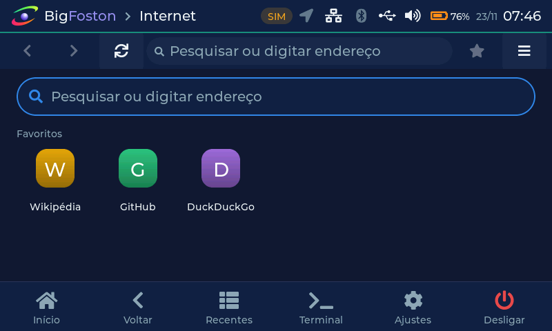
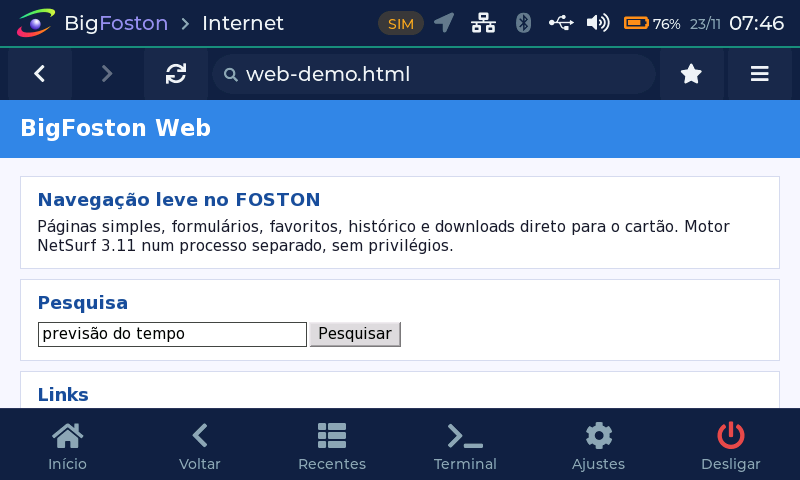
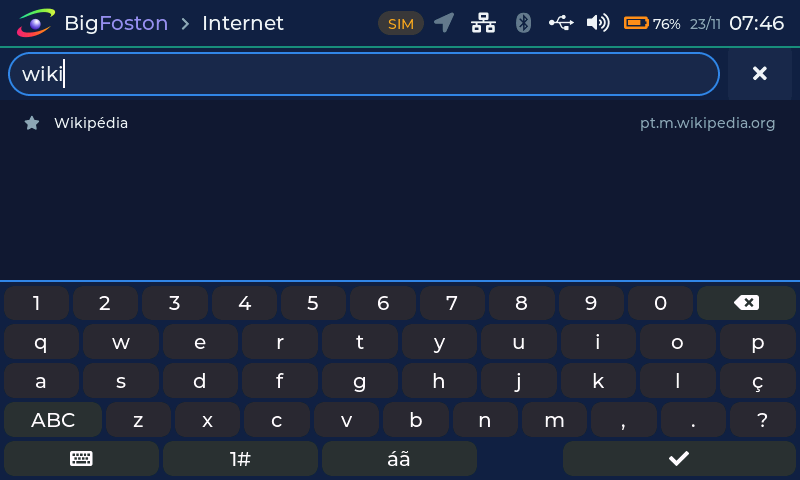
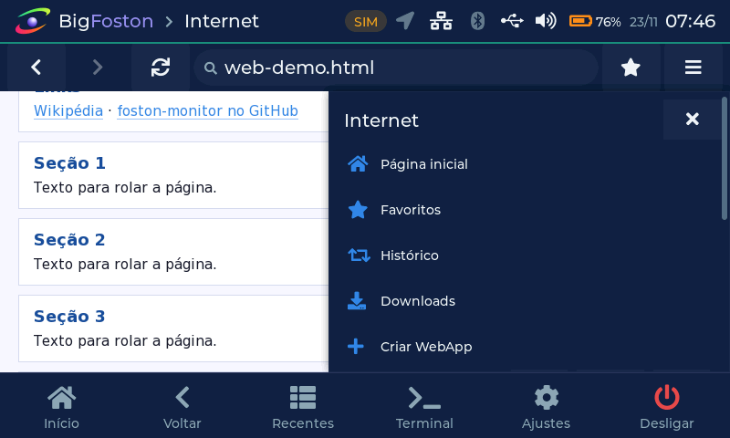

# BigFoston Web — app Internet

Navegador do BigFoston OS para o FOSTON FS-707DC (ARM1176 ~468 MHz, 128 MB, 800×480).

Dois modos, escolhidos sozinhos:

- **Completo** (padrão quando o PC está ligado): o Chrome do PC navega e o FOSTON mostra —
  qualquer site, inclusive com JavaScript pesado e YouTube ([10](10-remote-browser.md)).
- **Leve** (sem o PC): motor NetSurf 3.11 no próprio aparelho — sites simples.
Branch: `feat/bigfoston-web`. Estado em 23/11/2026: **fases 1 a 4 em andamento**,
motor rodando no aparelho, interface testada no simulador.

| Parte | Onde | Estado |
|---|---|---|
| Motor `bfweb` (NetSurf 3.11 + frontend próprio) | `src/web/frontend/` | roda no FOSTON (medido) |
| Baixador `bfdl` (libcurl) | `src/web/bfdl.c` | testado no PC: inteiro, pausa/retomada, 404, TLS, caminho |
| Tela Internet | `src/ui/screens/scr_web.c` | simulador (capturas 47*) |
| Processo do motor | `src/ui/core/webproc.c` | simulador |
| Favoritos, histórico, WebApps | `src/ui/core/webdata.c` | teste unitário `src/ui/tests/test_webdata.c` |
| Downloads no shell | `src/ui/core/webdl.c` | simulador |
| Teclado pt-BR compartilhado | `src/ui/widgets/kbd.c` | Internet e Telefone |
| Bibliotecas (curl, OpenSSL, imagens, fontes) | `firmware/buildroot/configs/bigfoston_web_defconfig` | compiladas |
| Build e pasta do cartão | `tools/bigfoston/build-web.sh` | host e arm |

## Usar

| | |
|---|---|
|  |  |
|  |  |

Ícone **Internet** na grade de Apps (página 2, último: a ordem dos apps existentes não muda).

- Barra: ◀ ▶ ⟳/✕ · endereço (cadeado em HTTPS; toque para digitar, com sugestões dos
  favoritos e do histórico) · ★ favorita · ☰ menu.
- Digite um domínio (`github.com` → `https://github.com`), um IP (`192.168.0.1` →
  `http://`) ou qualquer texto (pesquisa; padrão DuckDuckGo HTML, que funciona sem JavaScript).
- Página: arrastar rola (com inércia), toque clica, **toque longo** num link ou imagem
  abre Abrir / Baixar / Favoritar; campo de texto da página abre o teclado com acentos.
- Menu: página inicial, favoritos, histórico (desligável), downloads, criar WebApp, zoom,
  economizar dados (sem imagens), JavaScript, mecanismo de pesquisa, memória, sobre.
- **WebApps**: menu → criar WebApp no site aberto. O WebApp aparece no fim da grade de
  apps (modo Grade e botão Apps do Foston Glass) com a inicial e uma cor; um toque abre o
  site no Internet (título da barra = nome do WebApp), segurar o dedo oferece remover.
  Também ficam na página inicial do Internet. São atalhos: precisam de internet.
- **Tela cheia** (modo completo): o botão de tela cheia do site (vídeo do YouTube) ocupa os
  800x480, sem as barras; o toque segue para a página e mostra, no topo e ao centro, o
  aviso "Clique novamente para sair" (tocado, sai); o botão do próprio site também sai.
- **Modo performance** (Ajustes > Modo performance): com vídeo tocando, pausa GPS,
  Bluetooth, telefone e tarefas e dá prioridade à interface; tudo configurável, com
  etiqueta flutuante e janela de progresso ([10](10-remote-browser.md)).

## Internet no aparelho

O FOSTON não tem Wi-Fi. A internet vem do PC pela rede USB (192.168.7.1) com
compartilhamento: no NetworkManager, conexão `bigfoston` em modo **compartilhado**
(`nmcli c modify bigfoston ipv4.method shared ipv4.addresses 192.168.7.1/24`). Com `ufw`
ativo no PC, libere o encaminhamento e o DNS da rede USB:

```sh
sudo ufw route allow from 192.168.7.0/24
sudo ufw allow from 192.168.7.0/24 to any port 53
```

O firmware põe a rota padrão por 192.168.7.1 (métrica 200) e DNS (o do PC, 1.1.1.1 e
9.9.9.9) ao subir o `usb0` (`S39usbnet`). O HTTPS exige o relógio certo: GPS com sinal ou
NTP (o padrão já tenta `a.st1.ntp.br` e `pool.ntp.org`).

## Documentos

- [02 — comparação de motores](02-engine-comparison.md)
- [10 — modo completo pelo PC](10-remote-browser.md)
- [07 — arquitetura](07-architecture.md) · [protocolo do motor](../../src/web/frontend/protocol.md)
- [08 — build e instalação](08-buildroot-integration.md)
- [16 — downloads](16-download-manager.md)
- [19 — YouTube](19-youtube.md) · [20 — Netflix, Prime Video e DRM](20-streaming-drm.md)
- [26 — medições](26-benchmarks.md)
- [28 — recuperação](28-recovery.md) · [29 — limitações conhecidas](29-known-limitations.md)

Próxima fase (ainda não feita): alocador mais rápido no motor local.
